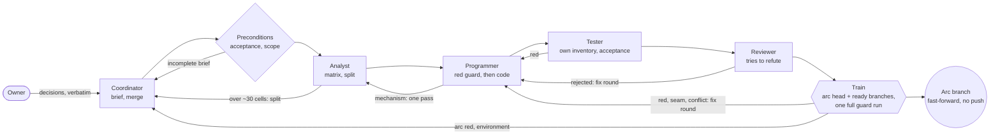

# codis-agents

**Agents are not what makes this work. What is written down around them is.**

A multi-agent delivery process for [Claude Code](https://claude.com/claude-code), packaged as a plugin: a coordinator
session, a chain of role agents that try to refute each other, and the written rules that keep them honest. It grew out
of a real product built with Claude Code on a single 16 GB laptop, several task chains a day, and every rule in it
exists because something broke without it.

## Start here - no plugin needed

Three habits carry most of the value, and they work for one person with one agent:

1. **A brief before work.** A file with the requester's words quoted verbatim and dated, and the acceptance written as a
   scenario in the real environment ("Add -> the item builds with no tab open"), not as a feature name.
2. **A red guard before code.** The agent first commits an executable check that fails on the current code, then the fix.
3. **Mutation after the commit.** Break the fix, see the guard go red, restore it, see it green. A check that does not
   turn red on a broken fix proves nothing.

Everything below is how those habits scale to a chain of roles and a dozen tasks a day.

## Terms

| term | meaning |
|---|---|
| guard | an executable check (`*-run.js`) judged by its exit code |
| brief | `BRIEF.md` of one task: the owner's words verbatim, scope, acceptance scenario |
| arc | a connected group of tasks over one surface, with one specification agreed up front |
| principles | the arc's numbered list of accepted decisions, each with its source and what it replaces |
| coordinator | the main session: writes briefs, starts chains, merges (with `guardSubsetCommand` the train merges a green branch), decides what the principles answer, asks the owner the rest |
| kind | every task is exactly one of `feature`, `defect`, `tail`; a `feature` starts only with its use cases (`useCases` or `useCasesFirst`) |
| selection | the guards of a task's diff (`scripts/guards-select.js`), run by the workflow after every programmer round instead of a full guard run in the task (with `guardSubsetCommand`) |
| train | the integration train (`scripts/train.js`): after the review a branch rides with the arc head and the other ready branches in one full guard run; green fast-forwards the arc branch (no push), red is attributed per branch |

## The role chain



With `guardSubsetCommand` in the config the task has no full guard run of its own: the workflow runs the selection of
its diff after every programmer round, and the full run belongs to the train. Without the key the reviewed branch is
done after the review and the coordinator merges it, as before.

Each role runs as its own agent in its own git worktree. A second rejection for code stops the fix rounds: the next round
starts with the analyst. Work on access, keys or cookies gets a security reviewer as well. A role that hits an open
question writes it into its report for the coordinator and never answers it itself.

## Decisions live in three layers

| layer | what it holds | size on the project it came from |
|---|---|---|
| brief | one task: the owner's words, scope, acceptance scenario | one file per task |
| principles | numbered decisions, each with its source and a "Replaces:" line | 121 decisions |
| short model | one-sentence rules, each linked to the principle it comes from | 31 rules, two pages |

When a role asks a question, the coordinator:

1. answers it itself when an accepted principle answers it, and writes "decided by principle N" into the brief;
2. answers it itself when no principle does but the answer is reversible and local (one task; not a storage format, an
   address, sharing, data deletion or security; not a mechanism whose choice is seen on the screen or rests on time),
   marked "coordinator's decision, not from the model - candidate" and
   listed in its report so the owner can overturn it;
3. sends everything else - everything the owner judges by looking at the screen (look, placement, UI wording),
   anything new or irreversible, two principles in conflict - to the owner as one list, each question with a
   recommendation.

A role never answers an owner question itself: it writes the question into its report for the coordinator.

## What counts as evidence

- **Guards**, red first, and **mutation-tested after the commit**.
- **Two browsers** for anything visual: WebKit drops things Chromium draws.
- **The real environment**: a change that touches two services is accepted in a two-service container stack driven
  through the real client, not in one process on the laptop, where guards stay green while the image fails.
- **A full guard run** before a branch reaches the arc: "N green - N new red - N known red"; only new red is a regression (known reds: config `guardBaseline`). With `guardSubsetCommand` it is the train's one run over the arc head and the ready branches together, and only that tree is merged.

Its limit, honestly: no headless browser reproduced a blurry label in real Safari. A person looking at the screen found
it. Agents do not replace that.

## Rules that grew out of failures

| what happened | rule |
|---|---|
| a feature took three days with about ten owner questions per task; one decision flipped three times | a specification of the whole arc before its first task; one numbered `PRINCIPLES.md` with "Replaces:" lines |
| a decision the owner made never reached the list and was never started | a decision not in the principles is lost; the list is the only list |
| a layout arrived "locally" with a mockup, no decision behind it, and had to be redone | what the owner judges by the screen is never decided by an agent; a mockup of all states before code |
| a programmer invented a height probe with a timer that no matrix named; its flicker was one question among 36, the second analyst wrote more cells of the same probe: 7 rounds, 30M, and the owner saw the flicker after the acceptance | a mechanism is challenged before cells: a section "Mechanism" of the analyst (choices seen on the screen or resting on time go to the owner), status `mechanism` of the programmer, "mechanism or cells?" first for the analyst of a second red, a line of the reviewer |
| a UX spec last touched at a redesign said nothing about the features built after it | living specs change in the same commit as the behaviour they describe |
| one task was re-scoped three times mid-flight and cost twice the median | split before the first programmer: over ~30 cells or more than two subsystems |
| the precondition check stopped tasks with an incomplete acceptance three times in one day | acceptance is a scenario in the real environment |
| agents were killed while their run waited for a heavy slot | reports are written as you go and end with "Next step"; a fresh agent continues |
| a role recorded "owner's answers" the owner never gave | only the coordinator writes decisions into a brief |
| idle waits over five minutes cost 21 % of all tokens | wait in slices of at most 270 s; the rule sits in every role prompt (21 % -> 7.4 %) |
| a cheap waiter gave up on a full run waiting in the heavy slot queue ("the tail has not changed"): 24 of 37 repeats in one window, each repeat on an expensive model | the waiter keeps waiting while the run is alive, whatever its tail; only the step's deadline or a refused queue ends it, as `environment` |
| a role waited for its own selection of guards in a heavy slot, inside its large context | the workflow runs the selection of the task's guards as its own wait step, so the programmer runs none; heavy commands only in the background |
| a resumed run of parallel tasks replayed one task's cached results into another, and both chains stopped | never `resumeFromRunId` for a multi-task run; relaunch each unfinished task alone with `start` |
| two parallel branches, each green alone, gave six red guards after the second merge | after merging the second of parallel branches over the same files: the guards of both tasks, then the full guard run; with `guardSubsetCommand` replaced by the integration train (p-train): one full run over the arc head and the ready branches together, a seam is attributed to the later branch |
| one full guard run per task still held a heavy slot for most of a task's calendar, and the seam stayed unchecked until the merge | no full guard run in the task: the selection of its diff after every programmer round; the full run moves to the train (replaces "one full guard run per task", p-train 2026-10-27) |
| several container stacks at once pushed a 16 GB machine into swap | at most two chains with acceptance in Docker at once |
| a merged worktree removed after a clean `git status` held the only copy of a measurement corpus in ignored files; an old copy of the repository removed the same way broke 1809 symlinks elsewhere | before removing a worktree or a data directory, the owner says "yes" to the output of `scripts/wt-remove-check.js` (ignored data with sizes, the path in code, symbolic links that lead into it) |
| images of old test stacks (481 of them, ~130 GB) filled the disk and stopped the chains | a tester removes its own stack with `docker compose -p <stack> down -v --rmi all`; the owner's stack is never touched, other images and the build cache are not cleaned by roles |

## The bottleneck is the owner's attention

A day of fourteen tasks is about forty decisions a person has to make. Faster agents do not help until fewer questions
reach that person: rules that answer themselves, questions batched with a recommendation each, a mockup instead of a
description for anything visual, and a two-page model a human can hold in their head next to the long list the agents
read.

So product chains go in waves: at most three, prepared and answered before the start, launched together; a question
born inside a chain stops only its task until one digest per wave (rule "Waves" in `rules/multi-agent.md`).

Before a wave starts, the analysis is checked before the start: the coordinator runs the analysis checker
(`agents/analysis-checker.md`) on the analysis of every task of the wave that has one, product or plugin task alike. It
reads only, tries to refute the analysis - premises against the code with file:line, sources and consumers without a
cell, guards that would be green without the fix, an acceptance that cannot run on the owner's real data, the basis of
the coordinator's decisions - and writes one report, `analysis-check.md`, next to the analysis (or returns its text when
the environment refuses the write; the coordinator saves it with `Saved-by: coordinator`). Every significant gap is
closed in the brief or the analysis, or goes to the owner with the other questions of the preparation; the coordinator
writes that into the report's section Closure. A task with `noAnalysis` gets no check. In wave 2 three such checks cost
0.46M tokens and about 20 minutes and found 14 significant gaps; one return of a task cost about 0.7M and 35-60 minutes.

## What is inside

| path | what |
|---|---|
| `workflows/role-chain.js` | the chain: preconditions -> (analyst) -> programmer -> tester -> reviewer (+ security reviewer) -> (with `guardSubsetCommand`) the integration train; fix rounds; an analyst after the second rejection, the second red tester round or the second red train |
| `agents/*.md` | role agents: `analyst`, `programmer`, `tester`, `reviewer`, `security-reviewer` (all may edit files - the tester its guards, the reviewers their reports; what they may change in the worktree is enforced by the git post-check, not by tool lists); and `analysis-checker`, run by the coordinator outside the chain before a wave starts - it may write only its report `analysis-check.md`, and the coordinator checks that (a snapshot of the worktree and the task folders before and after, `role-diff-check.js --role reviewer`), since no post-check of the chain follows it |
| `skills/role-chain` | reads the project config and starts the workflow |
| `skills/brief` | how to write a task brief |
| `skills/coordinator` | the coordinator's loop |
| `rules/multi-agent.md` | the process rules; lines marked `<!-- role:<id> -->` go into every role prompt |
| `hooks/hooks.json` | PreToolUse on Bash: refuses `git add -A` / `git add .`, pushes to protected branches or of protected tags, and `git remote set-head` / writes of `git symbolic-ref refs/remotes/<remote>/HEAD` / `git update-ref` on it and `git update-ref --stdin`, in any letter case, Unicode case folding included (they move the default branch the hooks protect); an abbreviated long option (`--del`, `--mi`) counts as the option; with `--git-dir` / `--work-tree` / `GIT_DIR` / `GIT_WORK_TREE` / `GIT_COMMON_DIR` the config is looked up from those paths too and a push is refused (use `-C`); git's global options before the subcommand are read by a table measured against git, and one outside it is refused; a commit or a reset of the arc branch under a live train (`<sharedDir>/train/lock/owner.json` names it as `base`): wait for the train (`train.js status`) or ride as a passenger |
| `scripts/slots.zsh`, `heavy.sh`, `medium.sh` | memory slots for heavy and medium jobs, with a FIFO queue |
| `scripts/stand.sh`, `stand.js` | the ticket of the project's shared stand (queue, holder, reset at issue and release) and its commands from the config |
| `scripts/slot-journal.js` | summary of the slot journal: queue wait and hold per class and per worktree |
| `scripts/guards-all.sh` | a full guard run of one worktree in a heavy slot, with a shared worker budget; an absolute worktree path brings its own project config (`config.js path --from <dir>`: the nearest `.claude/codis-agents.json` from it upwards, over `$CLAUDE_PROJECT_DIR` and the cwd; an explicit `$CODIS_AGENTS_CONFIG` still wins), a relative name is resolved by the config of the cwd as before - or on the remote runner (`scripts/guards-remote.js`, machine key `remote` with project key `remoteRun`; `--local` keeps it here); `--select <base>` runs only the selection of the task's diff (`guards-select.js --only-args` into `guardSubsetCommand`, its own log `guards-<name>.select.txt`, the quarantine read only, nothing selected - exit 0 and nothing runs, an unknown base - 65; remotely only with `remoteRun.subsetCommand`); `--guards <names file>` runs the same selection mode for the guards of a JSON array of names (the attribution of a red train); new reds rerun alone (`guardRerun`); a run on the same HEAD with a clean tracked tree that ended with exit 0 is not repeated ("reused, HEAD <sha>" and the saved summary; `--force` runs anyway); the main working copy of a repository is refused with 78 (`--main-checkout` runs it, for a project without worktrees); flaky guards go into the project's quarantine (`guardBaseline`); a remote run sends it with the run, the runner's own call `--quarantine-read-only` subtracts it without writing, and this machine writes the flaky guards of the log that comes back (a broken quarantine or a refused transfer: exit 69); `--no-quarantine` neither reads nor writes it |
| `scripts/main-checkout.js` | is a directory the main working copy of its repository (git-dir == git-common-dir)? 78 with the reason and `wt-setup.sh`, 0 for a linked worktree or with `--main-checkout`; `GIT_*` variables are ignored, and a git error inside a tree with `.git` above it is 78 with git's error; used by `guards-all.sh` and `env-check.js --worktree` |
| `scripts/guards-select.js` | the guards of a diff, run instead of the full suite (the workflow's selection from the task's `base`, the tester's from the programmer's HEAD after its own commits): changed guards, guards that import a changed file or name it, `guardAlways`; `--only-args` prints only the {onlyArgs} part (for `guards-all.sh --select`), `--command` fills `guardSubsetCommand` |
| `scripts/wait-step.js` | a long deterministic step (the selection of a task's guards after a programmer round, `guards-all.sh --select`) run detached by the workflow between role agents; `wait` blocks at most 270 s and reports JSON |
| `scripts/wt-setup.sh` | creates a task worktree and clones (not symlinks) git-ignored data into it; `--detach <name> <commit>` makes it detached, with no branch (the train) |
| `scripts/merge-only.js` | `<before> <head> --base <arc> [--wt <dir>] [--files <glob>]... [--guards <glob>]...`: is a train conflict round only the merge of the arc with docs resolved? One merge commit, first parent `before`, second parent an ancestor of the arc, and every file `git merge-tree --write-tree` names as conflicted, and every file where it differs from that automatic merge of its parents, matches the globs (`mergeOnlyFiles`), and none of them is a guard: a file of `--guards` (the project's `guardFiles`, passed by the workflow; without it the key's default) is a guard, not docs, even under a docs glob; JSON `{mergeOnly, reason, files}`, exit 0 yes, 1 no (also without globs), 2 an error |
| `scripts/train.js` | the train dispatcher (p-train): ready branches queue in `<sharedDir>/train/queue` (`enqueue`); one train at a time under a mkdir lock (a dead holder's lock is broken, its worktree removed); a train is the arc head plus every ready branch merged by `git merge-tree`/`commit-tree` into `refs/runs/train/<id>` (a conflicting passenger gets `conflict` with its files, the others ride), run by `guards-all.sh` as it is in a detached temporary worktree with cloned ignored data, removed afterwards; green moves the arc branch to the train commit (compare-and-swap, or `merge --ff-only` in the worktree where it is checked out and has no tracked changes, else `green-unmerged`), results in `<sharedDir>/train/result`; the arc moved during the run: no verdict, the next train; the environment (also a log without its tally), a git error halt the queue until `resume`; a red train is attributed: its repeated new reds run again alone (`guards-all.sh --guards`) on the bare arc head (red there: `arc-red`, the queue halts) and on "arc + X" for every passenger (red: X gets `red`, the others ride the next train); green on each alone is a seam - of two: the earlier rides, the later gets `seam` naming it; of three: the pairs (at most three runs) name the pair; an attribution that could not run, a guard now red now green, or more than three passengers halt for the coordinator; `await` waits for one entry and dispatches while it waits; `ride` (the chain after the review, p-train-c3) is enqueue + await with the verdict as its exit code - 0 green, 10 green-unmerged, 11 red, 12 seam (after the partner's own result; a halt of the partner's train gives that halt's code: 14, 15 or 75), 13 conflict, 14 arc-red, 15 coordinator (a halt for the coordinator: several red pairs, a guard now red now green, more than three passengers, one passenger green alone), 75 the queue halted by the environment, 74 the queue unavailable, 65 refused before the queue (a protected base or not a branch); a relaunch attaches to its entry or result; the lock holder is alive while any process of its process group lives (`scripts/train-lock.js`, the one reading of the lock for `train.js` and the session hook); `lock/owner.json` is `{pid, child, pgid, train, base, wt, since}`, `base` written as soon as the train has chosen its arc, and `status` prints `lock: train <id> for arc <base> by pid ...` (or `lock: free`); a dead train's worktree and attribution refs are removed |
| `scripts/corpus-sync.js` | the project's corpus on the remote runner (machine key `remote`), one way only: `manifest` (paths, sizes, mtimes and sha256 of the git-ignored data under `worktreeSetup.scan` into `<sharedDir>/corpus-manifest.json`; the main checkout is only read, `git status --no-optional-locks`), `sync` (the delta by rsync into `<root>/corpus`, chosen by sha256 and sent with `--ignore-times`, deletions inside the donor only; "corpus up to date <id>" when nothing differs), `status`, `copy <name>` (a run's own copy at `<root>/wt/<name>`, an earlier copy of that name removed first, time and size printed), `wipe-list` and `wipe --confirm <token>` (two commands: the second removes exactly the list the first showed). Never sent: `.env*` (an ignored entry git names is left out; a `.env*` inside ignored data refuses the sync before any transfer, exit 65, files named), `sessions/` at any depth and in any case (`Sessions/` is the same folder on a case-insensitive disk; refused before transfer like a `.env*`, and dropped by rsync's filters too), `node_modules`, `dist`, `.deps`, the `skip` and `link` globs, symbolic links. An empty source never empties the donor; an rsync cut off leaves the donor `incomplete` and `copy` refuses until a full sync (69, "environment: ...") |
| `scripts/guards-remote.js` | the full guard run on the remote runner, called by `guards-all.sh` when the machine file has `remote` and the project config `remoteRun`: committed HEAD only (tracked changes: 78), pushed over the pinned ssh into `<root>/repo.git` at `refs/runs/<name>/<sha>` (not when the runner has it), the runner's plugin of the same version and its `env-check.js` first; the runner prepares `<root>/wt/<name>` and runs its own `guards-all.sh --local` detached from ssh; here no slot is held while waiting ("waiting for remote run <id> on <host> ..." every `SLOT_SAY` s, one journal line of class `remote`); the log comes back with the header "ran on runner <host>, HEAD <sha>, workers N" and a meta with env `remote:<host>`; the guards of `remoteRun.localPattern` run here afterwards in a heavy slot, the worse exit code wins; environment problems exit 69 with the first log line `environment: <reason>` |
| `scripts/guards-remote-host.js` | the runner's half of `guards-remote.js`, sent over ssh to `node -` with `corpus-remote.js` bundled; the job of a run is that bundle in `<root>/runs/<name>/` started in its own session: worktree (`git worktree add --detach`), its own copy of the donor (under `corpus.lock`; a copy that changes a file the commit holds is refused, 69, the paths named: only the committed HEAD runs; a `.env*` the commit does not hold is refused right after it, before any project code), dependencies from `<root>/deps/<hash>` (installed once per hash in a medium slot, then read-only (`a-w`) with its manifest in `<hash>.ok`; a reuse that no longer matches the manifest is installed again: `u+w`, removed, installed, `a-w`; linked straight to their real paths), the `prepare` commands, again a refusal of any `.env*` the commit does not hold, then `guards-all.sh`; what the runner sends back is shown here without control characters; a start of the same name and SHA while it lives (or before its result was fetched) attaches to it |
| `scripts/corpus-remote.js` | the runner's half of `corpus-sync.js`, sent over ssh to `node -` (the ssh command never carries a path); runs there as `node corpus-remote.js <op> '<json>'` too |
| `scripts/wt-remove-check.js` | before a worktree or data directory is removed: prints its ignored data with sizes, the path named in code and the symbolic links that lead into it; removes nothing |
| `scripts/role-diff-check.js` | git post-check of the tester and reviewers |
| `scripts/role-post-check.js` | the post-check after the tester in one command: `role-diff-check.js` and `role-leftovers-check.js` together, one JSON `{ok, diff, left}` - one service agent per tester round instead of two |
| `scripts/role-leftovers-check.js` | post-check after the tester and at the end of a task: Docker resources of the task's stack (by the compose project label), processes in its worktree, slots they hold; `--fix` removes only those, never the owner's stack |
| `scripts/chain-cost.js` | cost of chain runs per task from the agent transcripts, and per feature (parts summed by `feature`, across runs) |
| `scripts/detect.js` | the facts of a repository for onboarding, read only, as JSON: git (default branch from origin/HEAD, main/master, tag shapes, remotes without passwords, hooksPath), GitHub workflow files, stacks by manifest, venvs, compose services (`docker compose config`, no daemon), ignored data with sizes, what an earlier onboarding left; the contract is in its header |
| `scripts/env-check.js` | free disk and swap headroom for the preconditions, floors `minFreeDiskGB` and `swapMinMB` of the machine file (the command line wins; 0 - off, said in notes); `--worktree <dir>`: the task worktree is not the main working copy |
| `scripts/git-hooks/` | `pre-push` (protected branches and tags) and `pre-commit` (cloud conflict copies, extra checks) |
| `scripts/config.js` | finds, validates and resolves the project config; `config.js smoke` runs one guard on every path that narrows a guard command (`scripts/config-smoke.js`) |
| `examples/`, `schemas/` | an example project config and its JSON schema |

## Install

From a local clone:

```sh
claude plugin marketplace add /path/to/codis-agents
claude plugin install codis-agents@codis-agents
```

After editing a local clone, run `/reload-plugins` in a session. `claude plugin validate /path/to/codis-agents` checks
the manifests.

Things that bite on first use:

- A plugin installed in the middle of a session gives its skills, workflows and agents only after a session restart.
- `scripts/wt-setup.sh` is a zsh script: run it directly (its shebang is zsh) or with `zsh`, not with `bash`, which fails
  on its zsh syntax.
- A Workflow started by `scriptPath` (for example a modified copy of the role-chain workflow) takes the script only
  from the working directory or the session's scratchpad; anything else is refused. The plugin's own workflow is
  started by name.

Requirements: Node.js 18+ and git everywhere; zsh for the slot scripts and `scripts/wt-setup.sh`. The slot locks use
zsh's own `zsystem flock` on macOS and Linux and need `ps` and `pgrep` (procps; missing - the slot scripts refuse with
exit 72); the exclusive guard lock needs `lockf(1)` (macOS) or `flock(1)` (Linux, util-linux). The memory and swap
readings come from `sysctl`, `memory_pressure`, `vm_stat` and `df` on macOS and from `/proc/meminfo`, `/proc/vmstat`
and `getconf PAGESIZE` on Linux (`SLOT_OS` and `SLOT_PROC` override the source; the Linux readings are checked on a
fake machine and in a container, not on Linux hardware). A Linux machine without swap needs `SLOT_SWAP_MIN_MB=0`, and one
with less swap than 4000 MB a lower `SLOT_SWAP_MIN_MB` (a 4 GiB swap file, 4095 MB, fits the default): with the default
threshold the slot scripts refuse at once (exit 78) and say so.
The workflow, agents, hooks and post-checks work anywhere. `wt-setup.sh` clones ignored data with an APFS clone (`cp -c`) and, where that is refused,
with `cp -r --reflink=auto` (GNU), then a plain copy. On a machine without zsh (Linux, CI) `npm test` stays green and
the zsh tests are skipped with "skipped: zsh not found" in their line and in the final tally.

## Configure a project

The plugin is opt-in per project: without `.claude/codis-agents.json` its hook does nothing. Copy
`examples/codis-agents.example.json` to `<project>/.claude/codis-agents.json` and edit it. The file is looked up in
this order: `$CODIS_AGENTS_CONFIG`; `$CLAUDE_PROJECT_DIR/.claude/`; the nearest `.claude/` above the working directory;
the main checkout of a linked worktree. Check it with:

```sh
node <plugin>/scripts/config.js check
```

Placeholders of the guard commands: every place that fills a command knows its own set (`scripts/config.js` `FILLS`),
and the check holds each template to it - a placeholder that is not filled in at its place, or an unknown placeholder (a typo
such as `{job}`), is a config error naming the key and the placeholder, so every slot of the project refuses (78)
instead of running a command with `{jobs}` left in it (a runner that read it as zero workers ran 0 guards and exited 0).
`guardCommand` and `remoteRun.command`: `{wt}`, `{jobs}`, `{limitFile}`; `guardCommandLegacy` and
`remoteRun.commandLegacy`: `{wt}`, `{jobs}`; `guardSubsetCommand` and `remoteRun.subsetCommand`: those of `guardCommand`
plus `{onlyArgs}`; `remoteRun.localCommand` (by default `guardSubsetCommand`): only `{wt}` and `{onlyArgs}`;
`guardRerun.command`: `{wt}`, `{name}`. A token is `{identifier}` not right after `$`: `${HOME}`, `{a,b}` and `{1..3}`
are the shell's, and a shell brace group takes a blank (awk `'{ print }'`, not `'{print}'`). The template is checked,
never the filled string, so a worktree path or a guard name with braces is fine. `guards-select.js --command` fills
only `{wt}` and `{onlyArgs}` and refuses (78) a `guardSubsetCommand` with `{jobs}` or `{limitFile}`: run
`guards-all.sh --select` instead.

The check reads templates; whether every path really runs a guard is checked by the smoke run, which takes heavy slots
(run it in the background):

```sh
node <plugin>/scripts/config.js smoke <worktree> <guard> [<guard of the part here>]
```

It runs the one guard on every path that narrows a guard command to named guards: the selection here
(`guardSubsetCommand`, `guards-all.sh --local --guards`), the runner's selection (`remoteRun.subsetCommand`, only with
`remote` in the machine file; committed HEAD only) and the part here of a remote run (`remoteRun.localCommand` with
`remoteRun.localPattern`, the second guard when given - pick one the runner skips). A path is `ok` when it exits 0 and
its tally (group 1 of `guardRerun.tallyPattern`) counts its guard; `RED` on 0, no tally line or another exit code
(pick a guard that is green there); `none` when the config has no such path. The full commands (`guardCommand`,
`remoteRun.command`) have no `{onlyArgs}` and get the static check only. Exit 1 on a config error or a red path, 78 on
the main working copy (`--main-checkout` as for `guards-all.sh`). The selection paths write the worktree's
`guards-<name>.select.txt`, the part here `guards-<name>.smoke-local.txt`. A project config whose guard commands
change is committed only after a green smoke (rules, "A project config's guard commands change only after a green
smoke"); to try an edited copy first, point `CODIS_AGENTS_CONFIG` at it.

| key | meaning |
|---|---|
| `repoDir` | main checkout; worktrees are created from it (`~` is expanded) |
| `worktreeRoot` | one worktree per task lives here |
| `sharedDir` | task folders `<sharedDir>/<task>/` (`BRIEF.md`, `analyst.md`, `prog.md`, `test.md`, `review.md`) and guard logs |
| `guardCommand` | the full guard run, executed with zsh in the worktree; placeholder `{wt}`, optionally `{jobs}` (the worker count of the slot budget) and `{limitFile}` (a file the runner re-reads for an adaptive worker limit). Without both (a runner that sets its own workers, e.g. `cd {wt} && pytest -q`) the run is counted as the whole budget `slots.jobsAlone` and starts only when that is free: no other heavy job. The log is `<sharedDir>/guards-<name>.txt` for a worktree directly under `worktreeRoot`, `guards-<basename>-<cksum of the path>.txt` for any other path |
| `guardCommandLegacy`, `guardAdaptiveProbe` | for branches whose runner has no adaptive limit: if `<wt>/<probe.file>` lacks `<probe.contains>`, the legacy command runs with a fixed worker count |
| `guardRerun` | rerun of new reds one by one after a red full run, in the same slot (`scripts/guards-result.js`): `command` runs one guard (`{wt}`, `{name}`), `newRedPattern` takes the names of new reds from the log (group 1), optional `tallyPattern` (no tally - a cut-off run - nothing reruns) and `maxReruns` (default 10). Its capture group 1 is the count of a run given guards by `--only` (`--select`, `--guards`, the runner's selection, the part here): the selected guards the run accounted for (ran, or skipped by a flag); fewer than selected minus those a `remoteRun.localPattern` line names, or no tally line, is the environment - "environment: ... accounted for T of N selected guards: ...", exit 69, before and instead of the rerun; a full run is not counted. Required with a group when `guardSubsetCommand` or `remoteRun.localPattern` is set (config error otherwise). `uncountedIsRed` (boolean, default false) counts the single rerun of a new red the same way: a run that exits 0 with no tally line, or whose tally counts 0 of its guard, is the environment (69), not flaky; without it the group alone does not, and `uncountedIsRed: true` needs the group (config error otherwise). Red again alone - a new red, the runner's exit code stays; green alone - flaky, listed for the project backlog, not a regression; only flaky - exit 0. Without the key nothing reruns |
| `guardBaseline` | known reds of the project: path, relative to the worktree, of a JSON file `{"<guard name>": "<reason>"}` committed with the project (it changes in the same commit as the fix). Needs `guardRerun`: after a red full run the names that `newRedPattern` finds and the file lists are subtracted before `maxReruns` is counted and never rerun; only known reds - exit 0 and "N known red"; a known name not red in a finished run is named ("known red not red now: X — remove it from the baseline"), on a selection (`guards-all.sh --select`) only among the selected guards, since a known red outside the selection did not run; a missing or broken file is an error line and the runner's exit code stands, never "all known" in silence. With it the quarantine is on: a guard green alone is written into `<sharedDir>/guards-quarantine.json` (same format, `"flaky: <log> <sha7>, green alone, <date>"`, under a lock, outside the worktree so the tracked tree stays clean), every later run subtracts it as known, a broken quarantine file is handled like a broken baseline, and its hash in the meta stops a reuse once it changed; `guards-result.js quarantine-take <wt> <guardBaseline> <file>` moves its entries into the baseline for the coordinator to commit, `quarantine-drop <file> <guard>...` drops them after a fix; entries `flaky:` are never named as "not red now". A run on the remote runner uses the quarantine of this machine: sent with the run, subtracted there, written here from the returned log, its hash in the remote meta (a start that attaches to a run begun with another quarantine - a --no-quarantine call attached to a run that subtracted entries, or a runner that does not say which one included - keeps that run's result, but its meta holds no hash: never reused). Without the key: "quarantine off" |
| `guardExclusive` | which guards share a machine resource and run one at a time under the exclusive lock (`heavy.sh`): `glob` (zsh patterns of the file name, matched with `extendedglob`; `config.js check` refuses one zsh cannot compile, such as `test_[.py`) and `marker` (the line-comment marker, literal), e.g. `{"glob": ["test_*.py"], "marker": "#"}` for a line `# guards:exclusive — <reason>`. Left out: `*-run.js`, `*-run.mjs` and `//`; given, both are required and replace the default |
| `guardFiles` | globs of the project's guard files for `scripts/guards-select.js` (default `*-run.js`, `*-run.mjs`, `*-run.cjs` at any depth) |
| `guardAlways` | guards always in the selection: a guard whose path contains an entry (scanners of the diff such as secrets or semgrep) |
| `guardSubsetCommand` | runs the selected guards (zsh; `{wt}`, `{onlyArgs}` = `--only <guard>` per guard, and `{jobs}` and `{limitFile}` as `guardCommand` has them). Contract: it narrows `guardCommand` to the selected guards of the same suite, so a full run includes every guard it selects. Without both `{jobs}` and `{limitFile}` the selection is a runner that sets its own workers: counted as the whole budget `slots.jobsAlone`, it waits for every other heavy job, so selections (and a selection next to the train's full run) go one at a time; `config.js check` and `guards-all.sh --select` print a note then. With `{jobs}` and `{limitFile}` two selections, or a selection and a full run, share the budget (`slots.jobsShared` each, together at most `slots.jobsAlone`). When set: no full guard run in the task - after every programmer round with a new HEAD the workflow runs the selection of the task's diff (`guards-all.sh --select <base>`, its own log, the quarantine read only), so the programmer runs only its new guards and mutations; the tester, after its own commits, runs the selection of its own diff from the programmer's HEAD (`guards-all.sh --select <the programmer's HEAD>`), none without a commit; every task needs `base`; a reviewed task rides the integration train (`scripts/train.js ride`), whose one full run replaces the one of the task. Without it the programmer runs the full run itself |
| `innerSelect` | with `guardSubsetCommand`: `false` - no selection inside the task (p-train-only): no selection after any programmer round and none of the tester; the programmer and the tester run only their new or changed guards and mutations, and the integration train is the first run of all guards; a red train fixed in the product (a file outside docs and `testerWritable`) gets a short tester round - the acceptance of the cells the fix touches and the tester's guards over them - before the second review, a fix of guards or docs only goes straight to it. Default `true`: the selection after every programmer round, as above |
| `mergeOnlyFiles` | globs of the project's docs files (a glob without `/` matches the file name at any depth; `*` and `?` stay within a segment, `**` crosses them), e.g. `["*.md", "docs/**"]`. With `guardSubsetCommand`: a fix round after a train `conflict` whose commit is only the merge of the arc, with every file resolved or edited by hand matching these globs (`scripts/merge-only.js`), skips the selection and goes to the second review and the train; a conflict in code or a guard keeps it (a file matching `guardFiles` too is a guard, not docs). Default `[]`: every round gets its selection |
| `worktreeSetup` | `scan` directories whose ignored data is copied into a new worktree; `skip` and `link` globs (everything else is an APFS clone) |
| `slots` | machine settings, read from the machine file (below); a project config may still carry `medium`, `heavy`, `total`, `lockDir`, `legacyLock`, `jobsAlone`, `jobsShared` until `config.js migrate` |
| `reportLanguage` | language of role reports (prompts stay in English) |
| `defaultBranch` | base of new worktrees (`wt-setup.sh` without a third argument); left out, it is taken from git: where `refs/remotes/origin/HEAD` points (`git clone` sets it, `git remote set-head origin --auto` sets it again - on the owner's word: the session hook refuses `set-head` in every form writes of `symbolic-ref refs/remotes/<remote>/HEAD` and `update-ref` on it without `ALLOW_PROTECTED_PUSH=1`; only the remote `origin` is read). Not derivable: `config.js check` still passes with a note, `wt-setup.sh` without a base exits 78. `pre-push` never reads the local `origin/HEAD` (a wrapper the session hook does not see can move it): without this key and `protectedBranches` it asks the remote it pushes to, `git ls-remote --symref -- <url> HEAD` (refused when the git config rewrites that URL for a fetch to another address, `url.<base>.insteadOf`, or when the URL is also the name of a configured remote, whose settings `ls-remote` would take) |
| `protectedBranches`, `protectedTagPattern` | refused by the hook and by `pre-push` without `ALLOW_PROTECTED_PUSH=1`; `protectedBranches` defaults to `[defaultBranch]` of the repository that pushes - for `pre-push`, without either key, to the branch the remote names as its `HEAD` (asked only for a branch push); while that is unknown (for `pre-push`: the remote unreachable, timed out after 60 s or naming no `HEAD`, as an empty repository does) both hooks refuse every branch push with the reason (closed, not open; owner 2026-10-21) - a tag to a bare name after a colon too (`git push origin master:master` with a local tag `master`: git matches the bare name against the remote's refs and updates a branch there); a tag goes as `<tag>` or `<src>:refs/tags/<name>` |
| `ownerStackReadOnly` | the owner's Docker Compose project; roles only read from it |
| `medianTaskIE` | median cost of an accepted task; `chain-cost.js` flags tasks above twice this |
| `featureIELimit` | cost of a whole feature (its parts summed by the task field `feature`) above which `chain-cost.js` flags it; default 3 x `medianTaskIE` |
| `testerWritable` | regular expressions of paths the tester may change - the project's guards and fixtures, e.g. `["(^\|/)tests/test_[^/]*\\.py$", "(^\|/)tests/fixtures/"]`; no default: without it the role chain stops every task before any agent, and `role-diff-check.js --role tester` without `--allow` fails |
| `roleNotes` | project-specific lines appended to one role's prompt (`analyst`, `programmer`, `tester`, `reviewer`, `security-reviewer`) |
| `roleModel` | model alias of every role agent of the chain (`sonnet`, `opus`, `haiku`, `fable`), passed as the agent's `model`; left out, the roles inherit the main session's model (so the coordinator may run on one model and the roles on a lower one). The first attempt of a post-check or wait step stays on `haiku` |
| `roleModels` | the same alias per role, over `roleModel`: `analyst`, `programmer`, `tester`, `reviewer`, `security-reviewer`, `preconditions`, and `wait` (the repeat of a post-check or wait step) |
| `threatModel` | path (in the worktree) of the threat model the security reviewer reads |
| `standingPush` | only for the repository of process rules: `branches` its HEAD may be pushed to without `ALLOW_PROTECTED_PUSH=1`, and a `check` that must pass first; the hooks honour only the committed `standingPush` of the repository that pushes, never forced, never tags |
| `gitHooks` | `blockICloudCopies` and `preCommit` (extra shell commands) for `scripts/git-hooks/pre-commit` |
| `remoteRun` | the full guard run on the remote runner of the machine file (`scripts/guards-remote.js`); left out, runs stay on this machine. `command` / `commandLegacy` - the guard command on the runner (default `guardCommand` / `guardCommandLegacy`, e.g. with a flag that skips guards the runner cannot run); `deps` - `[{files, install, link}]`: `files` (relative to the worktree) are copied into `<root>/deps/<hash>` (hash of their base names and contents, `install`, the node major version, platform, arch), `install` runs there once per hash in a medium slot of the runner, after which the directory is read-only and checked by its manifest on every reuse (a manual clone on the runner never links its `node_modules` into it), `link` maps worktree paths to paths in that directory (`""` = itself), each a link straight to its real path; `prepare` - commands run in the runner's worktree before the run (medium slot); `localPattern` - a regexp over the runner's log lines whose group 1 lists (`, `) guards the runner did not run: they run here after it in a heavy slot by `localCommand` (`{wt}`, `{onlyArgs}`; default `guardSubsetCommand`), as a section of the same log, and the worse exit code is the run's; `subsetCommand` - the selection of a task's guards on the runner (`guards-all.sh --select`; `{wt}`, `{onlyArgs}`, needs `guardSubsetCommand`; `{jobs}` and `{limitFile}` as `command` has them; without both the selection takes the runner's whole budget and selections there go one at a time): without it the selection runs in a heavy slot here |
| `stand` | the project's shared stand (`scripts/stand.sh`): `project` (its compose project, never `ownerStackReadOnly`), `ports`, command templates `up`, `deploy` (must contain `{wt}`), `reset`, `status` (exit 0 only while up), `down` - placeholders `{project}`, `{port}`, `{ports}`, `{repo}`, `{wt}`, values shell-quoted, run with zsh in `cwd` (an absolute or `~` path of an existing directory; without it `repoDir`); `imageFiles` (globs of the files that define the stand's image) and `memLimitMB` (for reference). The plugin only calls the commands; what they do is the project's |
| `preconditions` | machine settings, read from the machine file (`minFreeDiskGB`, `swapMinMB`); a project config may still carry `minFreeDiskGB` (GB) and `minSwapGB` (GB, compared as x 1024 with `swapMinMB`) until `config.js migrate` |

### The machine file

Settings of the machine, shared by every project on it, live outside any project:
`${XDG_CONFIG_HOME:-~/.config}/codis-agents/machine.json` (a relative `XDG_CONFIG_HOME` is ignored, as the XDG Base
Directory specification says); `$CODIS_AGENTS_MACHINE` names another file (tests; a missing named file is an error:
exit 78, `check` exit 1). Example: `examples/machine.example.json`, schema `schemas/codis-agents-machine.schema.json`.

| key | meaning |
|---|---|
| `configVersion` | format version (1); newer than the plugin reads - refused with "update the plugin"; left out - a note |
| `source` | where the numbers come from (a measurement on which machine) |
| `slots` | `medium` (2), `heavy` (2), `total` (4), `jobsAlone` (6), `jobsShared` (3) - positive integers; `lockDir` (`~/.cache/codis-agents/slots`) and `legacyLock` (empty) - absolute or `~`; `extraHeavy` - `false` (the extra heavy slot off) or `{freePct, swapGrowMB, windowS}` (0-100, >= 0, > 0); left out - decided by OS. The slot scripts read `extraHeavy` from U2a-2 on; until then they take `SLOT_THIRD_FREE_PCT`, `SLOT_THIRD_SWAP_GROW_MB`, `SLOT_THIRD_WINDOW` from the environment |
| `swapMinMB` | swap floor in MB for the preconditions (4000: a 4 GiB swap passes); 0 switches the swap check off. The slot scripts read it from U2a-2 on; until then they take `SLOT_SWAP_MIN_MB` from the environment (default 4000), so a machine without swap also sets `SLOT_SWAP_MIN_MB=0` |
| `minFreeDiskGB` | free disk in GB the preconditions require on the worktree and task folder volumes (10); 0 switches it off |
| `maxDockerChains` | chains with acceptance in Docker at once (2) |
| `coordinatorContextK` | the coordinator's context signpost in thousands of tokens (700) |
| `remote` | the remote runner: `{host, user, key, knownHosts, root}`, all required, and `plugin` (this plugin's directory on the runner, of the same version; default `~/.claude/plugins/marketplaces/codis-agents`). `host` is a name or an IPv4 address without `:` (git and rsync split `user@host:path` at the first colon). ssh goes as `user@host` with only `key` and only the `knownHosts` file (both on this machine, absolute or `~`), `StrictHostKeyChecking=yes`, no ssh config file; a changed host key is never accepted. `root` is on the runner (absolute or `~/...`, letters, digits and `. _ - /`, never the home or `/` itself): the donor `corpus/` with `corpus.state`, `corpus.manifest.json` and `corpus.lock`, the run copies and worktrees `wt/<name>`, the bare repository of the runs `repo.git`, the dependency cache `deps/` and the runs `runs/<name>`. Left out: no script contacts a runner (`corpus-sync.js` exits 78, `guards-all.sh` runs here) |

No machine file: the built-in defaults (measured on a 16 GB Mac), and `config.js check` and `env-check.js` say so in a
note. `config.js json` gives the merged values under `slots`, `preconditions` (`minFreeDiskGB`, `swapMinMB`),
`maxDockerChains`, `coordinatorContextK`, plus `machine` (`path`, `exists`, `source`); `config.js shell` with no
project config prints the machine's slot lines alone. An older machine key in a project config (`slots.*`,
`preconditions.*`): equal to the machine file - a warning; different - an error naming both values and both files
(two queues, two ceilings); with no machine file the project's value applies, with a warning to run `config.js
migrate`. `swapMinMB`, `slots.extraHeavy`, `maxDockerChains` and `coordinatorContextK` in a project config are always
an error. The hooks read neither: a broken machine file never changes what they decide about branches and tags.

`node <plugin>/scripts/config.js migrate [project config] [--write]` moves those older keys into the machine file, in its units (`minSwapGB` x 1024 as `swapMinMB`): without `--write` it prints the machine file it would write, with `--write` it writes it (creating the file and its directory, or adding to the existing file, whose own keys stay). migrate never edits the project config: it names the keys to remove there. migrate refuses on two values, writing nothing (exit 1): the machine file sets another value, or sets none and its default differs (writing it would change that value for every other project on the machine; change the machine file by hand if it should); also for a value a machine file cannot take (a relative `lockDir`, a `minSwapGB` that is not a whole number of MB, a wrong type) and for a broken machine file. A value the machine file already sets equally is left as it is.

Recommended in the project's `CLAUDE.md`, so the coordinator session follows the rules:

```markdown
@/path/to/codis-agents/rules/multi-agent.md
```

Git hooks for all worktrees of the project (optional; the Claude Code hook covers agents, these cover everyone):

```sh
git -C <repo> config core.hooksPath /path/to/codis-agents/scripts/git-hooks
```

`core.hooksPath` holds one directory, so the plugin's `pre-commit` runs the project's own checks for it: list them in
`gitHooks.preCommit`. Each entry is a shell command run in the repository root; a non-zero exit refuses the commit and
its output is shown. Keep project-specific checks (a bundle that must match its sources, a secrets scanner) in the
project, for example in its `.githooks/`, and call them from there:

```json
"gitHooks": {
  "blockICloudCopies": true,
  "preCommit": ["node .githooks/pre-commit.js"]
}
```

If the project keeps its own hooks directory as `core.hooksPath` instead, call the plugin from it:
`node /path/to/codis-agents/scripts/git-hooks/pre-commit.js` in its `pre-commit`, and pipe stdin to
`/path/to/codis-agents/scripts/git-hooks/pre-push "$@"` in its `pre-push`.

## Run a chain

1. Write a brief: `<sharedDir>/<task>/BRIEF.md` with the owner's words verbatim and dated, the scope, and the
   acceptance as a scenario in the real environment (skill `codis-agents:brief`).
2. Create the worktree: `<plugin>/scripts/wt-setup.sh <name> <branch> [base]` (base: the default branch when left out).
3. Ask Claude to run the role chain on the task (skill `codis-agents:role-chain`). The skill resolves the config and
   starts the workflow:

```js
Workflow({ name: "codis-agents:role-chain", args: {
  owner: "<the owner's request, verbatim>",
  config: /* output of: node <plugin>/scripts/config.js json */,
  tasks: [{ key: "q2", title: "Queue retries", wt: "q2", branch: "b-q2", kind: "defect", analystFirst: true,
            base: "b-arc", accept: "Add -> the item builds with no tab open; log and screenshot attached" }]
} })
```

Every task carries exactly one of `analystFirst`, `analysis`, `noAnalysis`: `analystFirst: true` runs the analyst
first; `analysis: "<path>"` reuses an existing analyst or diagnosis report (checked by the preconditions, named in the
programmer prompt); `noAnalysis: "<reason>"` says why none is needed (for a defect, why the diagnosis is skipped). With
none or several the task stops before any agent. The result carries `analysis: {mode: run|reused|none, path?, reason?}`.
A feature gets its own analysis: `analysis` must lie in the task's folder or in the folder of its `feature`, and the arc
specification goes into `spec` (context for every role), never into `analysis`.
Every task also carries exactly one `kind`: `feature`, `defect` or `tail` (without it, or with another value, the task
stops before any agent, with no guess from the other fields). A `feature` without `useCases` and without
`useCasesFirst` stops before any agent too: a feature starts only with its use cases. The result carries `kind`.
Optional task fields: `dir`, `gdir`, `start`, `feature` (the feature this task was split from), `spec` (the arc
specification), `useCases` (the feature's `use-cases.md`: actor, trigger, main and alternative flows, errors, out of
scope - context for every role, cited by the matrix, the tester's acceptance follows its flows), `useCasesFirst`,
`stack` (the tester's own compose project), `security`, `base` (the branch or commit the task started from, for
`guards-select.js`; required with `guardSubsetCommand`: the branch of the arc, a branch of the repository, not a commit
and not a protected branch, since the train moves it), `mode` (`mode: "light"` for a small task: one programmer-checker,
the selection step, one reviewer, then the train - see below), `prior` (for a relaunch: the counts of earlier runs of
the task - `testerReds`, `trainReds`, `rejections`, `analyst`, `mechanism: true` - from which its counters go on: a copy
of the field `counts` that every task result carries; 0.4.17). For a feature, `useCasesFirst: true` with `analystFirst` has the
analyst write only the use cases with their open questions and stops the task with status `use-cases-review`; after
the review with the owner the coordinator relaunches it with `useCases` and `analystFirst`.
Each task ends `done`, `use-cases-review` or `stopped` with the reason, the open questions, a proposed split or the
review findings.

## How the chain decides

- **Preconditions** first: a brief with an acceptance scenario, the worktree on its branch, no uncommitted changes, no
  unanswered question that acceptance depends on, free disk and swap headroom above the floors of `preconditions`
  (`scripts/env-check.js`). Otherwise it stops before any code.
- **Analyst** before the programmer when the task is marked `analystFirst`; a proposal to split stops the chain. With
  `analysis` the phase logs the reused report, with `noAnalysis` the reason. With `useCasesFirst` it writes only the
  use cases and the task stops for the owner's review.
- **Mechanism** (p-mechanism): for a task with a new channel, protocol, timing or state the analyst writes a section
  "Mechanism" before the matrix (2-3 mechanisms with their cost, the invariant, the visible limits, a recommendation);
  a choice seen on the screen or resting on time goes into its questions as "❓ owner: ..." and the task stops for the
  owner before the programmer. A programmer whose solution needs a protocol, timer or state that the analysis does not
  name stops with status `mechanism`: one analyst pass inside the run (it does not take the place of the analyst of a
  second red or rejection), then the same programmer round again on that section; a second `mechanism` in the run, or
  the pass with questions, stops the task for the coordinator. The analyst of a second red tester round, a second
  rejection or a second red train first answers "mechanism or cells?" (`mechanismOrCells`) and may replace the
  mechanism (a new section that names the one it replaces); an answer "cells" keeps every section "Mechanism" and adds
  the matrix to the earlier sections, and the pass keeps the other sections. The run records who wrote the section
  last (the analyst before the first programmer when it wrote one - `mechanismSection` in its answer -, the pass of round N, or the analyst of the second rejection, red tester round or red train that answered
  "mechanism"): every later programmer, programmer-checker, tester and analyst prompt names it. The limit of one pass is
  per task: a relaunch passes a pass made in an earlier run as `prior: {mechanism: true}` (0.4.17; rules, coordinator and role-chain skills). The reviewer writes one line "Mechanism:" - a simpler mechanism
  without timings, or "no".
- **Programmer** commits a red guard, then the code, then mutation-tests the guards after the commit and runs the full
  guard suite in a heavy slot - or, with `guardSubsetCommand` in the config, the programmer runs only its new guards and
  mutations, and the workflow runs the selection of the task's guards.
- **No full guard run in the task: the selection of its diff, run by the workflow after every programmer round** (with
  `guardSubsetCommand`; it replaces "one full guard run per task, run by the workflow after the programmer's last
  commit"): a cheap agent starts `guards-all.sh --select <base>` through `scripts/wait-step.js` and waits in slices of
  at most 270 s. The selection - guards that import a changed file or name it, plus `guardAlways`
  (`scripts/guards-select.js`) - runs by `guardSubsetCommand` with the rerun of new reds alone and the known reds, the
  quarantine read only, into its own log `guards-<name>.select.txt`; on the remote runner only with
  `remoteRun.subsetCommand`. Red goes back to the programmer with its log (at most two rounds, then the coordinator),
  green goes to the tester, who reuses the log and, after its own commits, runs the selection of its own diff from the
  programmer's HEAD, `guards-all.sh --select <the programmer's HEAD>` (its guards, the guards that import or name a
  fixture it changed, `guardAlways`; none without a commit: the product guards are already green on the same code). A HEAD
  whose selection is done is not run again; a fix of docs only gets one on its new HEAD (`guardAlways` is in it). The
  task's `base` is required with the key and is not a protected branch. The cheap agent keeps waiting while the run is
  alive (`"alive": true`), whatever its tail: a run may wait hours for a heavy slot. Exit 124 (the deadline of the step,
  4 h) and the refusals of the slot queue before the run (exit 77, 78, and 72, 73: no ps or pgrep, no mktemp), 65 (the
  selection could not be computed: unknown base) and 69 (the remote runner) stop the task with `environment` for the
  coordinator, not a programmer round; a project runner that itself exits 77 or 78 is taken for the environment too, so a runner should exit
  0 or 1. A step without an exit code stops the task for the coordinator; any other red run is a step that ran.
- **Fix rounds** (a programmer round after the first: after a red tester, a red selection or a rejection) read the
  findings of the round (`test.md`, `review.md` or the log of the selection) and the task's diff, the brief and the
  analysis only in the sections the findings cite, and mutate only the guards new or changed in this round, the guards
  the findings name and the guards that cover the product code changed in it. The first round, and the first round
  after an analyst, read and mutate as before.
- **Light mode** (`mode: "light"`, chosen by the coordinator for up to ~100 lines of product in one subsystem, off the
  attack surface, without a Docker acceptance): one programmer-checker (red guard, code, mutations, its own acceptance
  with evidence in `test.md`) -> the selection step (none with `innerSelect: false`) -> one reviewer; no tester role, after
  a red train too (with `innerSelect: false` the programmer-checker runs the acceptance of the cells its fix touches). A second rejection stops the task for
  the coordinator with the proposal to relaunch it in the full mode.
- **Tester** builds its own inventory, adds and mutation-tests guards, runs the acceptance scenario for real. Red goes
  straight back to the programmer, without a review. Red tester rounds for the product are counted per task: the
  second one (any cells) brings the analyst into the same run - a matrix of cases from the tester's findings in
  `test.md` and their cause in `prog.md` - then one round programmer -> tester -> review on it; a red tester round
  after that analyst stops the task for the coordinator (`tester red after analyst`). A red from the environment (a cut-off full
  run, a refused slot queue, disk or swap exhausted, Docker down) is the verdict `environment`: the task stops with its cause for the
  coordinator, not for a programmer.
- **Reviewer** reads only and tries to refute. With `security: true` the reviewer and the security reviewer run in
  parallel on the same HEAD, with one git post-check after both; done needs both, a rejection by either is a rejection,
  and a change of the worktree by either stops the task.
- **Rejection**: a fix round, then a second review. A rejection only for docs, guard wording or comments skips the
  tester: the second review reads the diff of the fix; when the fix touches files outside docs and guards, that review
  confirms it changes no behaviour (`fixBehaviourUnchanged`), and only an unconfirmed fix gets a tester round. A second rejection for code brings the analyst into the same run for one more round; after that the
  coordinator decides.
- **The integration train after the review** (with `guardSubsetCommand`; it replaces the coordinator's seam check after
  the second of parallel merges): one wait step runs `scripts/train.js ride` (enqueue the task with its branch, the
  head after the review, `base` and its folder, then wait, dispatching trains while it waits). A train is the arc head
  plus every ready branch, merged into `refs/runs/train/<id>` and run by one full guard run in a detached temporary
  worktree. The exit code of `ride` is the verdict: 0 `green` - the dispatcher fast-forwarded the arc branch to the
  tree that ran (no push), the task is done; 10 `green-unmerged` - done, the arc's worktree had tracked changes or
  refused the fast-forward, and the coordinator merges `refs/runs/train/<id>`; 11 `red` (the repeated new reds run
  again alone on the bare arc head and on "arc + X" for each passenger), 12 `seam` (green on each alone, red together:
  the earlier branch rides, the later one gets a round "seam with ..." after the partner's own result) and 13
  `conflict` (a round to merge the arc head) give a fix round on `<sharedDir>/train/result/<task>-<head>.json` - the
  programmer, the selection on the new HEAD (not after a conflict round that is only the merge of the arc with the
  files of `mergeOnlyFiles` resolved, checked by `scripts/merge-only.js`; never with `innerSelect: false`, where a fix
  that touches the product gets a short tester round on the cells it touches instead), the second review of the diff, the train again; a round without a commit
  goes to the coordinator, the second red train sends the task to the analyst inside the run, a red after it stops
  the task; 14 `arc-red` and 15 `coordinator` stop the task for the coordinator, who fixes the arc or decides and runs
  `train.js resume`; 74 (queue unavailable), 75 (the queue halted by the environment of a train) and 124 (the step's
  deadline) are `environment` - the queue stands until the coordinator, the entry stays and a relaunch of the task
  alone attaches to it; 65 - refused before the queue (a protected base or not a branch); 64 - refused arguments,
  among them `head is not a full sha: <value>`. The head is the full sha: the workflow resolves an abbreviated head of a
  role (hex digits, at least 4, gitrevisions(7)) right after the role's answer with one cheap service step
  (`git rev-parse --verify -q '<h>^{commit}'`), so the post-checks, the selection, the result file and the ride all use
  it; a head that does not resolve is kept as given, and `train.js` refuses it. The light mode rides too.
  After a green train the coordinator does not merge the branch by hand.
  Under a live train the session hook refuses to move its arc (p-noghost-e1; 2026-10-30 a commit in the arc's worktree,
  ab9ae807, moved the arc under the green train K3a: arc-moved, 16 minutes lost). While a live holder of
  `<sharedDir>/train/lock` names the arc in `owner.json` (`base`, for arc <base> in `train.js status`; written before
  the train reads the arc head, so a lock without it does not refuse), a `git commit` (not `--dry-run`), `merge`,
  `pull`, `rebase`, `cherry-pick`, `revert`, `am` (not `--abort` / `--quit`) or `reset <commit>` (not a reset of paths)
  in a directory of the project's repository - the cwd or `-C` - whose current branch, or the branch of an unfinished
  rebase there, is the arc, and `checkout -B` / `switch -C` of the arc, are refused with "wait for the train:
  train.js status" (until `lock: free`). A service change for the arc rides as a passenger instead of a direct commit:
  a service branch from the arc head, its commit, then
  `train.js ride --task <svc> --branch <svc> --head <full sha> --base <arc>` in the background (or `enqueue`, then
  `await`: there is no daemon, a waiter dispatches). A dead holder
  is no train; `ALLOW_PROTECTED_PUSH=1` does not lift the refusal; the dispatcher moves the arc from inside node
  (`spawnSync`), which the hook never sees, and `node train.js ...` is not git. `git reset HEAD` (any mode) moves
  nothing and is allowed. From any directory of the project's repository the commands that name the arc are refused too
  (p-noghost-e2): `update-ref refs/heads/<arc>` (and `update-ref HEAD` in its worktree), `branch -f/-m/-M/-c/-C/-d/-D`
  with the arc among the names (`branch -m <new>` in its worktree), `push` into this repository (`.`, a path,
  `file://`, a remote whose URL is it) with the arc as a destination (a bare `<arc>` or `HEAD` from another repository
  too: git-push(1) updates the same ref as the source), `fetch` / `pull` with the arc as a destination
  (`heads/<arc>`, `refs/heads/<arc>`, any case, a glob that covers it, `--stdin`), `worktree add -B <arc>`,
  `rebase <upstream> <arc>`; with `--git-dir` / `--work-tree` / `GIT_DIR` / `GIT_WORK_TREE` on the project's
  repository the current branch is taken to be the arc. The hook follows a literal `cd` / `pushd` / `popd` in the line
  (relative, `~`, `CDPATH`, subshells and pipelines as both bash and zsh run them). It reads the train of the config
  the session names and of the config found from the command's directory, so a session of another project meets it as
  well; a relative `repoDir` / `sharedDir` is relative to the project root (the parent of `.claude/`).
- **Post-checks**: after the tester and each reviewer, `role-diff-check.js` compares the worktree with the previous
  role's HEAD; any change a role may not make stops the chain. This, not a tool list, keeps product code out of their
  reach: a hook on Edit/Write would miss `sed -i`, `python -c`, a heredoc or a `git checkout`, while the post-check
  sees the result. The tester may change only paths matching `testerWritable` (guards and fixtures); the reviewers
  nothing in the worktree (their reports live in `sharedDir`).
- **Leftovers**: after the tester and at the end of the task, `role-leftovers-check.js --fix` removes what the task left
  running - containers, networks, volumes and images labelled with its compose project (`stack`), processes whose cwd
  or argv lies in its worktree, the memory slots they hold - and names them in the result and in `<task>/leftovers.md`.
  It never touches the owner's stack (`ownerStackReadOnly`) or another task; what it cannot remove stops the task.
  After the tester both checks run as one command, `role-post-check.js` (one JSON `{ok, diff, left}`), so a tester
  round costs one service agent instead of two; at the end of the task only the leftovers check runs.
- A failed post-check (ok=false or no result) is repeated once by the default model (`roleModels.wait`, else `roleModel`,
  when set; label `...#retry`, logged) and the
  second answer decides: the cheap agent that runs it sometimes answers without running the script, and the scripts
  are deterministic, so a real violation or real leftovers still stop the task.
- Every role prompt carries the marked rules of `rules/multi-agent.md`: wait at most 270 s at a time and keep waiting
  in slices while its own process is alive (a role does not end its work to wait), run `heavy.sh` and `guards-all.sh`
  only through Bash `run_in_background`, hand over past ~200k of context, open questions go to the coordinator, living specs change with the behaviour, stage by path,
  never push.

## Memory slots

Heavy work runs through `scripts/heavy.sh <cmd>` and `scripts/medium.sh <cmd>` (or `guards-all.sh <worktree>`). A role
runs `heavy.sh` and `guards-all.sh` only through Bash `run_in_background`: a blocking call is killed by the Bash timeout
while it waits in the queue, its ticket is dropped and it rejoins the queue at the end.

- **medium** (tsc, one bundler build without a browser): `slots.medium` slots (2);
- **heavy** (browsers, full guard runs, image builds): `slots.heavy` slots (2), one more only while the minimum free
  memory over a 5-minute window stays at 50 % or more and swap does not grow;
- medium + heavy together at most `slots.total` (4); no slot at all while swap capacity is under 4000 MB
  (`SLOT_SWAP_MIN_MB`; 0 switches the swap check off);
- waiters queue in arrival order; a full guard run first in the queue is never starved by single jobs;
- the train goes first: `scripts/train.js` runs its full guard run and the attribution of a red train with
  `guards-all.sh --priority` (`SLOT_PRIORITY=1` in `slots.zsh`), and such a ticket is ahead of every waiting heavy job
  without it - task selections, single `heavy.sh` jobs, CI; trains among themselves keep the order of arrival. Nothing
  running is stopped (the train waits for the end of the job in the slot), the last slot of the shared ceiling still
  goes by ticket number between the heads of the two queues (a priority ticket is the head of its queue), the command does not inherit the priority, and only the flag sets it, never a name like
  `train-*`. Known limits: a waiter of an older copy of the plugin on the same slot directory (a CI runner user with its
  own copy) ignores the priority and takes the head by number, so every copy that waits on one slot directory is
  updated together. With a remote runner the flag travels with the run (`guards-remote.js --priority`, the job's
  `priority`): the runner's own `guards-all.sh` runs with `--priority`, first in the runner's queue and its budget;
- all full guard runs together use at most `slots.jobsAlone` workers (6), `slots.jobsShared` (3) next to another
  heavy job, re-evaluated during the run for runners that read `{limitFile}`;
- the train goes first in that budget too (p-runner-share): a run with `--priority` never shares its workers with a
  full run without it. A selection that comes while the train runs waits outside the slot (first in the queue) or
  takes what a train with a fixed worker count leaves of `slots.jobsAlone` (an adaptive train claims all of it, whatever
  share it started at); a selection already running re-evaluates down to 1 worker (its
  running guards finish, nothing is stopped) and the train takes the rest - beside what the selection runs or has just
  planned to start, whichever is more - then all of it when the selection ends.
  Two trains, or two runs without the priority, share as before; a single `heavy.sh` job counts as before. The
  workers line of the log ends with `(--priority: the train; ...)`. On the runner the budget is the runner's own
  `slots.jobsAlone` (measured 2026-11-01: a train alone 14-16 min, with the selections of neighbouring tasks
  20-26 min, when it shed to its share).

The thresholds are measurements from a 16 GB machine; every one can be overridden from the environment (see the top of
`scripts/slots.zsh`).

| quantity | macOS | Linux (proc(5)) |
|---|---|---|
| swap capacity | `vm.swapusage` free + free space of `/System/Volumes/VM` | `SwapFree` of `/proc/meminfo` |
| swap used | `vm.swapusage` used | `SwapTotal - SwapFree` |
| free memory (extra heavy slot) | `memory_pressure` free percentage | `MemAvailable / MemTotal` |
| swapped out | `vm_stat` Swapouts x page size | `pswpout` of `/proc/vmstat` x `getconf PAGESIZE` |

On Linux the extra heavy slot is off unless `SLOT_THIRD_FREE_PCT` is set explicitly (the 50 % was measured with
`memory_pressure`, and `MemAvailable` is a different measure). A swap smaller than the threshold
(`SwapTotal / 1024 < SLOT_SWAP_MIN_MB`, no swap at all included) is a refusal at once with the numbers (exit 78), not an
endless wait: `SwapFree` never exceeds `SwapTotal`, and Linux swap does not grow by itself. A 4 GiB swap file shows
`SwapTotal 4194300 kB` = 4095 MB (the header page), so the default is 4000, not 4096 (owner 2026-10-21): such a
swap gets the slot. The refusal names the value of `SLOT_SWAP_MIN_MB` that fits. A swap at least the threshold but filled up is a wait, as on macOS. A reading that cannot be taken (an
unreadable source, an unknown OS) gives one line "swap not measured (...) - not checked" and the slot; the extra heavy
slot is then refused as "memory not measured". Inside a container `/proc/meminfo` shows the memory of the host.

A slot is held by a small zsh that takes `zsystem flock` (an fcntl lock) on the slot file, runs the command as its child
and exits with its code: when the holder dies (even `kill -9`) the kernel drops the lock, and a command it leaves
behind does not hold the slot. The holder never opens its own slot file after taking the lock (closing any descriptor
of the file would drop an fcntl lock), so the command is never exec-ed in its place. The exclusive lock of guards
marked `guards:exclusive` (`<slots.lockDir>/exclusive.lock`) is a `flock(2)` lock by contract, because the project's
guard runner takes the same file with `lockf(1)` or `flock(1)` and on Linux the two lock types do not see each other:
the slot scripts take it with the first executable of `SLOT_EXCL_TOOLS` (default `/usr/bin/lockf /usr/bin/flock
/bin/flock`); with none, a guard marked exclusive is refused (exit 72). Every lock of the slot directory must be
writable for the user: `zsystem flock` opens the file for writing and a failed open looks like "busy", so a slot file,
`admit.lock`, `queue.lock` or the directory left unwritable (by `sudo heavy.sh`, or by root in a container over a shared
slot directory) is a refusal with one line naming the path (exit 77), never an endless wait.

Every slot hold appends one line to the slot journal, `<slots.lockDir>/journal.tsv` (`SLOT_JOURNAL` overrides it, empty
turns it off): request, acquire and release times, class, slot, kind, pid, exit code, worktree and a short command with
`name=value` words masked. A failed write is ignored and never stops a slot. `node scripts/slot-journal.js [--since 2d]
[--until <time>] [--json]` sums it up: queue wait (acquire - request) and hold (release - acquire), total and median,
per class and per worktree, and the share of the queue in the agents' waiting.

## Shared stand

A project can keep one Docker stand for acceptance (config `stand`) instead of a stack per task: testers take it in
turn by ticket. `scripts/stand.sh`:

- `take` waits in the queue (FIFO, "waiting for the stand ticket <project>, position N in queue" at least every
  `SLOT_SAY` s) and then holds the ticket for as long as it runs: start it in the background; the line
  `ticket taken by <worktree>` says it is yours. Refused while the stand is not up (its `status` fails); the project's
  `reset` runs before the ticket is given.
- `deploy [<wt>]` runs the project's deploy of the holder's worktree in a medium slot; `reset` - the project's reset;
  `release` - reset while still held, then free. For another worktree than the holder's all three are refused
  ("the ticket is held by <wt>"); `release --force` is the coordinator's and is journaled.
- `status` - the stand, the holder with its worktree, pid and hold time, the queue; `up` / `down` - the coordinator's.
- `image-diff --base <ref>` - do the worktree's commits since `<ref>` touch `imageFiles` (exit 1: the task builds its
  own stack).

The project config of a call is the one found from the directory `stand.sh` is called in (or `CODIS_AGENTS_CONFIG`),
not from the task's worktree, and it holds for every command of that call: `take` changes into the worktree, whose
branch may carry another `stand` section, without changing the project. `take`, `deploy` and `status` print its path
(`project config <path>`); a tester calls every stand command from one directory.

The project's commands run with zsh in `stand.cwd` when it is set (an absolute or `~` path; `config.js check` refuses
one that is not an existing directory), else in `repoDir` (owner 2026-10-21). With `cwd` the commands can name
paths relative to one checkout, so a branch and the main checkout can carry the same config.

The ticket is a lock held by the take process itself: if it dies (even `kill -9`) the ticket is free and the next
holder gets a reset first; the leftovers post-check stops a holder left in the task's worktree. There is no idle limit
(a limit without data would be a guess); hold times are in `status` and in the slot journal (class `stand`). The stand
holds no memory slot: its memory is its own fixed ceiling.

An invalid project config is a refusal for every slot and stand script (exit 78 with the errors), never a silent
fallback to another slot directory: a second directory would be a second queue that the first one does not see.

## Changes in 0.4.18

- **The analysis is checked before the start** (p-analysis-check-a; the owner 2026-11-02, translated: "our approach of
  checking the analysis of cases beforehand seems to have paid off? let us formalize it in the plugin, so that wave 3
  starts on the new plugin"). A new agent `analysis-checker` (frontmatter like the reviewer's) reads an analysis before
  its task's chain starts and writes one report `analysis-check.md` next to it: a header (`Analysis`, `Analysis-sha256`,
  `Tasks`, `Verdict: ready | changes-needed`, `Significant gaps`), sections Premises, Missing sources and consumers,
  Guards: red without the fix?, Acceptance on the owner's real data, Coordinator's decisions, Gaps (G-n) and Closure,
  written by the coordinator. A refused write returns the text, saved by the coordinator with `Saved-by: coordinator`.
  The rule "Waves" gains the preparation step (product and plugin tasks; none for `noAnalysis`; every significant gap
  closed in the brief or sent into the owner's questions of the preparation), the coordinator skill the step itself
  (model never above `opus`, a snapshot before and after, `role-diff-check.js --role reviewer`, Closure). A coordinator
  rule only: the workflow does not check for the report yet (a precondition, a project key and a task field are a later
  part).

## Changes in 0.4.17

- **The counters of a task survive a relaunch: the task field `prior`** (p-testerred-route; the owner's request
  2026-11-01: "fix the failure in the plugin"). The rules count red tester rounds, red trains, the one analyst of a
  second red or rejection and the one pass "Mechanism" per task, but the workflow kept them for one run: a relaunch
  with `start` began from zero. In cvm-wheel-c (run wf_68338028-44b) the first red tester round of the relaunch was the
  second of the task and went to the programmer; the analyst came one red later. Now a relaunch passes
  `prior: {testerReds?, trainReds?, rejections?, analyst?: "tester-red" | "rejection" | "train-red", mechanism?: true}`,
  a copy of the field `counts` of its earlier run's result; the workflow checks it before any agent (a wrong value or key, or
  `testerReds` above 0 in the light mode, stops the task on preconditions), starts its counters from it and logs it.
  With a seeded `analyst` a red tester round (or, for `train-red`, a red train) stops the task as after the analyst of
  the same run, and a second rejection for code stops it without a second analyst; with `mechanism: true` a status
  `mechanism` goes to the coordinator. The analyst of the second red names the reds of earlier runs. `start` stays text
  for the programmer; the line "say in `start` that a pass was made" of 0.4.16 is replaced by `prior.mechanism`.
  Every task result carries `counts` in the shape of `prior`, the seed included (a refusal after a valid `prior` carries
  the seed, a refused `prior` none): the coordinator copies it into the next `prior` and recounts nothing from `test.md`
  (review 1: a hand count lost a red in cvm-wheel-c, and would count an environment round). `prior.rejections` carries
  the review rejections since the last analyst of the task: after a run stopped past rejection 1, the relaunch's first
  rejection is the second (analyst, or a stop after an analyst, or the coordinator in the light mode).
- **Waves** (owner 2026-11-01): at most three product chains at once, prepared (brief, use cases and matrix,
  "Mechanism", mockup, experiments) and answered by the owner before they start together; no question to the owner
  while a wave runs - a layer 3 question stops only its task; one digest per wave (results, what to check on the
  screen, questions with recommendations and the principle each may contradict, candidate decisions, tails) when every
  task is done or waits. A coordinator rule only: the workflow does not count chains.


## Changes in 0.4.16

- **A mechanism is challenged before cells** (p-mechanism; owner 2026-11-01: "yes to the step 'challenge the
  mechanism'"; diagnosis mechanism-gap: four tasks of one window, about 75-85M above their price, no new role). The
  analyst's section "Mechanism" for a task with a new channel, protocol, timing or state, with a choice seen on the
  screen or resting on time as a question to the owner (an exception from layer 2); the programmer's status
  `mechanism` -> one analyst pass inside the run -> the programmer again, a second one to the coordinator; "mechanism
  or cells?" first for the analyst of a second red tester round, a second rejection or a second red train, with the
  right to replace the mechanism (`mechanismOrCells` in its answer); one line "Mechanism:" in the reviewer's report.
  The run records by whom the section "Mechanism" was written last (the pass or a later analyst that answered
  "mechanism"), and every later programmer, programmer-checker, tester and analyst prompt names that author; an answer "cells" keeps
  every section "Mechanism" (the matrix is added to the earlier sections), and the pass keeps the other sections. The
  rule is marked `role:mechanism` and reaches every role prompt.
- **The analyst before the first programmer can be the author of the mechanism** (review of p-mechanism). The
  analystFirst analyst says in its answer whether it wrote a section "Mechanism" (`mechanismSection`); when it did, the
  run records it as the section's author, so the pass after a later status `mechanism` names the section it replaces
  and every later round and analyst names that author. Before, the pass added a second section without naming the first.
- **A pass made in an earlier run is said in `start`** (review of p-mechanism). The limit of one pass is per run, so a
  relaunch with `start` begins a new count; the coordinator names a pass already made in `start`. The line is now in
  the rule `role:mechanism`, the coordinator skill and the role-chain skill (field `start`), not only in README.

## Changes in 0.4.15

- **Only the train: no selection inside the task** (p-train-only; owner 2026-11-01, translated: "1. Only the train, plus a short
  tester round after a red train"). New project key `innerSelect` (default `true`: as before). With `false` the
  workflow runs no selection after a programmer round and the tester none of its own; both run only their new or
  changed guards and mutations, and the integration train is the first run of all guards. A red train fixed in the
  product gets a short tester round (the acceptance of the cells the fix touches, the tester's guards over them) before
  the second review; a fix of guards or docs only does not, and the light mode has no tester (its programmer-checker
  runs that acceptance). A short tester round still red after one fix round stops the task for the coordinator; the
  second red tester round of the task sends it to the analyst, whose round goes on in the same ride loop (the rides of
  a run are numbered once, at most four). The second red train still sends the task to the analyst,
  counting only `red` (the task's own finding). Measured (diagnosis train-only, 80 tasks): a selection found a real
  finding in 21 % of tasks while every task waited for it, a median of 32 min.
- **The attribution of a red train runs a guard only where it exists** (p-train-only). A red guard that is a file of
  the train's tree and is absent from the bare arc head (a new guard a passenger brought) is not run there and is not
  the arc's red; it runs on "arc + X" only for the passengers whose tree holds it, so the passenger who brought it gets
  `red`. Before, the bare arc head "accounted for 0 of N" (exit 69) and the queue halted as the environment (train
  20261101-132215552-80147). The guard names must be paths from the repository root (as `git cat-file -e <tree>:<name>`
  reads them); a name that is not such a file is run on every tree, as before.

## Changes in 0.4.14

- **The tester selects only its own diff** (p-tester-select). With `guardSubsetCommand` the tester, after its own
  commits, runs `guards-all.sh --select <the programmer's HEAD of its round>`: its guards, the guards that import or
  name a fixture it changed, and `guardAlways`; no commit of the tester - no selection of its own. The workflow's
  selection from the task's `base` after every programmer round, the train and the light mode are unchanged
  (measured 2026-11-01: the tester's repeat of the whole selection took a median of 17.9 min of a task's path).
- **A docs-only merge after a train conflict skips the selection** (p-merge-docs). New project key `mergeOnlyFiles`
  (globs of docs files, default `[]`: off) and `scripts/merge-only.js`: a fix round after a train `conflict` that is
  one merge of the arc, with every conflicted or hand-edited file matching those globs, goes straight to the second
  review and the train. A file that also matches `guardFiles` is a guard, not docs, and keeps the selection
  (`merge-only.js --guards`, passed by the workflow; a tail of the review of p-merge-docs).
- **The train goes first in the worker budget and on the remote runner** (p-runner-share). A run with `--priority`
  never shares its workers with a full run without it: a selection that comes waits or takes what a fixed-worker train
  leaves, a running selection drops to one worker while its guards finish; the flag travels with a remote run
  (`guards-remote.js --priority`), so the runner's own run is first in the runner's queue and budget.

## Known gaps

- The check of the analysis before the start (0.4.18) is a coordinator rule: the chain's preconditions do not read
  `analysis-check.md`, so a task launched without the check, or with gaps left open, still starts; a deterministic
  check of the report (its header, its verdict, every significant gap closed, the analysis unchanged since) is a later
  part. The checker's own post-check is the coordinator's snapshot, not a step of the workflow.
- The session hook reads the command line as written: wrappers and indirection (`bash -c 'git push ...'`,
  `command -p git` (`-p` is an option the hook does not read; git still runs), `exec`, `eval`, `env` with options such as `env -i` / `env -u NAME`, `$G` or `G=git; $G`
  in the place of the command, an alias such as `git -c alias.p=push p` or `git -c alias.x=symbolic-ref x ...`, aliases
  and functions of the user's shell profile) pass it. For a push the git `pre-push` hook of the target repository is a
  second layer, but only while it runs (`git push --no-verify` and `git -c core.hooksPath=...` turn it off, and the
  session hook does not refuse them) and only for the branch it knows: `git remote set-head`, `git symbolic-ref` and
  `git update-ref` have no second layer of their own; once a wrapper has moved `refs/remotes/origin/HEAD`, the session
  hook protects the branch it now points to, while `pre-push` does not read it: it takes the default branch from the
  config or from the remote (`git ls-remote --symref -- <url> HEAD`) and refuses every branch push when neither answers
  (p-head2). When the git config rewrites the pushed URL for a fetch (`url.<base>.insteadOf`, which `ls-remote`
  follows while a push follows `pushInsteadOf` first), `git ls-remote --get-url -- <url>` shows another address and
  `pre-push` refuses every branch push with the reason instead of asking that address; likewise when the pushed URL
  is also the name of a configured remote (any `remote.<url>.*` key: `ls-remote` would take its `uploadpack` or `vcs`,
  which a push to the URL does not; this check runs first, so the reason is the same on git 2.43 and 2.50), and an
  empty URL is refused before any git call. A reason prints the URL without its userinfo (`user:password@`), as git
  shows it in its own messages. The checks and the query are separate git calls: a process that changes the git config between them is not seen. Wrappers: their own task (owner
  2026-10-21).
- Git config that itself runs a command is the same class of indirection and passes the session hook: `git -c
  core.fsmonitor='git remote set-head origin feat; true' status` moves `refs/remotes/origin/HEAD` (measured with git
  2.50, a project with a config, no tty); likewise `-c core.sshCommand=...`, `-c diff.external=...`, `-c core.pager=...`
  and `GIT_PAGER`, `-c man.<tool>.cmd=...` with `--help`, and config passed through the environment
  (`GIT_CONFIG_COUNT` / `GIT_CONFIG_KEY_<n>` / `GIT_CONFIG_VALUE_<n>`, `GIT_CONFIG_PARAMETERS`). Open; to be closed with
  the wrappers in their own task (owner 2026-10-21).
- The session hook splits a line by its own small lexer, not by the grammar of the shell (zsh on macOS, bash in
  Linux), and a git command it does not see as one passes. Open forms (measured with git 2.50, zsh and bash): a zsh
  modifier outside its set of prefixes (`repeat 1 git`, `{git ...}` without a space); a redirection before or between the words (`2>/dev/null git ...`,
  `2> /dev/null git`, `&>/dev/null git`, `git 2>/dev/null remote set-head ...`); a line continuation (backslash and
  newline); `$'...'` with escapes (`$'\x73et-head'`) and `$"..."`; backquotes (`` echo `git ...` ``); an expansion in
  the subcommand or its arguments (`$X`, `${X:-set-head}`, `$(printf set-head)`, `git $(echo remote) ...`). To be closed
  in task p-shell (owner 2026-10-21: after p-head2), which refuses an expansion in `git remote`, `git symbolic-ref` and
  `git update-ref`. A push with an expansion (`git push origin "$BRANCH"`, `git push origin HEAD:$B`) stays allowed
  (owner 2026-10-21): `pre-push`, while it runs, is its layer.
  Closed (p-noghost-e2, coordinator's decision 2026-10-31): the shell's prefixes of a command are judged by every rule
  of the hook. The reserved words and modifiers `{`, `!`, `if`, `then`, `elif`, `else`, `while`, `until`, `do`, `time`
  (and `time -p`), `command`, `builtin`, `noglob`, `nocorrect`, nested and mixed with assignments (`X=1 time env git`),
  are taken off before git, so a protected push, a protected tag, `git remote set-head` and `git add -A` behind them
  are refused like the bare command (`builtin git` and, in bash, `noglob` / `nocorrect git` run no git at all).
- Global options of git before the subcommand are read by a table measured against git (`GIT_GLOBAL` in
  `scripts/hooks/guard-bash.js`, checked by `tests/hooks-sec-globals.test.js` against the git it runs on); in a
  project with a config an option outside the table is refused. A git that adds a global option with a value needs a
  new row; until then the hook refuses it (fail closed), it does not misread it.
  From a directory without a project config the unknown option is not refused, even when `-C` then points into a
  project: `git --newopt -C <project> remote set-head ...` passes the session hook (open; `pre-push` stays the layer
  for pushes).
- `git branch -dr origin/HEAD` deletes `refs/remotes/origin/HEAD` and the session hook does not judge it; with no
  `defaultBranch` / `protectedBranches` the session hook then refuses every branch push (closed, not open), until the
  owner sets it again; `pre-push` still asks the remote.
- Other ways to move `refs/remotes/origin/HEAD` that the session hook does not judge: `git remote rename` (the HEAD of
  the renamed remote becomes `origin/HEAD`), `git fetch` with `remote.origin.followRemoteHEAD` (git 2.48+), writing the
  ref file under `.git/refs/remotes/` directly. They mislead only the session hook (`pre-push` asks the remote); open,
  for the coordinator's backlog.
- `pre-push` asks the remote at the URL git hands it, from the top of the worktree; a relative URL that does not resolve
  from there is unreachable to it and every branch push is refused (closed);
  `defaultBranch` / `protectedBranches` in the config push without the remote's answer.
- With the protected branches known, a partly qualified destination such as `git push origin HEAD:heads/main` is taken
  by the session hook as the bare name `heads/main`, while git updates `refs/heads/main`; only `pre-push` (while it
  runs) refuses it. Open, for the coordinator's backlog.
- With the protected branches known, glob refspecs (`'refs/heads/*:refs/heads/*'`, `'refs/tags/*:refs/tags/*'`) and
  the matching refspec `:` name no branch or tag the session hook can check, so it lets them through; `pre-push` (while it runs) judges
  every ref they expand to (owner 2026-10-21: backlog).

- The refusal to move the arc under a train reads the line with the same lexer as a push, so the same grammar and
  wrappers pass it as for a push (`command -p git commit`, `bash -c`, `eval`, aliases, a redirection before the words);
  the shell's prefixes of a command (`{ git commit; }`, `time [-p] git commit`, `if ...; then git commit; fi`,
  `! git commit`, a loop's `do`) and `git -C ~/<path>` (the directory under `HOME`, as for `cd ~`) are judged.
  Open besides: `git -C` with an expansion (`git -C "$WT" commit`, `git -C $(git rev-parse --show-toplevel) merge`,
  `-C ~user`) is resolved as a literal path from the directory before it, so the hook judges that directory, not the
  one git runs in; a `cd` with an expansion (`cd "$WT"`, `cd $(git rev-parse --show-toplevel)`, `cd -` to the directory of
  the session before the line, `cd ~user`, `pushd +1`, zsh `pushd -q <path>`: an option the hook does not read) is not followed and the command after it is not judged for
  the train (owner's decision 1 for p-noghost-e: a refusal there would stop every `cd "$X" && git commit` of a
  programmer for the time of each train); `CDPATH` is read from the hook's environment, not the shell's; `git checkout
  --ignore-other-worktrees <arc> && git commit` (and `git worktree add <path> <arc>`, `git symbolic-ref HEAD
  refs/heads/<arc>` before a commit in the same line) is judged before anything runs, while the branch of that
  directory is not the arc yet; a push to this repository through the default remote with no repository on the line,
  a fetch through refspecs configured for the remote (`remote.<name>.fetch`), URL rewrites (`url.<base>.insteadOf`),
  subcommands outside the measured table (`filter-branch`, `subtree`, `replace`); `git commit --dry-run --no-dry-run`
  (the hook reads `--dry-run` and lets it pass, while the later `--no-dry-run` makes git commit); commits outside Claude Code
  (a terminal, scripts) are not seen: there is no git hook for this (decision 7 for p-noghost). The hook judges at the
  moment of the call: a train that leaves between the check and the command is not seen, and the last line stays the
  train's own compare-and-swap of the arc head (`arc-moved`, no verdict, the passengers ride again).
  A relative `sharedDir` is read by the hook from the project root (the parent of `.claude/`), while `train.js` reads
  it from its own working directory: started anywhere else, the train's lock is not where the hook looks, and the
  refusal does not fire (open, for the plugin's backlog; a `sharedDir` with `~` or an absolute path is not affected).

- `guardBaseline` must name a flat file `{"<guard name>": "<reason>"}`: `config.js check` validates only that the path
  is relative, and `guards-result.js` refuses any value that is not a string ("the reason of ... is not a string"), so
  with a nested file (for example `{note, checked, known: {...}}`) nothing is subtracted and the runner's exit code
  stands. A project that keeps its known reds in a nested format points `guardBaseline` at a separate flat file.

## Tests

```sh
npm test            # or: node tests/run.js [filter]
CODIS_GUARD_JOBS=3 npm test   # three workers
```

`tests/run.js` runs the test files in two phases. First every file not marked quiet, in parallel: `CODIS_GUARD_JOBS`
workers (a positive integer; the plugin's own `guardCommand` passes `{jobs}` in it, so a full run counts only those
workers against the slot budget), else the smaller of the CPU count and `slots.jobsAlone` of the machine file. Then the
quiet files, one at a time with nothing else running: a file is quiet when one of its lines starts with
`// tests:quiet - <reason>` (`*.test.js`) or `# tests:quiet - <reason>` (`*.test.sh`), for the tests of slots, locks,
queues and time that turn red under load. The marker lives in the file, never in a list in the runner. The report
keeps a stable order (the parallel files sorted by name, then the quiet ones), names every red file in the tally, and
the exit code is not 0 when any file is red.

The suite checks the chain logic with fake agents (every routing case, the post-checks, the rule markers against
`RULE_LIST` and every role prompt), the post-check and cost scripts, the config, the hooks, the worktree setup, the
slots on a fake macOS and a fake Linux machine (classes, the extra slot, swap, queue order, worker budget, the slot
journal and its summary),
the stand ticket on fake project commands, `detect.js` on fixture repositories built from
`tests/fixtures/repos/` against their expected output, that the repository holds no
Cyrillic text, home paths or e-mail addresses, and that a run without zsh skips the zsh tests visibly instead of failing.

## License

MIT
