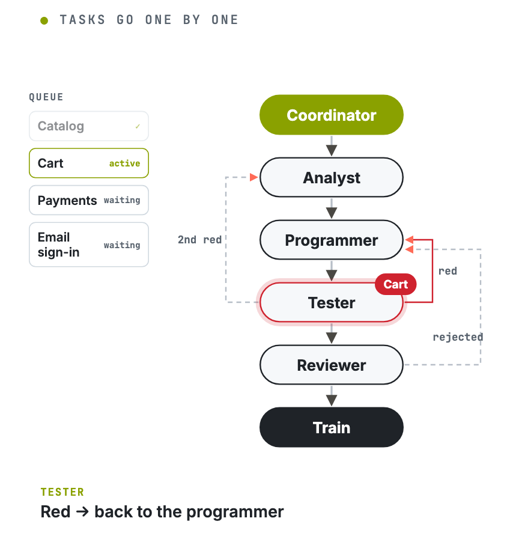
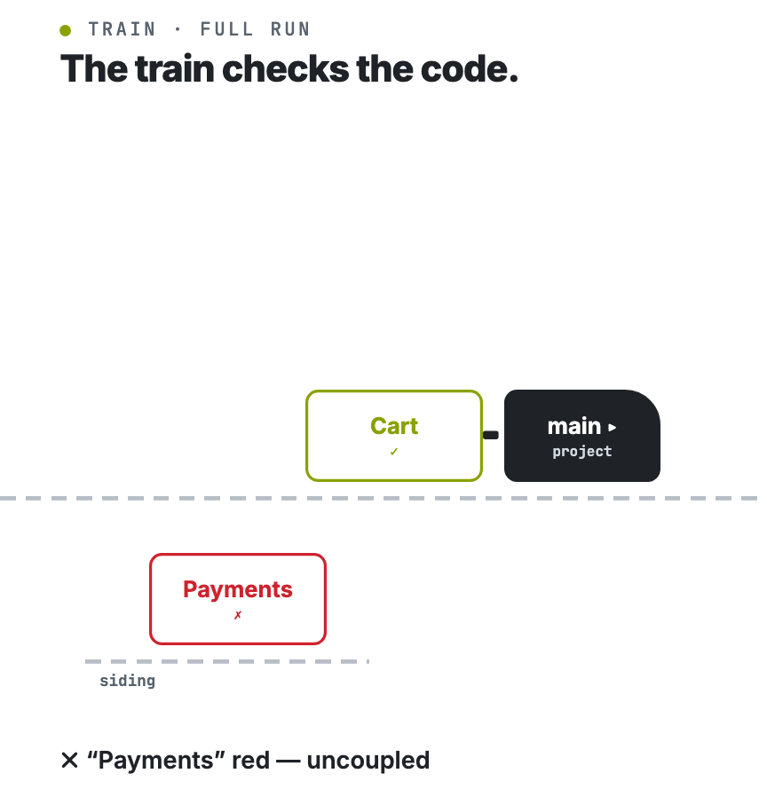
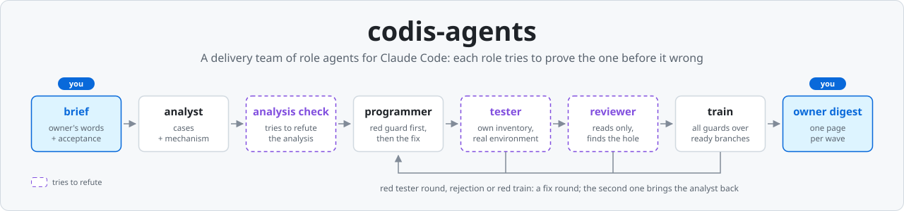
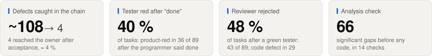
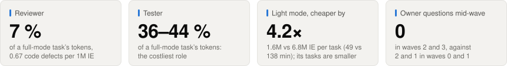
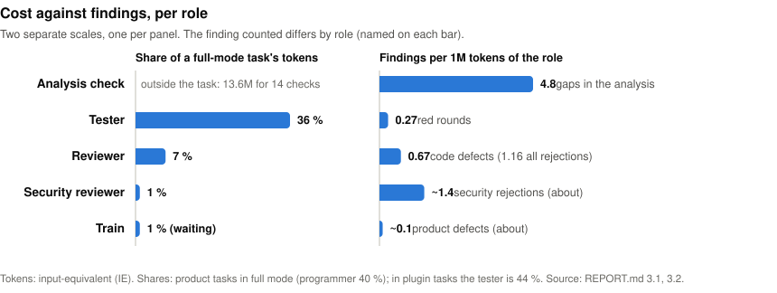

<p align="center">
  <a href="LICENSE"></a>
  <a href="CHANGELOG.md"></a>
  <a href="https://claude.com/claude-code"></a>
  <a href="#codex-cli"></a>
</p>

# Agents work. The graph checks. You decide.

**codis-agents** turns [Claude Code](https://claude.com/claude-code) from one assistant into a small delivery team. You say what you want; your main Claude session becomes the coordinator, writes it down as a task, and hands it to a chain of role agents - an analyst, a programmer, a tester and a reviewer - each of whom tries to prove the one before wrong. You are asked only what really needs you, and you get evidence instead of promises.

**Install in a minute** (Claude Code), then restart the session and follow the [Quick start](#quick-start):
```sh
claude plugin marketplace add VSAVENKOV88/codis-agents
claude plugin install codis-agents@codis-agents
```

## Everyone knows who goes next

<p align="center"><picture><source media="(prefers-color-scheme: dark)" srcset="assets/graph-dark.svg"></picture></p>

The coordinator hands each task to the analyst, the programmer, the tester and the reviewer in turn. A red result goes back along a fixed edge: a red tester returns the task to the programmer, a second red brings the analyst back.

## The train checks the code

<p align="center"><picture><source media="(prefers-color-scheme: dark)" srcset="assets/train-dark.svg"></picture></p>

Ready branches ride one train that runs the whole test suite. A red wagon is uncoupled, fixed on the siding and coupled again; only what rode together is merged.

<p align="center"><picture><source media="(prefers-color-scheme: dark)" srcset="assets/banner-dark.svg"></picture></p>

> **Agents are not what makes this work. What is written down around them is.**

It grew out of a product project that I built in Claude Code. Every rule in it exists because something broke without it. New to the words? See the [Glossary](#glossary).

> [!NOTE]
> Nothing is merged into your main branch, tagged or released without your explicit "yes". A project may let the
> coordinator push working branches and process-rule changes on its own; see [Technical reference](#technical-reference), Git.

## Do the roles pay off?

Measured on a product project, 2026-10-24..11-03: 249 chain runs, 115 accepted tasks; all core roles ran on the same
model.

<p align="center">
  <picture>
    <source media="(prefers-color-scheme: dark)" srcset="assets/roles-catch-hooks-dark.svg">
    
  </picture>
</p>

<p align="center">
  <picture>
    <source media="(prefers-color-scheme: dark)" srcset="assets/roles-findings-dark.svg">
    
  </picture>
</p>

- **Tester:** product-red in 36 of 89 tasks (40 %) that the programmer had handed over as done; 71 red rounds; about
  36-44 % of a full-mode task's tokens. Most of its finds need real execution (two browser engines, fractional pixels,
  the live stand), which the reading roles cannot do.
- **Reviewer:** rejected 43 of 89 tasks after a green tester (48 %), with a code or security defect in 29 (33 %); about
  7 % of a task's tokens and a median of 4 minutes.
- **Security reviewer:** findings in 5 of 8 security tasks, 4 of them seen by no other role.
- **Analysis check** before the code: 66 significant gaps in 14 checks; no measurable effect on later defects yet (9
  tasks).
- **Owner after acceptance:** 4 defects that every role missed (about 4 % of roughly 108 caught in the chain), all of
  one class: an event source missing from the shared matrix, or synthetic input instead of real input. The roles'
  blind spots are correlated through their shared inputs, not only through the shared model.
- **Cost:** a median of 6.8M IE and 138 agent-minutes per full-mode task against 1.6M and 49 minutes in light mode
  (light tasks are smaller by selection).

<p align="center">
  <picture>
    <source media="(prefers-color-scheme: dark)" srcset="assets/roles-hooks-dark.svg">
    
  </picture>
</p>

<p align="center">
  <picture>
    <source media="(prefers-color-scheme: dark)" srcset="assets/roles-cost-dark.svg">
    
  </picture>
</p>

The measurement cannot say what would have passed without a role (no counterfactual), and a red round is not exactly
one defect. Methodology, sources and limits are kept in the measured project's task folder, not in this plugin.

## The process

This is the part every project gets, whatever machine it runs on. All of it is text and checks; the rules are in
`rules/multi-agent.md`.

- **Roles.** The analyst thinks before anyone codes (cases, what could go wrong, whether to split the task). The
  programmer first commits a check that fails on today's code, then the fix. The tester makes its own list of what to
  try before it reads the programmer's, and runs the real scenario. The reviewer only reads, and its job is to find
  the hole. Each runs as a separate agent, and each task works in its own copy of the repository.
- **The brief.** One file per task: your words quoted exactly and dated, the scope, and what "done" means as a scenario
  you could try yourself ("press Add -> the item builds even with the tab closed").
- **Principles.** One numbered list per area of work (an arc): every decision you made, with its date, and a
  "Replaces: N" line when it overturns an older one, so no decision exists in two versions.
- **Three layers of decisions.** A question a principle answers, the coordinator answers. A reversible, local one it
  answers too, marks as a candidate and lists for you to overturn. Everything you judge by the screen, anything new or
  irreversible, comes to you.
- **Post-checks.** After the tester and the reviewer a script compares the repository with the previous role's
  commit: the tester may change only checks, the reviewer nothing. A role cannot quietly "fix" what it was meant to
  judge.
- **Waves and one digest.** At most three product tasks run at once, prepared and answered before they start; a
  question born inside a task stops only that task, and all of them reach you on one page when the wave ends.

## An example: a task, end to end

An example, shortened and made up from the reports of real tasks of a web product. You write: *"Exported reports lose
rows when the filter changes during the export."*

**1. The brief** (`<task>/BRIEF.md`, by the coordinator):

```text
## Owner's words (2026-11-01)
"Exported reports lose rows when the filter changes during the export."
## Acceptance
Start an export of 5 000 rows, change the filter while it runs -> the file holds all 5 000 rows of the filter
at the start; log and the file attached.
kind: defect
```

**2. The analysis and its check.** The analyst writes the cause and the cases (`analyst.md`): *"Cause: the export
re-reads the filter on every page (export.js:88). Cases: C1 filter changed mid-export, C2 tab closed mid-export, C3 a
second export started..."*. The analysis checker tries to refute it (`analyst.check.md`): *"Verdict: changes-needed.
G-1: the guard of C1 uses a 10-row fixture and stays green without the fix: one page only."* The coordinator closes
G-1 in the brief before the start.

**3. The programmer** (`prog.md`): *"Red guard export-filter-run.js committed (red: 4 000 of 5 000 rows). Fix: the
filter is read once at the start. Mutation after the commit: restored the per-page read, guard red; checkout, green."*

**4. The tester** (`test.md`), round 1: *"Red. C2: after closing the tab the export resumes with the current filter.
Expected 5 000 rows, actual 3 120."* Back to the programmer, without a review. Round 2: *"Green. Acceptance in the
real app: 5 000 rows, log and file attached."*

**5. The reviewer** (`review.md`): *"Rejected. export.js:131: a retry after a network error re-reads the filter - the
same defect on another path, not in the matrix."* One fix round, a second review: *"Done."*

**6. The train.** The branch rides with two other ready branches; all guards run once over the three together. Green:
the arc branch moves forward; nothing is pushed.

**7. The digest** at the end of the wave: *"Export keeps its filter - done. Check: start a large export, change the
filter, open the file."*

## Local runtime - optional

These parts serve the machine the chain runs on. They change nothing in the process above; adopt them when your
machine needs them.

- **Memory slots.** Heavy jobs (browsers, builds, full test runs) queue for a limited number of slots, so several
  agents at once do not freeze a memory-limited machine. The plugin's guard-run scripts always go through them; the
  thresholds live in a machine file you can change ([Memory slots](#memory-slots)).
- **A shared stand.** One test deployment that testers take in turn by ticket, instead of a stack per task. Off until
  the project config has a `stand` section ([Shared stand](#shared-stand)).
- **A remote runner.** Full guard runs on another machine over ssh, so they do not take your memory. Off until the
  machine file names a `remote` ([The machine file](#the-machine-file)).
- **Worktree copies.** Each task gets its own git worktree, and the project's untracked data is cloned into it, never
  linked, so a check in one task cannot wipe data of another (`scripts/wt-setup.sh`).

## Why codis-agents?

Every rule below came with a measurement on the project the plugin grew out of. The left column is what was measured
without the rule, the right one what the rule does and, where it was measured, what it gave. Token figures in
input-equivalent tokens (IE, see the [Glossary](#glossary)) are marked as such.

| Without the rule | With codis-agents |
|---|---|
| Idle waits over five minutes re-wrote the agents' prompt caches: **21 %** of all token spend[^idle] | Every role waits in slices of at most 270 s: **7.4 %**[^idle] |
| Features with only the arc specification: **44 %** red tester rounds, **2.4** programmer rounds per task[^own] | A feature gets its own matrix of cases: **24 %** and **1.65**[^own] |
| A gap in the analysis found mid-task costs a fix round: a programmer and a tester agent are a median of **0.89M + 1.12M IE**[^check] | The analysis checker reads it before the start: three checks cost **1.9M IE** and about **20 min** and found **14** significant gaps; over ten days **14** checks cost **13.6M IE** and found **66**[^check] |
| **3.9** full guard runs per task, about **81 min**: **37 %** of a task's calendar[^runs] | One integration train runs the full suite over the arc head and every ready branch together, and merges only the tree that ran[^train] |
| **6 of 17** full runs ended red only from guards unstable under load, each costing a programmer round or a stopped task[^rerun] | A new red is first rerun alone; green alone goes into quarantine, not back to the programmer[^rerun] |
| Programmer rounds "without changes" after reds of the environment: about **3.3M** tokens in one window[^env] | A red of the environment (disk, swap, slot queue, Docker) gets its own verdict and goes to the coordinator[^env] |
| Tasks of up to 100 lines of product took **2-2.6 h** through the full chain, against about **0.6 h** in one session[^light] | Light mode: one programmer-checker and one reviewer, the same train: a median of **1.6M IE** and **49 min** of agent time per task, against **6.8M IE** and **138 min** in full mode[^light] |
| A specification that covered only the architecture: about **ten** owner questions per task[^arc] | The arc is specified with the owner up front; questions come as one list per wave, each with a recommendation[^arc] |

[^idle]: `rules/multi-agent.md`, "Waiting, context and cost", rule "Never sit idle longer than 270 s at a time".
[^own]: `rules/multi-agent.md`, "Roles", rule "A feature gets its own analysis; the arc specification does not replace it".
[^check]: Role measurement 2026-10-24..11-03 (see [Do the roles pay off?](#do-the-roles-pay-off)): median IE per agent, analysis checks. The rule "The analysis is checked before the start" in `rules/multi-agent.md` quotes the same three checks as 0.46M: that is raw tokens, not IE.
[^runs]: `rules/multi-agent.md`, "Order and shortcuts", rule "Only the train" (the "Why" of its `innerSelect: true` part: measurement 2026-10-10..20, 73 tasks).
[^train]: `rules/multi-agent.md`, "Order and shortcuts", rule "The train is the seam check" (p-train, 2026-10-27..29). No before/after figure for the train itself is in the rules.
[^rerun]: `rules/multi-agent.md`, "Order and shortcuts", rule "A new red is first rerun alone".
[^env]: `rules/multi-agent.md`, "Order and shortcuts", rule "A red from the environment goes to the coordinator, not to the programmer". The source does not say whether the 3.3M is raw or IE.
[^light]: `rules/multi-agent.md`, "Order and shortcuts", rule "Light mode for small tasks". The 0.6 h is a single session without the chain. The light and full medians are from the role measurement; light tasks are smaller by selection, so it is not the same work compared.
[^arc]: `rules/multi-agent.md`, "Arcs: specification, principles, mockups", rule "An arc starts with a specification agreed with the owner before its first task"; one digest per wave: "Waves".

## Glossary

| term | in plain words |
|---|---|
| owner | you: the person who decides what is built and accepts it |
| coordinator | your main Claude Code session: writes briefs, starts chains, routes results, asks you what only you can answer |
| role | one agent with one job in the chain: analyst, programmer, tester, reviewer, security reviewer |
| arc | a group of related tasks over one area, specified with you before the first task |
| brief | `BRIEF.md`, one per task: your words verbatim and dated, the scope, the acceptance scenario |
| acceptance scenario | what "done" means, written as steps you could try in the real app |
| use cases | for a new feature: who does what, what can go differently, what can go wrong; written before the matrix |
| matrix of cases | the analyst's table of every case the task must handle; each later finding is a cell of it |
| analysis check | a reading agent that tries to refute the analysis before any code; its gaps are closed before the start |
| guard | an executable check, judged only by its exit code |
| red guard first | the programmer commits a guard that fails on today's code before writing the fix |
| mutation | after the commit, break the fix on purpose and see the guard turn red; a guard that stays green proves nothing |
| post-check | a script after a role that refuses changes the role was not allowed to make |
| worktree | a separate working copy of the repository for one task |
| known red, quarantine | guards already known to fail, each with its reason; only a new red counts as a regression |
| train | after the review, ready branches ride together with the arc head through one run of all guards; only the tree that ran is merged |
| seam | two changes that pass alone and fail together; the train finds it |
| wave | up to three product tasks prepared together and started together |
| digest | one page per wave: results, what to check on the screen, your questions, the coordinator's candidates |
| layer 1 / 2 / 3 | who decides a question: 1 a principle answers it; 2 the coordinator, when it is reversible and local; 3 you |
| candidate | a layer-2 decision of the coordinator, listed for you to keep or overturn |
| full mode, light mode | full: analyst (when needed), programmer, tester, reviewer; light: one programmer-checker and one reviewer, for small tasks |
| environment red | a failure of the machine (disk, memory, queue, a service down), sent to the coordinator, not to the programmer |
| slot | a place in the memory queue for a heavy or medium job |
| stand, ticket | a shared test deployment, and the lock a tester holds while it uses it |
| IE | input-equivalent tokens: input + 1.25 x cache writes + 0.1 x cache reads + 5 x output; how the plugin compares cost |

## Quick start

| Step | Command |
|---|---|
| 1. Add the marketplace | `claude plugin marketplace add VSAVENKOV88/codis-agents` (or a local clone: `claude plugin marketplace add /path/to/codis-agents`) |
| 2. Install the plugin, then restart the session | `claude plugin install codis-agents@codis-agents` |
| 3. Turn it on for a project | copy `examples/codis-agents.example.json` to `<project>/.claude/codis-agents.json`; set where worktrees and task folders live and how your tests run |
| 4. Check the project config | `node /path/to/codis-agents/scripts/config.js check` |
| 5. Give the coordinator the rules | add `@/path/to/codis-agents/rules/multi-agent.md` to the project's `CLAUDE.md` |
| 6. Ask for a task in plain words | "write a brief for retrying failed uploads and run the role chain on it" |

> [!IMPORTANT]
> You need Node.js 18+, git and zsh (macOS has it; on Linux install it). A plugin installed in the middle of a session
> gives its skills, workflows and agents only after a session restart.

Details of each step: [Install](#install), [Configure a project](#configure-a-project), [Run a chain](#run-a-chain).

## What's inside

```text
codis-agents/
├── agents/       6 role agents: analyst, programmer, tester, reviewer, security-reviewer, analysis-checker
├── skills/       3 skills: role-chain (starts a chain), coordinator (its loop), brief (how to write one)
├── workflows/    role-chain.js - the chain itself, fix rounds, the analyst after a second red, the train
├── rules/        multi-agent.md - the process rules; 20 marked lines go into every role prompt
├── hooks/        hooks.json - refuses git add -A, pushes to protected branches and tags
 ├── scripts/      38 scripts: memory slots, guard runs and selection, the train, post-checks, remote runner, cost
├── examples/     example project and machine configs
├── schemas/      their JSON schemas
└── tests/        170 test files of the plugin itself (npm test)
```

Every file, script and config key is described in the [Technical reference](#technical-reference).

## What you get as the owner

- **Fewer, better questions.** Rules you already agreed on answer themselves; small reversible choices are taken by
  the coordinator and listed for you; the rest arrives in one sitting per wave instead of all day long.
- **Evidence, not "it works".** Every fix comes with a check that was red before it and green after, and the check is
  itself tested: the fix is broken on purpose to see the check catch it.
- **The real environment.** Acceptance happens where you would see it - the real app, the real browser, the real
  services - with logs and screenshots in the task's folder.
- **A memory that does not drift.** Your decisions are written down verbatim with their date, in one numbered list
  per area, so the same question is not asked, or answered differently, twice.

> [!TIP]
> **Start here - no plugin needed.** Three habits carry most of the value, and they work for one person with one agent:
>
> 1. **A brief before work.** The requester's words quoted verbatim and dated, and the acceptance written as a
>    scenario in the real environment ("Add -> the item builds with no tab open"), not as a feature name.
> 2. **A red guard before code.** The agent first commits an executable check that fails on the current code, then the fix.
> 3. **Mutation after the commit.** Break the fix, see the guard go red, restore it, see it green. A check that does not
>    turn red on a broken fix proves nothing.
>
> Everything else in this plugin is how those habits scale to a chain of roles and a dozen tasks a day.

## Is it for you?

> [!WARNING]
> It is more than you need for a one-off script or a single quick fix: there, the three habits above are enough.

It fits when you build a real product with Claude Code, several changes a day, and you would rather answer ten good
questions once than discover twenty small surprises later.

> [!TIP]
> **Which mode, from the measurement** (advice, not a rule of the plugin): light mode for diagnosed defects and tails of
> up to about 100 lines in one subsystem, with no new channel, state, timer or attack surface, and an acceptance that
> does not rest on a gesture in two browser engines or a multi-service stand; full mode for features and for anything
> that brings a new channel or state. Keep the reviewer in both: in light mode it found a code defect in 4 of 34 tasks
> and twice moved a task to full mode.

## Version history

What changed in each version, newest first: [CHANGELOG.md](CHANGELOG.md).

---

## Technical reference

Everything below is for maintainers and for people adapting the plugin to their own project: the terms, the rules
and how the chain decides, every config key, every script, the memory slots, the shared stand, the known gaps and the
plugin's own tests. A change of the plugin's behaviour updates this block; the version entry goes into
[CHANGELOG.md](CHANGELOG.md).

Contents, in the two parts of the plugin described above:

- **The process:** [Terms](#terms) - [The role chain](#the-role-chain) -
  [Decisions live in three layers](#decisions-live-in-three-layers) - [What counts as evidence](#what-counts-as-evidence) -
  [Rules that grew out of failures](#rules-that-grew-out-of-failures) -
  [The bottleneck is the owner's attention](#the-bottleneck-is-the-owners-attention) - [Run a chain](#run-a-chain) -
  [How the chain decides](#how-the-chain-decides)
- **Local runtime (optional):** [The machine file](#the-machine-file) - [Memory slots](#memory-slots) -
  [Shared stand](#shared-stand); the remote runner and worktree copies are rows of [What is inside](#what-is-inside) and
  [Configure a project](#configure-a-project)
- **Both:** [What is inside](#what-is-inside) - [Install](#install) - [Configure a project](#configure-a-project) -
  [Known gaps](#known-gaps) - [Tests](#tests) - [License](#license)

The terms below are the technical ones; the plain [Glossary](#glossary) is above.

## Terms

| term | meaning |
|---|---|
| guard | an executable check (`*-run.js`) judged by its exit code |
| brief | `BRIEF.md` of one task: the owner's words verbatim, scope, acceptance scenario |
| arc | a connected group of tasks over one surface, with one specification agreed up front |
| principles | the arc's numbered list of accepted decisions, each with its source and what it replaces |
| coordinator | the main session: writes briefs, starts chains, merges (with `guardSubsetCommand` the train merges a green branch), decides what the principles answer, asks the owner the rest |
| kind | every task is exactly one of `feature`, `defect`, `tail`; a `feature` starts only with its use cases (`useCases` or `useCasesFirst`) |
| selection | the guards of a task's diff (`scripts/guards-select.js`), run by the workflow after every programmer round instead of a full guard run in the task (with `guardSubsetCommand`) |
| train | the integration train (`scripts/train.js`): after the review a branch rides with the arc head and the other ready branches in one full guard run; green fast-forwards the arc branch (no push), red is attributed per branch |

## The role chain


With `guardSubsetCommand` in the config the task has no full guard run of its own: the workflow runs the selection of
its diff after every programmer round, and the full run belongs to the train. Without the key the reviewed branch is
done after the review and the coordinator merges it, as before.

Each role runs as its own agent; each task has its own git worktree. A second rejection for code stops the fix rounds: the next round
starts with the analyst. Work on access, keys or cookies gets a security reviewer as well. A role that hits an open
question writes it into its report for the coordinator and never answers it itself.

## Decisions live in three layers

| layer | what it holds | size on the project it came from |
|---|---|---|
| brief | one task: the owner's words, scope, acceptance scenario | one file per task |
| principles | numbered decisions, each with its source and a "Replaces:" line | 121 decisions |
| short model | one-sentence rules, each linked to the principle it comes from | 31 rules, two pages |

When a role asks a question, the coordinator:

1. answers it itself when an accepted principle answers it, and writes "decided by principle N" into the brief;
2. answers it itself when no principle does but the answer is reversible and local (one task; not a storage format, an
   address, sharing, data deletion or security; not a mechanism whose choice is seen on the screen or rests on time),
   marked "coordinator's decision, not from the model - candidate" and
   listed in its report so the owner can overturn it;
3. sends everything else - everything the owner judges by looking at the screen (look, placement, UI wording),
   anything new or irreversible, two principles in conflict - to the owner as one list, each question with a
   recommendation.

A role never answers an owner question itself: it writes the question into its report for the coordinator.

## What counts as evidence

- **Guards**, red first, and **mutation-tested after the commit**.
- **Every browser engine your users run** for anything visual: on the measured project WebKit dropped things Chromium drew.
- **The real environment**: a change that touches two services is accepted in a two-service container stack driven
  through the real client, not in one process on a developer machine, where guards stay green while the image fails.
- **A full guard run** before a branch reaches the arc: "N green - N new red - N known red"; only new red is a regression (known reds: config `guardBaseline`). With `guardSubsetCommand` it is the train's one run over the arc head and the ready branches together, and only that tree is merged.

Its limit, honestly: no headless browser reproduced a blurry label in a real desktop browser. A person looking at the screen found
it. Agents do not replace that.

## Rules that grew out of failures

| what happened | rule |
|---|---|
| a feature took three days with about ten owner questions per task; one decision flipped three times | a specification of the whole arc before its first task; one numbered `PRINCIPLES.md` with "Replaces:" lines |
| a decision the owner made never reached the list and was never started | a decision not in the principles is lost; the list is the only list |
| a layout arrived "locally" with a mockup, no decision behind it, and had to be redone | what the owner judges by the screen is never decided by an agent; a mockup of all states before code |
| a programmer invented a height probe with a timer that no matrix named; its flicker was one question among 36, the second analyst wrote more cells of the same probe: 7 rounds, 30M, and the owner saw the flicker after the acceptance | a mechanism is challenged before cells: a section "Mechanism" of the analyst (choices seen on the screen or resting on time go to the owner), status `mechanism` of the programmer, "mechanism or cells?" first for the analyst of a second red, a line of the reviewer |
| a UX spec last touched at a redesign said nothing about the features built after it | living specs change in the same commit as the behaviour they describe |
| an outside review found that the comments of an AI edit loop retold the history of decisions and hid the current behaviour | a comment says what the code does now and why; history goes into commits and reports; a comment the code contradicts is a rejection, a history-only one a tail |
| one task was re-scoped three times mid-flight and cost twice the median | split before the first programmer: over ~30 cells or more than two subsystems |
| the precondition check stopped tasks with an incomplete acceptance three times in one day | acceptance is a scenario in the real environment |
| agents were killed while their run waited for a heavy slot | reports are written as you go and end with "Next step"; a fresh agent continues |
| a role recorded "owner's answers" the owner never gave | only the coordinator writes decisions into a brief |
| idle waits over five minutes cost 21 % of all tokens | wait in slices of at most 270 s; the rule sits in every role prompt (21 % -> 7.4 %) |
| a cheap waiter gave up on a full run waiting in the heavy slot queue ("the tail has not changed"): 24 of 37 repeats in one window, each repeat on an expensive model | the waiter keeps waiting while the run is alive, whatever its tail; only the step's deadline or a refused queue ends it, as `environment` |
| a role waited for its own selection of guards in a heavy slot, inside its large context | the workflow runs the selection of the task's guards as its own wait step, so the programmer runs none; heavy commands only in the background |
| a resumed run of parallel tasks replayed one task's cached results into another, and both chains stopped | never `resumeFromRunId` for a multi-task run; relaunch each unfinished task alone with `start` |
| two parallel branches, each green alone, gave six red guards after the second merge | after merging the second of parallel branches over the same files: the guards of both tasks, then the full guard run; with `guardSubsetCommand` replaced by the integration train (p-train): one full run over the arc head and the ready branches together, a seam is attributed to the later branch |
| one full guard run per task still held a heavy slot for most of a task's calendar, and the seam stayed unchecked until the merge | no full guard run in the task: the selection of its diff after every programmer round; the full run moves to the train (replaces "one full guard run per task", p-train 2026-10-27) |
| several container stacks at once pushed a memory-limited machine into swap | at most two chains with acceptance in Docker at once |
| a merged worktree removed after a clean `git status` held the only copy of a measurement corpus in ignored files; an old copy of the repository removed the same way broke 1809 symlinks elsewhere | before removing a worktree or a data directory, the owner says "yes" to the output of `scripts/wt-remove-check.js` (ignored data with sizes, the path in code, symbolic links that lead into it) |
| images of old test stacks (481 of them, ~130 GB) filled the disk and stopped the chains | a tester removes its own stack with `docker compose -p <stack> down -v --rmi all`; the owner's stack is never touched, other images and the build cache are not cleaned by roles |

## The bottleneck is the owner's attention

A day of fourteen tasks is about forty decisions a person has to make. Faster agents do not help until fewer questions
reach that person: rules that answer themselves, questions batched with a recommendation each, a mockup instead of a
description for anything visual, and a two-page model a human can hold in their head next to the long list the agents
read.

So product chains go in waves: at most three, prepared and answered before the start, launched together; a question
born inside a chain stops only its task until one digest per wave (rule "Waves" in `rules/multi-agent.md`).

Before a wave starts, its analyses are checked: the coordinator runs the analysis checker
(`agents/analysis-checker.md`) on the analysis of every task of the wave that has one, product or plugin task alike. It
reads only, tries to refute the analysis - premises against the code with file:line, sources and consumers without a
cell, guards that would be green without the fix, an acceptance that cannot run on the owner's real data, the basis of
the coordinator's decisions - and writes one report per analysis, `<name of the analysis>.check.md` next to it
(`analyst.check.md`, `diagnosis.check.md`), or returns its text when the environment refuses the write (the coordinator
saves it with `Saved-by: coordinator`). A repeated check of the same analysis (another part of a feature, a run again)
appends a run with its own header and Closure; the earlier runs stay as they are (the coordinator checks that the
earlier content is an exact prefix of the report after the run). A task counts as checked only by a run whose `Tasks`
line names its key: a run for another part of the feature does not count. Every significant gap is
closed in the brief or the analysis, or goes to the owner with the other questions of the preparation; the coordinator
writes that into the report's section Closure. A task with `noAnalysis` gets no check. In wave 2 three such checks cost
0.46M tokens and about 20 minutes and found 14 significant gaps; one return of a task cost about 0.7M and 35-60 minutes.

## What is inside

| path | what |
|---|---|
| `workflows/role-chain.js` | the chain: preconditions -> (analyst) -> programmer -> tester -> reviewer (+ security reviewer) -> (with `guardSubsetCommand`) the integration train; fix rounds; an analyst after the second rejection, the second red tester round or the second red train |
| `agents/*.md` | role agents: `analyst`, `programmer`, `tester`, `reviewer`, `security-reviewer` (all may edit files - the tester its guards, the reviewers their reports; what they may change in the worktree is enforced by the git post-check, not by tool lists); and `analysis-checker`, run by the coordinator outside the chain before a wave starts - it may write only its report `<name of the analysis>.check.md`, and the coordinator checks that (a snapshot of the worktree and the task folders before and after, `role-diff-check.js --role reviewer`, the earlier runs of the report unchanged), since no post-check of the chain follows it |
| `skills/role-chain` | reads the project config and starts the workflow |
| `skills/brief` | how to write a task brief |
| `skills/coordinator` | the coordinator's loop |
| `rules/multi-agent.md` | the process rules; lines marked `<!-- role:<id> -->` go into every role prompt |
| `hooks/hooks.json` | PreToolUse on Bash: refuses `git add -A` / `git add .`, pushes to protected branches or of protected tags, and `git remote set-head` / writes of `git symbolic-ref refs/remotes/<remote>/HEAD` / `git update-ref` on it and `git update-ref --stdin`, in any letter case, Unicode case folding included (they move the default branch the hooks protect); an abbreviated long option (`--del`, `--mi`) counts as the option; with `--git-dir` / `--work-tree` / `GIT_DIR` / `GIT_WORK_TREE` / `GIT_COMMON_DIR` the config is looked up from those paths too and a push is refused (use `-C`); git's global options before the subcommand are read by a table measured against git, and one outside it is refused; a commit or a reset of the arc branch under a live train (`<sharedDir>/train/lock/owner.json` names it as `base`): wait for the train (`train.js status`) or ride as a passenger |
| `scripts/slots.zsh`, `heavy.sh`, `medium.sh` | memory slots for heavy and medium jobs, with a FIFO queue |
| `scripts/stand.sh`, `stand.js` | the ticket of the project's shared stand (queue, holder, reset at issue and release) and its commands from the config |
| `scripts/slot-journal.js` | summary of the slot journal: queue wait and hold per class and per worktree |
| `scripts/guards-all.sh` | a full guard run of one worktree in a heavy slot, with a shared worker budget; an absolute worktree path brings its own project config (`config.js path --from <dir>`: the nearest `.claude/codis-agents.json` from it upwards, over `$CLAUDE_PROJECT_DIR` and the cwd; an explicit `$CODIS_AGENTS_CONFIG` still wins), a relative name is resolved by the config of the cwd as before - or on the remote runner (`scripts/guards-remote.js`, machine key `remote` with project key `remoteRun`; `--local` keeps it here); `--select <base>` runs only the selection of the task's diff (`guards-select.js --only-args` into `guardSubsetCommand`, its own log `guards-<name>.select.txt`, the quarantine read only, nothing selected - exit 0 and nothing runs, an unknown base - 65; remotely only with `remoteRun.subsetCommand`); `--guards <names file>` runs the same selection mode for the guards of a JSON array of names (the attribution of a red train); new reds rerun alone (`guardRerun`); a run on the same HEAD with a clean tracked tree that ended with exit 0 is not repeated ("reused, HEAD <sha>" and the saved summary; `--force` runs anyway); the main working copy of a repository is refused with 78 (`--main-checkout` runs it, for a project without worktrees); flaky guards go into the project's quarantine (`guardBaseline`); a remote run sends it with the run, the runner's own call `--quarantine-read-only` subtracts it without writing, and this machine writes the flaky guards of the log that comes back (a broken quarantine or a refused transfer: exit 69); `--no-quarantine` neither reads nor writes it |
| `scripts/main-checkout.js` | is a directory the main working copy of its repository (git-dir == git-common-dir)? 78 with the reason and `wt-setup.sh`, 0 for a linked worktree or with `--main-checkout`; `GIT_*` variables are ignored, and a git error inside a tree with `.git` above it is 78 with git's error; used by `guards-all.sh` and `env-check.js --worktree` |
| `scripts/guards-select.js` | the guards of a diff, run instead of the full suite (the workflow's selection from the task's `base`, the tester's from the programmer's HEAD after its own commits): changed guards, guards that import a changed file or name it, `guardAlways`; `--only-args` prints only the {onlyArgs} part (for `guards-all.sh --select`), `--command` fills `guardSubsetCommand` |
| `scripts/wait-step.js` | a long deterministic step (the selection of a task's guards after a programmer round, `guards-all.sh --select`) run detached by the workflow between role agents; `wait` blocks at most 270 s and reports JSON |
| `scripts/wt-setup.sh` | creates a task worktree and clones (not symlinks) git-ignored data into it; `--detach <name> <commit>` makes it detached, with no branch (the train) |
| `scripts/merge-only.js` | `<before> <head> --base <arc> [--wt <dir>] [--files <glob>]... [--guards <glob>]...`: is a train conflict round only the merge of the arc with docs resolved? One merge commit, first parent `before`, second parent an ancestor of the arc, and every file `git merge-tree --write-tree` names as conflicted, and every file where it differs from that automatic merge of its parents, matches the globs (`mergeOnlyFiles`), and none of them is a guard: a file of `--guards` (the project's `guardFiles`, passed by the workflow; without it the key's default) is a guard, not docs, even under a docs glob; JSON `{mergeOnly, reason, files}`, exit 0 yes, 1 no (also without globs), 2 an error |
| `scripts/train.js` | the train dispatcher (p-train): ready branches queue in `<sharedDir>/train/queue` (`enqueue`); one train at a time under a mkdir lock (a dead holder's lock is broken, its worktree removed); a train is the arc head plus every ready branch merged by `git merge-tree`/`commit-tree` into `refs/runs/train/<id>` (a conflicting passenger gets `conflict` with its files, the others ride), run by `guards-all.sh` as it is in a detached temporary worktree with cloned ignored data, removed afterwards; green moves the arc branch to the train commit (compare-and-swap, or `merge --ff-only` in the worktree where it is checked out and has no tracked changes, else `green-unmerged`), results in `<sharedDir>/train/result`; the arc moved during the run: no verdict, the next train; the environment (also a log without its tally), a git error halt the queue until `resume`; a red train is attributed: its repeated new reds run again alone (`guards-all.sh --guards`) on the bare arc head (red there: `arc-red`, the queue halts) and on "arc + X" for every passenger (red: X gets `red`, the others ride the next train); green on each alone is a seam - of two: the earlier rides, the later gets `seam` naming it; of three: the pairs (at most three runs) name the pair; an attribution that could not run, a guard now red now green, or more than three passengers halt for the coordinator; `await` waits for one entry and dispatches while it waits; `ride` (the chain after the review, p-train-c3) is enqueue + await with the verdict as its exit code - 0 green, 10 green-unmerged, 11 red, 12 seam (after the partner's own result; a halt of the partner's train gives that halt's code: 14, 15 or 75), 13 conflict, 14 arc-red, 15 coordinator (a halt for the coordinator: several red pairs, a guard now red now green, more than three passengers, one passenger green alone), 75 the queue halted by the environment, 74 the queue unavailable, 65 refused before the queue (a protected base or not a branch); a relaunch attaches to its entry or result; the lock holder is alive while any process of its process group lives (`scripts/train-lock.js`, the one reading of the lock for `train.js` and the session hook); `lock/owner.json` is `{pid, child, pgid, train, base, wt, since}`, `base` written as soon as the train has chosen its arc, and `status` prints `lock: train <id> for arc <base> by pid ...` (`by watch pid ...` when `train.js watch` holds it; or `lock: free`); a dead train's worktree and attribution refs are removed; a ride or an await of its own entry writes its waiter file `<sharedDir>/train/waiters/<task>-<head>-<pid>.json` `{pid, procStart, state, at}` (procStart = now - `LC_ALL=C ps -o etime=`, so a reused pid is no waiter), marked `claimed` or `left` on its exit, and takes (`claimedAt`) the result it returns as its own; a result not taken, with waiter files and none of them a live waiting process, not superseded by a later head of the task (`enqueuedAt`), is a verdict without an addressee: `status` names it after its halt/lock/queue lines (green: the merged sha and arc; green-unmerged: the ref to merge; conflict: the files; seam: the partner) and marks queue entries `waiter pid N alive` or `no live waiter`; `resume` names the entries without a live waiter; `train.js ack --task <t> --head <sha>` takes a verdict by hand (66 without a result); `train.js watch` is the coordinator's background wait: it dispatches like any waiter and exits with `{orphans}` on a verdict without an addressee that was not there when it started, or with `{halt, entriesWithoutWaiter}` on a new halt that leaves an entry whose waiters are gone without reporting it; the coordinator does not end its session while `status` shows a live lock of `watch` (`by watch pid N (alive)`), and a version with waiters is installed between waves with the plugin of the remote runner |
| `scripts/corpus-sync.js` | the project's corpus on the remote runner (machine key `remote`), one way only: `manifest` (paths, sizes, mtimes and sha256 of the git-ignored data under `worktreeSetup.scan` into `<sharedDir>/corpus-manifest.json`; the main checkout is only read, `git status --no-optional-locks`), `sync` (the delta by rsync into `<root>/corpus`, chosen by sha256 and sent with `--ignore-times`, deletions inside the donor only; "corpus up to date <id>" when nothing differs), `status`, `copy <name>` (a run's own copy at `<root>/wt/<name>`, an earlier copy of that name removed first, time and size printed), `wipe-list` and `wipe --confirm <token>` (two commands: the second removes exactly the list the first showed). Never sent: `.env*` (an ignored entry git names is left out; a `.env*` inside ignored data refuses the sync before any transfer, exit 65, files named), `sessions/` at any depth and in any case (`Sessions/` is the same folder on a case-insensitive disk; refused before transfer like a `.env*`, and dropped by rsync's filters too), `node_modules`, `dist`, `.deps`, the `skip` and `link` globs, symbolic links. An empty source never empties the donor; an rsync cut off leaves the donor `incomplete` and `copy` refuses until a full sync (69, "environment: ...") |
| `scripts/guards-remote.js` | the full guard run on the remote runner, called by `guards-all.sh` when the machine file has `remote` and the project config `remoteRun`: committed HEAD only (tracked changes: 78), pushed over the pinned ssh into `<root>/repo.git` at `refs/runs/<name>/<sha>` (not when the runner has it), the runner's plugin of the same version and its `env-check.js` first; the runner prepares `<root>/wt/<name>` and runs its own `guards-all.sh --local` detached from ssh; here no slot is held while waiting ("waiting for remote run <id> on <host> ..." every `SLOT_SAY` s, one journal line of class `remote`); the log comes back with the header "ran on runner <host>, HEAD <sha>, workers N" and a meta with env `remote:<host>`; the guards of `remoteRun.localPattern` run here afterwards in a heavy slot, the worse exit code wins; environment problems exit 69 with the first log line `environment: <reason>` |
| `scripts/guards-remote-host.js` | the runner's half of `guards-remote.js`, sent over ssh to `node -` with `corpus-remote.js` bundled; the job of a run is that bundle in `<root>/runs/<name>/` started in its own session: worktree (`git worktree add --detach`), its own copy of the donor (under `corpus.lock`; a copy that changes a file the commit holds is refused, 69, the paths named: only the committed HEAD runs; a `.env*` the commit does not hold is refused right after it, before any project code), dependencies from `<root>/deps/<hash>` (installed once per hash in a medium slot, then read-only (`a-w`) with its manifest in `<hash>.ok`; a reuse that no longer matches the manifest is installed again: `u+w`, removed, installed, `a-w`; linked straight to their real paths), the `prepare` commands, again a refusal of any `.env*` the commit does not hold, then `guards-all.sh`; what the runner sends back is shown here without control characters; a start of the same name and SHA while it lives (or before its result was fetched) attaches to it |
| `scripts/corpus-remote.js` | the runner's half of `corpus-sync.js`, sent over ssh to `node -` (the ssh command never carries a path); runs there as `node corpus-remote.js <op> '<json>'` too |
| `scripts/wt-remove-check.js` | before a worktree or data directory is removed: prints its ignored data with sizes, the path named in code and the symbolic links that lead into it; removes nothing |
| `scripts/role-exec.js` | the role adapter for a host CLI (p-codex, parts A1a and A1b: the contract, the data and the process): `createAgent(cfg)` returns `agent(prompt, {schema, model, effort, label, phase, agentType})` with the contract of the Workflow `agent()` - the object of the schema or `null`, never an exception - for the host `codex` (Codex CLI) or `claude` (Claude Code). The task comes from the label (`<kind>:<task key>...`, a key with `:` or `#` is refused by `createAgent`, and so is a codex config without an absolute `codex.home`: the child's `CODEX_HOME` is always that run home, never the parent's; the personal `~/.codex`, also through a link, is refused by `createAgent` and by `check`), the role from the kind of the label (`pre`, `analyst`/`usecases`, `prog`, `test`, `review`, `sec`, the service kinds `sha/diff/left/post/run/merge`), and `agentType` only picks the body (`codis-agents:<role>` must name that role and its `agents/<role>.md` must exist in `pluginRoot`; `general-purpose` - no body; anything else is refused). On codex the prompt is `body.trim() + "\n\n" + prompt` (body without frontmatter), the schema goes in its strict form (`strict()`: every key required, optional fields admit `null`, `additionalProperties: false`, nested levels too; only the keywords `type/properties/required/items/enum/description`, any other is refused), the answer comes back by `unstrict()` (a `null` only in a field that was optional and not nullable is removed; a nullable field such as `RUN.rc` keeps it) and is checked against the original schema (`invalid-result` otherwise); the model by the table `codex.models` (default: every alias and no model -> `gpt-6-astra`), the effort `opts.effort` or `codex.effort` (default `high`) only when the codex catalog lists it for that model; the service kinds and `prog`/`test` are refused on codex while the adapter runs the real codex CLI (the sandbox profile of code writes is part A2a-3), and so is `pre` unless `cfg.preconditionsByConductor` is `true` (the caller ran the environment check on the host itself and the prompt carries its result); `cfg.beforeLaunch(plan)` runs after every static refusal and before the launch, and resolves `null` (launch) or `{outcome, error}` (the call ends with that outcome and no process); `cfg.onRecord(rec)` gets every record before it is appended to `calls.jsonl`, also when the file refuses it; with `cfg.commit` and a launcher of the caller (`cfg.launch`) `prog` and `test` run and get the commit channel (`scripts/commit-service.js`): `cfg.commit` = `{stateDir, git?, gitVersions?, author?, codexVersions?, walkMaxEntries?, walkTimeoutMs?, walkMaxResultBytes?, walkMaxIgnoreBytes?, walkMaxReadBytes?}` (the checks of a commit get the role's network - on only for `test` -, its task folder, the npm cache `<call folder>/npm-cache` and `killGraceMs`; the signal handlers stay on until a running check is stopped) is accepted only on the host codex (the claude host: part A2c), and `createAgent` refuses a `stateDir` that is not absolute or that overlaps a task folder, a worktree, `/tmp` or the `TMPDIR` of the role (folders a role may write); a `prog`/`test` call needs `tasks[k].branch` (refused before the launch without it); the call gets a box `<call folder>/commit`, an answers folder in `stateDir`, and `CODIS_COMMIT_BOX`/`CODIS_COMMIT_ANSWERS` in its environment (an inherited value never reaches any role); the service lives exactly as long as the launcher, and the record gets `commit` (`box`, `answers`, `commits[{id, sha, paths}]`, `refused[{id, why}]`, `nothing`, `cancelled`, `notes`). On claude the original schema goes in `--json-schema`, `--agent` and `--plugin-dir <pluginRoot>`, `--model`/`--effort` only when given, `--permission-mode` `auto`, `--strict-mcp-config` and `--disallowedTools` with the tools a Workflow agent lacks (`Task`, the schedule and notification tools, by the names of the `init` event), cwd the task folder. Each call saves `prompt.txt` (the bytes of stdin) and, on codex, `schema.json` in a folder of its own `<task dir>/calls/<label>-<time>-<random>/` (two calls never share one) and appends one line to `<task dir>/calls.jsonl` (`callsDir` for an unknown task) whatever its outcome (`refused` before any process); the folder's own path is resolved, then the file is opened with no link followed (`O_NOFOLLOW_ANY` on macOS, `O_NOFOLLOW` elsewhere), without blocking (`O_NONBLOCK`) and must be a regular file with one link: a link, a FIFO or a hard link the role left in place of `calls.jsonl` is never written through, the record is lost and `cfg.log` names the reason. The process of the role (`spawnRole`; `cfg.launch` replaces it): the launch gate first - `/bin/sh` in a process group of its own waits for one line `go` on stdin and then `exec`s the CLI, so pid, group and start time stay the CLI's own (no binary or no execute bit: exit 126 or 127, `crashed` with the text of the shell); `cfg.onLaunch` gets `{label, key, stepId, callDir, host, pid, pgid, lstart}` synchronously before `go`, and a registration that fails (it throws, `ps` gives nothing) closes stdin, so the CLI never starts and the call ends as `not-registered` (a launcher of the caller gets `substitute: true` and `pid: null` before it runs, and is not run when that fails); the prompt follows on stdin, the JSONL stream saved as `events.jsonl` and parsed line by line (a broken line is a note), stderr in `stderr.log`; outcomes by fields, never by words - codex: `ok` (exit 0, `turn.completed`, the `-o` file passes the schema), `schema-refused` (`turn.failed` with status 400 and `invalid_json_schema`), `rate-limited` (a JSON error message with status 429; the plain-text plan limit of codex 0.166.0 is `crashed`, see Known gaps), `auth` (401/403; the reason names `CODEX_HOME=<home> codex login`), `crashed` (spawn error, another status, exit != 0 without `turn.failed`, with the tail of stderr), `no-result` (no `turn.completed` or no JSON in the `-o` file; the last `agent_message` is never used); claude: by `result.subtype`, `is_error`, `api_error_status`, `structured_output`, and `rate-limited` for any error (a result error or an exit != 0 without a result) after a `rate_limit_event` whose status is not `allowed` (`allowed_warning` included); both: `killed` (a signal from outside), `ceiling` (3 h on the monotonic clock: SIGTERM to the group, SIGKILL 30 s later; no silence timer), `signalled` (SIGTERM/SIGINT/SIGHUP to the adapter: every live group stopped the same way, every call `signalled`, then `process.exitCode = 128+n`, the handlers removed and no new call started). No outcome is retried. After the leader exits its group gets SIGKILL; a process the role moved into a session of its own is not tracked, and every record says so. The record carries `usage` as the host's raw numbers (codex: the sum of every `turn.completed` with `input`, `cachedInput`, `cacheWrite`, `output`, `reasoning`, `null` without one; claude: `result.usage`), `costUSD` (claude `total_cost_usd`, codex `null`), `notes` (the number of `turn.completed` events, `error` events, `rate_limit_event`, `permission_denials`, `modelUsage` against `result.usage`, the codis-agents plugin and the tools of the claude `init` event), `sessionId`, `credentialExpiresAt`, the wall `seconds` and the monotonic `awakeSeconds`; the reason of every outcome other than `ok` also goes to `cfg.log`. `role-exec.js check --host codex|claude` checks a host without a model: codex version (`--versions`, default 0.166.0), `login status` in the run home by its exit code (chatgpt mode; the parent's `OPENAI_API_KEY`/`CODEX_API_KEY` are dropped), the key file (apiKeyFile mode: mode 600, not empty, the value only in the child's `CODEX_API_KEY`), the model and effort in `codex debug models` (cached in the run home for the adapter), whether the binary is a Node wrapper whose Node lacks `process.execve`; claude version and the role files in the plugin root; JSON, exit 0 / 1 / 2 |
| `scripts/chain-resolve.js` | the coordinator's way out of a refusal of the conductor, run as `chain-run.js resolve <run> --task <k> --as ran\|retry\|abort [--step <n>] [--verdict <v>] [--head <sha>] --basis <seq:sha256> --note <text>`: one decision per step, `<sharedDir>/runs/<runId>/resolved/<task>/<n>.json` or `abort.json`, written whole (a hard link) under the lock of the task, only while the conductor of the run and the executor of the step are not alive, bound to the basis of the task's journal that `chain-run.js status` and the refusal of a start print. `ran` needs `--verdict` on a tester, review, selection or train step (equal to the verdict the journal records) and `--head` on a programmer or a green tester step; it continues only on the main path of a full run, and in the light mode only after the programmer or a green selection (to the review); elsewhere only `retry` or `abort`. At the threshold of the analyst (the second red tester round, review rejection or red train) it refuses and names the route and the counts: `abort`, then a relaunch with `analystFirst` and `priorReason`. The next start must follow the decisions of the newest run: `resumeAt`, `head` and `prior` as their next (a next `done` refuses), after `abort` only `priorReason`; a `prior` that differs from the counts of the newest run needs `priorReason`, kept in `tasks/<key>.json` and the log; after a decision `ran` or `retry` the worktree has no tracked change (after `abort` it is not checked). `resolve --list` gives one line per decision for the digest; `resolve --commits` and `status --commits` close an `undetermined` request of the commits journal |
| `scripts/commit-service.js` | the adapter's half of the commit channel (p-codex A2a-1, A2a-2a and A2a-2b; owner 2026-11-06, answers 1 to 6, the answers to G2 and G7, question 6, c4; owner 2026-11-07 on the walk): a programmer or tester inside its sandbox asks for a commit of named paths, and the adapter commits them outside the sandbox. The box (`<call folder>/commit`, written by the role) is an untrusted source: the adapter only reads it - nothing there is renamed, removed or written - and reads a request with `open(O_RDONLY \| O_NONBLOCK \| O_NOFOLLOW_ANY)` and `fstat` (a symbolic link in any component of the path fails the open itself; a FIFO, socket, device or folder is refused without blocking; above 64 KiB refused); only names `<32 hex>.json` are requests (temporary files and other names are ignored, no file of their name is made); a request is exactly `{id, paths, message}` (any other field - an author, an answer path - is refused); answers, the journal and the private index live in `commit.stateDir`. The box is scanned at once, then on every `fs.watch` event (only a signal to scan again) and every second (the interval of the fallback poll; a busy adapter and the scheduler can add to the delay); scans never overlap and only queue new ids; one worker processes the requests one at a time in the order they were created, asynchronously (the adapter's loop goes on during a check); without `fs.watch` the notes say so and the poll goes on. Paths: relative, no `.`/`..`/empty component, no `.git` component in any case, no leading `-`, NUL or line break, no duplicate (also by case), at most 1000; a file is read by Node with the same no-follow open (a symbolic link in the path, a FIFO or a folder: refused; a missing tracked file: deleted; a missing untracked one: refused). Before each request: the git dir of the worktree is the one at the start of the call, no `index.lock`, `HEAD` is `refs/heads/<tasks[k].branch>`, the tip is the adapter's last commit (or the tip at the start of the call: `branch moved` otherwise), and without hooks of a check the real index equals `HEAD`. The hooks of a check (A2a-2a) are the executable `pre-commit`, `prepare-commit-msg` and `commit-msg` of the folder the user's git would use - the last `core.hooksPath` of any config source (relative: from the worktree root; `~`: the user's HOME), else `<common git dir>/hooks`; a `hook.*` key is refused with `no safe check path`. Without them the request is committed as is and the worktree outside it is not looked at. On both paths a named path is checked against the recorded tip and the file system: inside a gitlink (`inside the submodule <path>`), under a tracked file (`its parent ... is a tracked file in HEAD`: the commit would drop that file from the tree), another spelling of a tracked entry (`the worktree entry is tracked as ...`: the same dev and inode, one of the two names in the listing of the folder, so a hard link is another path; no folding of names) and an untracked ignored path (`ignored ...`, by the `.gitignore` files of its parents) are refused; a path that is a symbolic link is a link entry, mode 120000 with the text of the link, its target never read. With hooks, before any hook: U0, the walk of the worktree by `scripts/commit-walk.js`, a process of its own with limits (`commit.walkMaxEntries` 200 000 entries visited, folders and ignored ones too; `commit.walkTimeoutMs` 15 s for one walk; `commit.walkMaxResultBytes` 64 MiB of results, a walk's own answer, and the same number bounds the rename pairs and the file of whole lists below; `commit.walkMaxIgnoreBytes` 16 MiB of ignore files in total; `commit.walkMaxReadBytes` 1 GiB read for the hashes of rename pairs): any limit, a crash of the process or a folder replaced during the walk refuses `no safe check path: ...; walked N entries, the walk did not finish`, the hooks do not run, no partial list is given; the end of the call or SIGTERM of the adapter removes the process with SIGKILL, so a hung file call stops only the walk. Its `untrackedInputs` are the non-folder entries outside the tracked paths and the request that are not ignored, plus every untracked `.gitignore`. Every tracked path of the recorded tip outside the request is compared by Node (the no-follow read, the bytes hashed as a blob; no git command reads the worktree outside the sandbox) and the real index with the tip (`diff-index --cached --no-renames`): any difference refuses `tracked changes outside the request` with the whole list `changed[{path, kind, status?, from?, note?}]` (`modified`, `deleted`, `typechange`, `mode`, `staged` A/M/D - both sides of a rename in the index -, `renamed` with `from` when a deleted blob equals untracked files: every such file, none for an empty blob; an ignored one is a `note` on `deleted`), nothing extended, rolled back or hidden. Every deleted file pairs with every such file, so the JSON of all pairs and notes of a request is summed before they are built (`commit.walkMaxResultBytes`): above it the request refuses `no safe check path: the rename pairs of D deleted files and C files with the same content take N bytes, above the L of results; the walk finished, the pairs are not listed`, with no list, before the hooks or after them (their changes stay visible). A path whose raw bytes differ and that has a conversion (`check-attr --source=<tip>`: `text`, `eol`, `filter`, `crlf`, `ident`, `working-tree-encoding`; or `core.autocrlf`, unless `text` or `crlf` is unset) is hashed through git inside the sandbox (`git --attr-source=<tip> -c <keys> hash-object -- <paths>`, stdout apart from stderr; codex verified and probed before that launch, so a filter of the repository never runs outside the sandbox; `filter.*`, `core.autocrlf`, `core.eol`, `core.safecrlf`, `core.attributesFile` of the user's config go as `-c`, the white list of the environment does not grow; an empty answer refuses). A named file with a conversion (by the attributes of the tip or of the snapshot) is refused `a named path with a conversion is refused: <path>: ...`. The message goes through `git stripspace` (as `git commit -F`) into `<stateDir>/<task>/calls/<call>/msg/<id>-<pass>/COMMIT_EDITMSG`, a folder of the adapter that is a write root of the check only (owner c4). Then, once per call, codex of a verified version (0.166.0, `commit.codexVersions`; none or another: `no safe check path`) and a probe of the sandbox with the command of the checks (a write outside the roots refused, the npm cache of the call writable, the network as the role's, `CODEX_SANDBOX=seatbelt`, no variable outside the white list; else `no safe check path: the sandbox probe failed: <item>`). Each hook runs as `codex sandbox -P codis-check` with the profile `extends=":workspace"`, write to the worktree, the task folder and the message folder (the npm cache of the call must resolve inside the worktree or the task folder and adds no root: a cache elsewhere, such as a call folder swapped for a link, refuses the request with `no safe check path`), `<wt>/.git` and `<wt>/.codex` read only, the network of the role always explicit (only the tester's is on), cwd the worktree, `git -c core.hooksPath=<that folder> hook run --ignore-missing <hook> [-- <message file> [message]]`, in a process group of its own (`spawn`, never `spawnSync`), in an environment built from a white list (PATH with the adapter's node and git, a new empty home per launch as `HOME` and `CODEX_HOME`, removed after, the role's `TMPDIR`, `LANG`/`LC_ALL`, `GIT_INDEX_FILE` the private index, `npm_config_cache` the cache of the call: no key, token, `NODE_OPTIONS` or `GIT_*` of the adapter), its output into `<answers>/<id>.<pass>.<hook>.log`; its end is the exit of its leader, the rest of its group is killed then. rc != 0 refuses `<hook> failed (rc N)` (a hook killed by a signal comes from codex as rc 137 or 143, named as it comes). After the hooks of a pass: the tree of the private index (else `index changes are an adapter operation`), the git dir, `HEAD` (`HEAD of the worktree is not ...`), the tip (`HEAD changed during the operation (recorded <tip>)`), the tracked paths outside the request and the real index, and the walk against the walk before the pass, each path classed by the ignore rules before the pass (`changed outside the request during the check (by the check or the role)` with `created`, `modified`, `deleted` of untracked files; a changed untracked `.gitignore` is a change whatever its class, so a hook cannot hide its writes with one; a new empty folder is no change) are compared again; changes of ignored files are only listed (`ignoredChanged`). A named path or the message (read back with the no-follow open, a link or a FIFO refuses, compared after `git stripspace`; empty after a pass refuses) that changed gives one re-check (owner answer 1): a new snapshot, `rechecked: true`, `changed`, and the hooks again; a tree equal to the parent's is `nothing`; a second change refuses `the check is not stable` with the list. After any refusal the worktree stays as the check left it. The commit gets the tree and the message of the last pass. A list above 200 entries is cut in the answer, and so are the paths in the notes of the entries shown, to 200 in all; `<name>Count` gives the length of a list and `changesFile` (`<answers>/<id>.changes.json`) the whole lists, at most `commit.walkMaxResultBytes` of entries; lists above that, or a file that cannot be written, give no file and `changesFileError` with the reason (the counts stay true, a cut list is never given as whole), and change no status: a request whose branch moved is `committed`; the journal holds only the counts and `changesFileError`. A request has one result: an answer that cannot be written (a full disk) changes no status, the poll of the box writes it from the result while the request lies there, and the same id in a later call gets it from the journal. The answer adds `checks[{hook, pass, rc, signal, ms, log, tail (the last 4000 characters), launch {codex, profile, network, writeRoots, home}}]` and `environment {writeRoots, network, reads: "the whole disk except the denials of the profile", untracked: "not part of the commit"}`. The commit: plumbing only (`hash-object -w --stdin --no-filters` of the bytes Node read, `read-tree` and `update-index --index-info` into a private index, `write-tree`, `commit-tree --no-gpg-sign`, `update-ref` with the old value), git an absolute path of a verified version (2.50.0, `commit.gitVersions`), its environment built from nothing (`GIT_CONFIG_NOSYSTEM`, `GIT_CONFIG_GLOBAL=/dev/null`, `GIT_NO_LAZY_FETCH=1`, a home and an empty work tree of the adapter) and every command with `-c core.hooksPath=<an empty folder of the adapter> -c core.fsmonitor=false -c commit.gpgSign=false`: no hook, fsmonitor, filter, signing program or promisor transport of the repository or the user runs; the author and committer are `commit.author` or `user.name`/`user.email` of the user's config, read once (none: refused); after the commit the real index gets the named paths (`indexSync: failed` in the answer when it cannot, and the next request is refused until the index equals `HEAD`). The journal `<stateDir>/<task>/commits.jsonl`: one writer (a lock with the pid; a live other adapter refuses, a dead one's lock is taken over), version 1, a number per event, each line fsynced before its action - `intent` (tree, parent, entries) before `commit-tree`, `intent-commit` (sha, old tip) before `update-ref`, then `result`; a request id is bound to its result (read again or copied into a later box: its result again; other content under the same id: refused, the first result stands); a torn last line is cut off, kept beside the journal and named in the notes; a damaged line inside refuses every request; a line that cannot be written whole is cut back; a result line that cannot be written leaves its status in the memory of the call (the same id still gets it) and, when the request has an intent, refuses the rest of the call, because a later commit would move the tip past that intent; an intent without a result is settled at the next open by the tip: the intended sha - `committed`, the old tip or no sha yet - `refused` (interrupted), anything else - `undetermined`, and every request of the task is refused until the coordinator resolves it. `cancel()` stops a running check (SIGTERM to its group, SIGKILL after `killGraceMs`) and starts no new one; `close()` (a Promise) cancels the running check and waits for it, carries a request past its checks through to its result, and `cancels` the requests still queued or in the box. macOS only (`O_NOFOLLOW_ANY`): elsewhere every request is refused (its file is still opened and hashed for the journal, never parsed or committed) |
| `scripts/commit-walk.js` | the walk of a worktree for the checks of a commit, a process of its own that the adapter removes with a signal (owner 2026-11-07): `node commit-walk.js <job.json>`, one JSON object on stdout. `walk`: lists the non-folder entries outside the tracked paths and the request with (type, dev, ino, size, mode, mtime, ctime), copies every `.gitignore` into a mirror and classes them by `git check-ignore --no-index` against it (and against the mirror of the walk before), every path with the prefix `./`, so that a name starting with `:` is no pathspec magic; folders in portions (`opendir`), an `O_NOFOLLOW_ANY` open and an inode compare after the listing; a link `.gitignore` is absent, another non-regular one refuses. `named`: only the `.gitignore` files of the parents of named paths. `hash`: blob ids of rename candidates. Any limit answers `{limit, visited}`, never a partial list |
| `scripts/commit-req.js` | the client of the commit channel, run by the role inside its sandbox: `commit-req.js [--max <s>] (-m <message> \| --message-file <file>) -- <path>...` writes `{id, paths, message}` (a random 32-hex id) into a temporary file of the box and publishes it by a rename, then waits for the answer at most `--max` seconds (default and ceiling 270: the longest single wait) and prints one JSON line `{id, status, sha?, why?, paths?, indexSync?}` (with hooks of a check also `checks`, `environment`, `rechecked`, `changed`, `untrackedInputs`, `ignoredChanged`, `walkNotes`, each list at most 200 entries with `<name>Count`, and `changesFile`, or `changesFileError` when the whole lists have no file) or `{id, status: "pending"}`; `commit-req.js wait --id <id> [--max <s>]` waits again. The box and the answers folder come from `CODIS_COMMIT_BOX`/`CODIS_COMMIT_ANSWERS`, which only a prog or test call has (otherwise `channel closed for this role`). Exit 0 committed or nothing, 1 refused or cancelled, 2 usage, 3 pending, 4 the channel is closed |
| `scripts/codex-hooks-check.js` | read-only check that Codex CLI will run the plugin's hook in a Codex home: `--codex-home <dir>` (required; the personal `~/.codex` - the same directory by device and inode, so also through a link, a case variant or the `/System/Volumes/Data` firmlink - is refused before any start, exit 2), `[--cwd <project>]`, `[--codex <bin>]`, `[--timeout-ms <n>]` (default 30000); starts `codex app-server` with `CODEX_HOME` = the realpath of `--codex-home` (never the parent's), checks that `initialize` names that same directory as `codexHome`, asks `hooks/list {cwds}` over stdio JSON-RPC, matches answers by `id` and skips notifications; the hooks of the plugin are those whose `pluginId` before `@` is the `name` of `.claude-plugin/plugin.json`; exit 0 only when every one is `trusted` and `enabled` and the answer has no `errors`, 1 otherwise (no hook, `untrusted`, `modified`, `managed`, disabled, errors), 3 not checked (no `codex`, exit before the answer, no answer in time, not JSON, a JSON-RPC error, a result off the schema); the app-server is stopped at the end |
| `scripts/agents-md.js` | AGENTS.md for Codex from the project's CLAUDE.md files: `write` / `check` `[--root <dir>] [--config <file>]` (`write` also `[--discard-edits] [--enable]`). One `AGENTS.md` next to each `CLAUDE.md` git tracks (the index counts; a `CLAUDE.md` under `.claude/` is refused, an untracked one is named and skipped, an ignored one and a submodule's are not seen). Each file is one marker line (`codis-agents agents-md v<N>`, the source `CLAUDE.md` as a path from the root with `%`, whitespace, `;` and `>` percent-encoded, sha256 of the body) and the body: its `CLAUDE.md` byte for byte, then a section `Contents of <path>:` per imported file, in the order Claude Code reads its `@imports` (an `@token` that starts a line or follows whitespace, outside code spans, fenced and indented code and HTML comments, with list items and block quotes as CommonMark containers; depth first, each file once, four hops; `<path>` from the repository root, `~/...` in the home, absolute elsewhere). A nested file leaves out what the files of its parent directories carry, since Codex reads them all on the way down. Connected by the project key `agentsMd`; `check` is green only when every `AGENTS.md` is what `write` generates now (red: missing, stale, moved with its directory, edited by hand, foreign, generated while not connected, generated with no tracked `CLAUDE.md` beside it - found on disk even when git ignores it -, an `AGENTS.override.md` beside it - Codex reads that instead, even empty, ignored by git too), and writes nothing; an `AGENTS.override.md` on the way to a generated file and a foreign `AGENTS.md` with no `CLAUDE.md` beside it are named (not one git ignores, such as a dependency's own file). `write` builds every file first and changes nothing while one is in the way (a foreign or hand-edited file - `--discard-edits` overwrites its own -, a broken import, an override), naming each; it removes its own files whose `CLAUDE.md` left git, never an edited one; `--enable` writes every file and then sets `"agentsMd": true`, or changes nothing. A missing import is exit 1 inside the repository, 69 outside it (not on this machine); an import of a generated `AGENTS.md` or of an `AGENTS.override.md` is exit 1. **The budget:** Codex silently cuts the `AGENTS.md` files it reads from the root down to its working directory at one limit for the whole chain, so both commands add up the chain of every generated file and name each (`chain sub: 108000/131072 bytes (AGENTS.md, sub/AGENTS.md)`). The limit is the top-level `project_doc_max_bytes` of the root `.codex/config.toml`, read by a strict scan (`131_072` and `0x20000` count, a key spelled with TOML escapes is the same key; the key in a table or a comment does nothing in Codex, and is named), 32768 without it; it counts only while the project is trusted in the Codex home, which is not looked at: trust the root of the main repository, which covers its worktrees. Exit 1 with the line: a value that is not a positive TOML integer, a duplicate, `= 0` (Codex then reads no project instructions), a config the scan cannot read (Codex refuses it too), a nested `.codex/config.toml` with the key (the config nearest the working directory wins, so one limit would not hold), `project_doc_fallback_filenames` in a project config (the files it names spend the same budget and are not counted). In the sum: for each directory on the way, `AGENTS.override.md` (it replaces the `AGENTS.md` beside it, even empty), else `AGENTS.md`, generated files by the bytes `write` would write, others by their bytes on disk through a link, a file of whitespace as 0, one git ignores on the way too. Outside it: your own orphans, which `write` removes; a file git ignores off the way (not named); any other file off the way, named with what Codex would read there; the personal `$CODEX_HOME/AGENTS.md` and any limit in the home. A chain over the limit is exit 1 with its files and bytes: `check` red, `write` on a connected project still writes the files, since the limit or the text must change, not the generation; `write --enable` writes nothing and sets no key. Order for a large project: `.codex/config.toml` first, then `--enable`. Personal `$CODEX_HOME/AGENTS.override.md` and a `project_doc_fallback_filenames` in the home are not checked, nor is a lower-case `agents.md` (Codex reads it on a case-insensitive disk). Exit 0 / 1 / 69 / 64 usage / 70 an unexpected error |
| `scripts/role-diff-check.js` | git post-check of the tester and reviewers |
| `scripts/role-post-check.js` | the post-check after the tester in one command: `role-diff-check.js` and `role-leftovers-check.js` together, one JSON `{ok, diff, left}` - one service agent per tester round instead of two |
| `scripts/role-leftovers-check.js` | post-check after the tester and at the end of a task: Docker resources of the task's stack (by the compose project label), processes in its worktree, slots they hold; `--fix` removes only those, never the owner's stack |
| `scripts/chain-cost.js` | cost of chain runs per task from the agent transcripts, and per feature (parts summed by `feature`, across runs); `--journal <task dir | calls.jsonl>` (repeatable) adds the calls of the role adapter (`scripts/role-exec.js`, hosts codex and claude) from the task's `calls.jsonl`: IE = fresh + 1.25 x cache write + 0.1 x cache read + 5 x output, where on claude fresh is `usage.input` and on codex `input - cachedInput - cacheWrite` (codex counts the cache inside its input) with the coefficients of the model's price table (`gpt-6-astra`; a model without prices is a note and the task line says `IE incomplete`), output the real output tokens (codex reasoning is inside them); a journal named twice (folder and file, a symbolic or hard link) is read once, a call already counted from another journal (same non-empty `callDir`) is skipped, `refused` calls are no agents, a call without usage counts as an agent with a note that IE is a lower bound, a broken record is a note with `<file>:<line>`, the call folders `calls/*/events.jsonl` are never read; a task with journal calls names its sources (`[workflow 4.2M, claude 0.5M, codex 0.6M]`) and, without transcripts, `max context n/a`; its feature comes from the run record or the records' field `feature`, and a key with two different features is in none (a note); a `--journal` path that is missing, a folder without `calls.jsonl`, an empty file or no value: one line on stderr, exit 66; without `--journal` the output is the one before it |
| `scripts/detect.js` | the facts of a repository for onboarding, read only, as JSON: git (default branch from origin/HEAD, main/master, tag shapes, remotes without passwords, hooksPath), GitHub workflow files, stacks by manifest, venvs, compose services (`docker compose config`, no daemon), ignored data with sizes, what an earlier onboarding left; the contract is in its header |
| `scripts/env-check.js` | free disk and swap headroom for the preconditions, floors `minFreeDiskGB` and `swapMinMB` of the machine file (the command line wins; 0 - off, said in notes); a swap that cannot be measured (a codex sandbox refuses `sysctl`) is a problem `swap not checked: <reason>` when the floor is on the command line (`--min-swap-mb`, as the chain passes it), a note otherwise; `--worktree <dir>`: the task worktree is not the main working copy |
| `scripts/git-hooks/` | `pre-push` (protected branches and tags) and `pre-commit` (cloud conflict copies, extra checks) |
| `scripts/config.js` | finds, validates and resolves the project config; `config.js smoke` runs one guard on every path that narrows a guard command (`scripts/config-smoke.js`) |
| `examples/`, `schemas/` | an example project config and its JSON schema |

## Install

From a local clone:

```sh
claude plugin marketplace add /path/to/codis-agents
claude plugin install codis-agents@codis-agents
```

After editing a local clone, run `/reload-plugins` in a session. `claude plugin validate /path/to/codis-agents` checks
the manifests.

### Codex CLI

Codex CLI (checked with 0.166.0) installs the same repository as it is: its marketplace and plugin come from
`.claude-plugin/`, and it runs the same session hook from `hooks/hooks.json`. There is no second manifest for Codex
(`.codex-plugin/`, a root `plugin.json`, `.agents/plugins/marketplace.json` or `api_marketplace.json` would override
the name or the version; `tests/codex-manifests.test.js` forbids them). Install into the Codex home your sessions use,
named explicitly (`~/.codex` is the default when `CODEX_HOME` is not set):

```sh
export CODEX_HOME=/path/to/codex-home
codex plugin marketplace add /path/to/codis-agents          # or a git source: <owner>/codis-agents, a URL with --ref <branch>
codex plugin add codis-agents@codis-agents
```

Codex keeps the hook inactive until you trust it: start `codex` in that home, open `/hooks` and trust the hook of
`codis-agents`. Then check that Codex will run it:

```sh
node /path/to/codis-agents/scripts/codex-hooks-check.js --codex-home "$CODEX_HOME" [--cwd /path/to/project]
```

Exit 0 means every hook of the plugin is trusted and enabled; 1 names what is wrong (`not trusted: run /hooks ...`,
`changed since trusted`, `hook disabled: enable it in /hooks ...`, no hook of the plugin); 3 is "not checked" (no
`codex`, no answer in `--timeout-ms`, 30000 by default, an answer it does not understand); 2 refuses before starting
Codex, also for the personal `~/.codex`, since the app-server it starts writes its state files into the home it
checks. It changes no trust itself: trust stays a decision made in `/hooks`.

To update: `codex plugin marketplace upgrade` (a git source; a local folder is read as it is), then
`codex plugin add codis-agents@codis-agents` again - until then the old copy keeps running. Codex resets the trust
whenever any file of the installed plugin changes, so after every update open `/hooks` again and rerun the check.

Things that bite on first use:

- A plugin installed in the middle of a session gives its skills, workflows and agents only after a session restart.
- `scripts/wt-setup.sh` is a zsh script: run it directly (its shebang is zsh) or with `zsh`, not with `bash`, which fails
  on its zsh syntax.
- A Workflow started by `scriptPath` (for example a modified copy of the role-chain workflow) takes the script only
  from the working directory or the session's scratchpad; anything else is refused. The plugin's own workflow is
  started by name.

Requirements: Node.js 18+ and git everywhere; zsh for the slot scripts and `scripts/wt-setup.sh`. The slot locks use
zsh's own `zsystem flock` on macOS and Linux and need `ps` and `pgrep` (procps; missing - the slot scripts refuse with
exit 72); the exclusive guard lock needs `lockf(1)` (macOS) or `flock(1)` (Linux, util-linux). The memory and swap
readings come from `sysctl`, `memory_pressure`, `vm_stat` and `df` on macOS and from `/proc/meminfo`, `/proc/vmstat`
and `getconf PAGESIZE` on Linux (`SLOT_OS` and `SLOT_PROC` override the source; the Linux readings are checked on a
fake machine and in a container, not on Linux hardware). A Linux machine without swap needs `SLOT_SWAP_MIN_MB=0`, and one
with less swap than 4000 MB a lower `SLOT_SWAP_MIN_MB` (a 4 GiB swap file, 4095 MB, fits the default): with the default
threshold the slot scripts refuse at once (exit 78) and say so.
The workflow, agents, hooks and post-checks work anywhere. `wt-setup.sh` clones ignored data with a copy-on-write clone (`cp -c` on macOS) and, where that is refused,
with `cp -r --reflink=auto` (GNU), then a plain copy. On a machine without zsh (Linux, CI) `npm test` stays green and
the zsh tests are skipped with "skipped: zsh not found" in their line and in the final tally.

## Configure a project

The plugin is opt-in per project: without `.claude/codis-agents.json` its hook does nothing. Copy
`examples/codis-agents.example.json` to `<project>/.claude/codis-agents.json` and edit it. The file is looked up in
this order: `$CODIS_AGENTS_CONFIG`; `$CLAUDE_PROJECT_DIR/.claude/`; the nearest `.claude/` above the working directory;
the main checkout of a linked worktree. Check it with:

```sh
node <plugin>/scripts/config.js check
```

Placeholders of the guard commands: every place that fills a command knows its own set (`scripts/config.js` `FILLS`),
and the check holds each template to it - a placeholder that is not filled in at its place, or an unknown placeholder (a typo
such as `{job}`), is a config error naming the key and the placeholder, so every slot of the project refuses (78)
instead of running a command with `{jobs}` left in it (a runner that read it as zero workers ran 0 guards and exited 0).
`guardCommand` and `remoteRun.command`: `{wt}`, `{jobs}`, `{limitFile}`; `guardCommandLegacy` and
`remoteRun.commandLegacy`: `{wt}`, `{jobs}`; `guardSubsetCommand` and `remoteRun.subsetCommand`: those of `guardCommand`
plus `{onlyArgs}`; `remoteRun.localCommand` (by default `guardSubsetCommand`): only `{wt}` and `{onlyArgs}`;
`guardRerun.command`: `{wt}`, `{name}`. A token is `{identifier}` not right after `$`: `${HOME}`, `{a,b}` and `{1..3}`
are the shell's, and a shell brace group takes a blank (awk `'{ print }'`, not `'{print}'`). The template is checked,
never the filled string, so a worktree path or a guard name with braces is fine. `guards-select.js --command` fills
only `{wt}` and `{onlyArgs}` and refuses (78) a `guardSubsetCommand` with `{jobs}` or `{limitFile}`: run
`guards-all.sh --select` instead.

The check reads templates; whether every path really runs a guard is checked by the smoke run, which takes heavy slots
(run it in the background):

```sh
node <plugin>/scripts/config.js smoke <worktree> <guard> [<guard of the part here>]
```

It runs the one guard on every path that narrows a guard command to named guards: the selection here
(`guardSubsetCommand`, `guards-all.sh --local --guards`), the runner's selection (`remoteRun.subsetCommand`, only with
`remote` in the machine file; committed HEAD only) and the part here of a remote run (`remoteRun.localCommand` with
`remoteRun.localPattern`, the second guard when given - pick one the runner skips). A path is `ok` when it exits 0 and
its tally (group 1 of `guardRerun.tallyPattern`) counts its guard; `RED` on 0, no tally line or another exit code
(pick a guard that is green there); `none` when the config has no such path. The full commands (`guardCommand`,
`remoteRun.command`) have no `{onlyArgs}` and get the static check only. Exit 1 on a config error or a red path, 78 on
the main working copy (`--main-checkout` as for `guards-all.sh`). The selection paths write the worktree's
`guards-<name>.select.txt`, the part here `guards-<name>.smoke-local.txt`. A project config whose guard commands
change is committed only after a green smoke (rules, "A project config's guard commands change only after a green
smoke"); to try an edited copy first, point `CODIS_AGENTS_CONFIG` at it.

| key | meaning |
|---|---|
| `repoDir` | main checkout; worktrees are created from it (`~` is expanded) |
| `worktreeRoot` | one worktree per task lives here |
| `sharedDir` | task folders `<sharedDir>/<task>/` (`BRIEF.md`, `analyst.md`, `prog.md`, `test.md`, `review.md`) and guard logs |
| `guardCommand` | the full guard run, executed with zsh in the worktree; placeholder `{wt}`, optionally `{jobs}` (the worker count of the slot budget) and `{limitFile}` (a file the runner re-reads for an adaptive worker limit). Without both (a runner that sets its own workers, e.g. `cd {wt} && pytest -q`) the run is counted as the whole budget `slots.jobsAlone` and starts only when that is free: no other heavy job. The log is `<sharedDir>/guards-<name>.txt` for a worktree directly under `worktreeRoot`, `guards-<basename>-<cksum of the path>.txt` for any other path |
| `guardCommandLegacy`, `guardAdaptiveProbe` | for branches whose runner has no adaptive limit: if `<wt>/<probe.file>` lacks `<probe.contains>`, the legacy command runs with a fixed worker count |
| `guardRerun` | rerun of new reds one by one after a red full run, in the same slot (`scripts/guards-result.js`): `command` runs one guard (`{wt}`, `{name}`), `newRedPattern` takes the names of new reds from the log (group 1), optional `tallyPattern` (no tally - a cut-off run - nothing reruns) and `maxReruns` (default 10). Its capture group 1 is the count of a run given guards by `--only` (`--select`, `--guards`, the runner's selection, the part here): the selected guards the run accounted for (ran, or skipped by a flag); fewer than selected minus those a `remoteRun.localPattern` line names, or no tally line, is the environment - "environment: ... accounted for T of N selected guards: ...", exit 69, before and instead of the rerun; a full run is not counted. Required with a group when `guardSubsetCommand` or `remoteRun.localPattern` is set (config error otherwise). `uncountedIsRed` (boolean, default false) counts the single rerun of a new red the same way: a run that exits 0 with no tally line, or whose tally counts 0 of its guard, is the environment (69), not flaky; without it the group alone does not, and `uncountedIsRed: true` needs the group (config error otherwise). Red again alone - a new red, the runner's exit code stays; green alone - flaky, listed for the project backlog, not a regression; only flaky - exit 0. Without the key nothing reruns |
| `guardBaseline` | known reds of the project: path, relative to the worktree, of a JSON file `{"<guard name>": "<reason>"}` committed with the project (it changes in the same commit as the fix). Needs `guardRerun`: after a red full run the names that `newRedPattern` finds and the file lists are subtracted before `maxReruns` is counted and never rerun; only known reds - exit 0 and "N known red"; a known name not red in a finished run is named ("known red not red now: X — remove it from the baseline"), on a selection (`guards-all.sh --select`) only among the selected guards, since a known red outside the selection did not run; a missing or broken file is an error line and the runner's exit code stands, never "all known" in silence. With it the quarantine is on: a guard green alone is written into `<sharedDir>/guards-quarantine.json` (same format, `"flaky: <log> <sha7>, green alone, <date>"`, under a lock, outside the worktree so the tracked tree stays clean), every later run subtracts it as known, a broken quarantine file is handled like a broken baseline, and its hash in the meta stops a reuse once it changed; `guards-result.js quarantine-take <wt> <guardBaseline> <file>` moves its entries into the baseline for the coordinator to commit, `quarantine-drop <file> <guard>...` drops them after a fix; entries `flaky:` are never named as "not red now". A run on the remote runner uses the quarantine of this machine: sent with the run, subtracted there, written here from the returned log, its hash in the remote meta (a start that attaches to a run begun with another quarantine - a --no-quarantine call attached to a run that subtracted entries, or a runner that does not say which one included - keeps that run's result, but its meta holds no hash: never reused). Without the key: "quarantine off" |
| `guardExclusive` | which guards share a machine resource and run one at a time under the exclusive lock (`heavy.sh`): `glob` (zsh patterns of the file name, matched with `extendedglob`; `config.js check` refuses one zsh cannot compile, such as `test_[.py`) and `marker` (the line-comment marker, literal), e.g. `{"glob": ["test_*.py"], "marker": "#"}` for a line `# guards:exclusive — <reason>`. Left out: `*-run.js`, `*-run.mjs` and `//`; given, both are required and replace the default |
| `guardFiles` | globs of the project's guard files for `scripts/guards-select.js` (default `*-run.js`, `*-run.mjs`, `*-run.cjs` at any depth) |
| `guardAlways` | guards always in the selection: a guard whose path contains an entry (scanners of the diff such as secrets or semgrep) |
| `guardSubsetCommand` | runs the selected guards (zsh; `{wt}`, `{onlyArgs}` = `--only <guard>` per guard, and `{jobs}` and `{limitFile}` as `guardCommand` has them). Contract: it narrows `guardCommand` to the selected guards of the same suite, so a full run includes every guard it selects. Without both `{jobs}` and `{limitFile}` the selection is a runner that sets its own workers: counted as the whole budget `slots.jobsAlone`, it waits for every other heavy job, so selections (and a selection next to the train's full run) go one at a time; `config.js check` and `guards-all.sh --select` print a note then. With `{jobs}` and `{limitFile}` two selections, or a selection and a full run, share the budget (`slots.jobsShared` each, together at most `slots.jobsAlone`). When set: no full guard run in the task - after every programmer round with a new HEAD the workflow runs the selection of the task's diff (`guards-all.sh --select <base>`, its own log, the quarantine read only), so the programmer runs only its new guards and mutations; the tester, after its own commits, runs the selection of its own diff from the programmer's HEAD (`guards-all.sh --select <the programmer's HEAD>`), none without a commit; every task needs `base`; a reviewed task rides the integration train (`scripts/train.js ride`), whose one full run replaces the one of the task. Without it the programmer runs the full run itself |
| `innerSelect` | with `guardSubsetCommand`: `false` - no selection inside the task (p-train-only): no selection after any programmer round and none of the tester; the programmer and the tester run only their new or changed guards and mutations, and the integration train is the first run of all guards; a red train fixed in the product (a file outside docs and `testerWritable`) gets a short tester round - the acceptance of the cells the fix touches and the tester's guards over them - before the second review, a fix of guards or docs only goes straight to it. Default `true`: the selection after every programmer round, as above |
| `mergeOnlyFiles` | globs of the project's docs files (a glob without `/` matches the file name at any depth; `*` and `?` stay within a segment, `**` crosses them), e.g. `["*.md", "docs/**"]`. With `guardSubsetCommand`: a fix round after a train `conflict` whose commit is only the merge of the arc, with every file resolved or edited by hand matching these globs (`scripts/merge-only.js`), skips the selection and goes to the second review and the train; a conflict in code or a guard keeps it (a file matching `guardFiles` too is a guard, not docs). Default `[]`: every round gets its selection |
| `worktreeSetup` | `scan` directories whose ignored data is copied into a new worktree; `skip` and `link` globs (everything else is a copy-on-write clone) |
| `slots` | machine settings, read from the machine file (below); a project config may still carry `medium`, `heavy`, `total`, `lockDir`, `legacyLock`, `jobsAlone`, `jobsShared` until `config.js migrate` |
| `reportLanguage` | language of role reports (prompts stay in English) |
| `defaultBranch` | base of new worktrees (`wt-setup.sh` without a third argument); left out, it is taken from git: where `refs/remotes/origin/HEAD` points (`git clone` sets it, `git remote set-head origin --auto` sets it again - on the owner's word: the session hook refuses `set-head` in every form writes of `symbolic-ref refs/remotes/<remote>/HEAD` and `update-ref` on it without `ALLOW_PROTECTED_PUSH=1`; only the remote `origin` is read). Not derivable: `config.js check` still passes with a note, `wt-setup.sh` without a base exits 78. `pre-push` never reads the local `origin/HEAD` (a wrapper the session hook does not see can move it): without this key and `protectedBranches` it asks the remote it pushes to, `git ls-remote --symref -- <url> HEAD` (refused when the git config rewrites that URL for a fetch to another address, `url.<base>.insteadOf`, or when the URL is also the name of a configured remote, whose settings `ls-remote` would take) |
| `protectedBranches`, `protectedTagPattern` | refused by the hook and by `pre-push` without `ALLOW_PROTECTED_PUSH=1`; `protectedBranches` defaults to `[defaultBranch]` of the repository that pushes - for `pre-push`, without either key, to the branch the remote names as its `HEAD` (asked only for a branch push); while that is unknown (for `pre-push`: the remote unreachable, timed out after 60 s or naming no `HEAD`, as an empty repository does) both hooks refuse every branch push with the reason (closed, not open; owner 2026-10-21) - a tag to a bare name after a colon too (`git push origin master:master` with a local tag `master`: git matches the bare name against the remote's refs and updates a branch there); a tag goes as `<tag>` or `<src>:refs/tags/<name>` |
| `ownerStackReadOnly` | the owner's Docker Compose project; roles only read from it |
| `medianTaskIE` | median cost of an accepted task; `chain-cost.js` flags tasks above twice this |
| `featureIELimit` | cost of a whole feature (its parts summed by the task field `feature`) above which `chain-cost.js` flags it; default 3 x `medianTaskIE` |
| `testerWritable` | regular expressions of paths the tester may change - the project's guards and fixtures, e.g. `["(^\|/)tests/test_[^/]*\\.py$", "(^\|/)tests/fixtures/"]`; no default: without it the role chain stops every task before any agent, and `role-diff-check.js --role tester` without `--allow` fails |
| `roleNotes` | project-specific lines appended to one role's prompt (`analyst`, `programmer`, `tester`, `reviewer`, `security-reviewer`) |
| `roleModel` | model alias of every role agent of the chain (`sonnet`, `opus`, `haiku`, `fable`), passed as the agent's `model`; left out, the roles inherit the main session's model (so the coordinator may run on one model and the roles on a lower one). The first attempt of a post-check or wait step stays on `haiku` |
| `roleModels` | the same alias per role, over `roleModel`: `analyst`, `programmer`, `tester`, `reviewer`, `security-reviewer`, `preconditions`, and `wait` (the repeat of a post-check or wait step) |
| `threatModel` | path (in the worktree) of the threat model the security reviewer reads |
| `standingPush` | only for the repository of process rules: `branches` its HEAD may be pushed to without `ALLOW_PROTECTED_PUSH=1`, and a `check` that must pass first; the hooks honour only the committed `standingPush` of the repository that pushes, never forced, never tags |
| `gitHooks` | `blockICloudCopies` (refuse conflict copies `<name> 2.<ext>` of cloud-synced folders) and `preCommit` (extra shell commands) for `scripts/git-hooks/pre-commit` |
| `remoteRun` | the full guard run on the remote runner of the machine file (`scripts/guards-remote.js`); left out, runs stay on this machine. `command` / `commandLegacy` - the guard command on the runner (default `guardCommand` / `guardCommandLegacy`, e.g. with a flag that skips guards the runner cannot run); `deps` - `[{files, install, link}]`: `files` (relative to the worktree) are copied into `<root>/deps/<hash>` (hash of their base names and contents, `install`, the node major version, platform, arch), `install` runs there once per hash in a medium slot of the runner, after which the directory is read-only and checked by its manifest on every reuse (a manual clone on the runner never links its `node_modules` into it), `link` maps worktree paths to paths in that directory (`""` = itself), each a link straight to its real path; `prepare` - commands run in the runner's worktree before the run (medium slot); `localPattern` - a regexp over the runner's log lines whose group 1 lists (`, `) guards the runner did not run: they run here after it in a heavy slot by `localCommand` (`{wt}`, `{onlyArgs}`; default `guardSubsetCommand`), as a section of the same log, and the worse exit code is the run's; `subsetCommand` - the selection of a task's guards on the runner (`guards-all.sh --select`; `{wt}`, `{onlyArgs}`, needs `guardSubsetCommand`; `{jobs}` and `{limitFile}` as `command` has them; without both the selection takes the runner's whole budget and selections there go one at a time): without it the selection runs in a heavy slot here |
| `agentsMd` | `true` - the project's `AGENTS.md` files for Codex are generated from its tracked `CLAUDE.md` files (`scripts/agents-md.js`) and must exist and be fresh: `agents-md.js check` is red when one is missing, stale, edited by hand or foreign, or when a chain of them is over `project_doc_max_bytes` of `.codex/config.toml` (32768 without it). `false` or left out (default) - not used; a generated `AGENTS.md` left anywhere in the project is red. `agents-md.js write --enable` writes the files and sets the key in one step. An older plugin refuses the key as unknown: commit it only after every machine of the project runs a version that knows it |
| `stand` | the project's shared stand (`scripts/stand.sh`): `project` (its compose project, never `ownerStackReadOnly`), `ports`, command templates `up`, `deploy` (must contain `{wt}`), `reset`, `status` (exit 0 only while up), `down` - placeholders `{project}`, `{port}`, `{ports}`, `{repo}`, `{wt}`, values shell-quoted, run with zsh in `cwd` (an absolute or `~` path of an existing directory; without it `repoDir`); `imageFiles` (globs of the files that define the stand's image) and `memLimitMB` (for reference). The plugin only calls the commands; what they do is the project's |
| `preconditions` | machine settings, read from the machine file (`minFreeDiskGB`, `swapMinMB`); a project config may still carry `minFreeDiskGB` (GB) and `minSwapGB` (GB, compared as x 1024 with `swapMinMB`) until `config.js migrate` |

### The machine file

Settings of the machine, shared by every project on it, live outside any project:
`${XDG_CONFIG_HOME:-~/.config}/codis-agents/machine.json` (a relative `XDG_CONFIG_HOME` is ignored, as the XDG Base
Directory specification says); `$CODIS_AGENTS_MACHINE` names another file (tests; a missing named file is an error:
exit 78, `check` exit 1). Example: `examples/machine.example.json`, schema `schemas/codis-agents-machine.schema.json`.

| key | meaning |
|---|---|
| `configVersion` | format version (1); newer than the plugin reads - refused with "update the plugin"; left out - a note |
| `source` | where the numbers come from (a measurement on which machine) |
| `slots` | `medium` (2), `heavy` (2), `total` (4), `jobsAlone` (6), `jobsShared` (3) - positive integers; `lockDir` (`~/.cache/codis-agents/slots`) and `legacyLock` (empty) - absolute or `~`; `extraHeavy` - `false` (the extra heavy slot off) or `{freePct, swapGrowMB, windowS}` (0-100, >= 0, > 0); left out - decided by OS. The slot scripts read `extraHeavy` from U2a-2 on; until then they take `SLOT_THIRD_FREE_PCT`, `SLOT_THIRD_SWAP_GROW_MB`, `SLOT_THIRD_WINDOW` from the environment |
| `swapMinMB` | swap floor in MB for the preconditions (4000: a 4 GiB swap passes); 0 switches the swap check off. The slot scripts read it from U2a-2 on; until then they take `SLOT_SWAP_MIN_MB` from the environment (default 4000), so a machine without swap also sets `SLOT_SWAP_MIN_MB=0` |
| `minFreeDiskGB` | free disk in GB the preconditions require on the worktree and task folder volumes (10); 0 switches it off |
| `maxDockerChains` | chains with acceptance in Docker at once (2) |
| `coordinatorContextK` | the coordinator's context signpost in thousands of tokens (700) |
| `remote` | the remote runner: `{host, user, key, knownHosts, root}`, all required, and `plugin` (this plugin's directory on the runner, of the same version; default `~/.claude/plugins/marketplaces/codis-agents`). `host` is a name or an IPv4 address without `:` (git and rsync split `user@host:path` at the first colon). ssh goes as `user@host` with only `key` and only the `knownHosts` file (both on this machine, absolute or `~`), `StrictHostKeyChecking=yes`, no ssh config file; a changed host key is never accepted. `root` is on the runner (absolute or `~/...`, letters, digits and `. _ - /`, never the home or `/` itself): the donor `corpus/` with `corpus.state`, `corpus.manifest.json` and `corpus.lock`, the run copies and worktrees `wt/<name>`, the bare repository of the runs `repo.git`, the dependency cache `deps/` and the runs `runs/<name>`. Left out: no script contacts a runner (`corpus-sync.js` exits 78, `guards-all.sh` runs here) |

No machine file: the built-in defaults (measured on one memory-limited laptop), and `config.js check` and `env-check.js` say so in a
note. `config.js json` gives the merged values under `slots`, `preconditions` (`minFreeDiskGB`, `swapMinMB`),
`maxDockerChains`, `coordinatorContextK`, plus `machine` (`path`, `exists`, `source`); `config.js shell` with no
project config prints the machine's slot lines alone. An older machine key in a project config (`slots.*`,
`preconditions.*`): equal to the machine file - a warning; different - an error naming both values and both files
(two queues, two ceilings); with no machine file the project's value applies, with a warning to run `config.js
migrate`. `swapMinMB`, `slots.extraHeavy`, `maxDockerChains` and `coordinatorContextK` in a project config are always
an error. The hooks read neither: a broken machine file never changes what they decide about branches and tags.

`node <plugin>/scripts/config.js migrate [project config] [--write]` moves those older keys into the machine file, in its units (`minSwapGB` x 1024 as `swapMinMB`): without `--write` it prints the machine file it would write, with `--write` it writes it (creating the file and its directory, or adding to the existing file, whose own keys stay). migrate never edits the project config: it names the keys to remove there. migrate refuses on two values, writing nothing (exit 1): the machine file sets another value, or sets none and its default differs (writing it would change that value for every other project on the machine; change the machine file by hand if it should); also for a value a machine file cannot take (a relative `lockDir`, a `minSwapGB` that is not a whole number of MB, a wrong type) and for a broken machine file. A value the machine file already sets equally is left as it is.

Recommended in the project's `CLAUDE.md`, so the coordinator session follows the rules:

```markdown
@/path/to/codis-agents/rules/multi-agent.md
```

Git hooks for all worktrees of the project (optional; the Claude Code hook covers agents, these cover everyone):

```sh
git -C <repo> config core.hooksPath /path/to/codis-agents/scripts/git-hooks
```

`core.hooksPath` holds one directory, so the plugin's `pre-commit` runs the project's own checks for it: list them in
`gitHooks.preCommit`. Each entry is a shell command run in the repository root; a non-zero exit refuses the commit and
its output is shown. Keep project-specific checks (a bundle that must match its sources, a secrets scanner) in the
project, for example in its `.githooks/`, and call them from there:

```json
"gitHooks": {
  "blockICloudCopies": true,
  "preCommit": ["node .githooks/pre-commit.js"]
}
```

If the project keeps its own hooks directory as `core.hooksPath` instead, call the plugin from it:
`node /path/to/codis-agents/scripts/git-hooks/pre-commit.js` in its `pre-commit`, and pipe stdin to
`/path/to/codis-agents/scripts/git-hooks/pre-push "$@"` in its `pre-push`.

## Run a chain

1. Write a brief: `<sharedDir>/<task>/BRIEF.md` with the owner's words verbatim and dated, the scope, and the
   acceptance as a scenario in the real environment (skill `codis-agents:brief`).
2. Create the worktree: `<plugin>/scripts/wt-setup.sh <name> <branch> [base]` (base: the default branch when left out).
3. Ask Claude to run the role chain on the task (skill `codis-agents:role-chain`). The skill resolves the config and
   starts the workflow:

```js
Workflow({ name: "codis-agents:role-chain", args: {
  owner: "<the owner's request, verbatim>",
  config: /* output of: node <plugin>/scripts/config.js json */,
  tasks: [{ key: "q2", title: "Queue retries", wt: "q2", branch: "b-q2", kind: "defect", analystFirst: true,
            base: "b-arc", accept: "Add -> the item builds with no tab open; log and screenshot attached" }]
} })
```

Every task carries exactly one of `analystFirst`, `analysis`, `noAnalysis`: `analystFirst: true` runs the analyst
first; `analysis: "<path>"` reuses an existing analyst or diagnosis report (checked by the preconditions, named in the
programmer prompt); `noAnalysis: "<reason>"` says why none is needed (for a defect, why the diagnosis is skipped). With
none or several the task stops before any agent. The result carries `analysis: {mode: run|reused|none, path?, reason?}`.
A feature gets its own analysis: `analysis` must lie in the task's folder or in the folder of its `feature`, and the arc
specification goes into `spec` (context for every role), never into `analysis`.
Every task also carries exactly one `kind`: `feature`, `defect` or `tail` (without it, or with another value, the task
stops before any agent, with no guess from the other fields). A `feature` without `useCases` and without
`useCasesFirst` stops before any agent too: a feature starts only with its use cases. The result carries `kind`.
Optional task fields: `dir`, `gdir`, `start`, `feature` (the feature this task was split from), `spec` (the arc
specification), `useCases` (the feature's `use-cases.md`: actor, trigger, main and alternative flows, errors, out of
scope - context for every role, cited by the matrix, the tester's acceptance follows its flows), `useCasesFirst`,
`stack` (the tester's own compose project), `security`, `base` (the branch or commit the task started from, for
`guards-select.js`; required with `guardSubsetCommand`: the branch of the arc, a branch of the repository, not a commit
and not a protected branch, since the train moves it), `mode` (`mode: "light"` for a small task: one programmer-checker,
the selection step, one reviewer, then the train - see below), `prior` (for a relaunch: the counts of earlier runs of
the task - `testerReds`, `trainReds`, `rejections`, `analyst`, `mechanism: true` - from which its counters go on: a copy
of the field `counts` that every task result carries; 0.4.17), and only under the conductor `scripts/chain-run.js`
`resumeAt` (`tester`, `review` or `train`) with `head` (the full sha it resumes on), the entry in the middle of the
chain that a decision of `chain-run.js resolve` gives, and `priorReason` (why a `prior` that differs from the counts of
the newest run, or follows an `abort`, holds). For a feature, `useCasesFirst: true` with `analystFirst` has the
analyst write only the use cases with their open questions and stops the task with status `use-cases-review`; after
the review with the owner the coordinator relaunches it with `useCases` and `analystFirst`.
Each task ends `done`, `use-cases-review` or `stopped` with the reason, the open questions, a proposed split or the
review findings.

### Stopping a run

The conductor runs detached, in a session of its own, so Ctrl+C or the hang-up of the terminal that started it never
reach it. `chain-run.js stop <run-id|run folder> [--config <file>]` stops a run: it sends SIGTERM to the conductor's own
pid only - never to its group, never to a pid of 1 or less - and waits for nothing (`status --wait` shows the end).
`kill -TERM|-INT|-HUP <pid>` by hand works the same. The first check that fires decides:

| check | answer | exit |
|---|---|---|
| no argument, extra flags, an unknown run | usage naming `stop`, or `no run <id> in <runs>` | 64 |
| `results.json` is there | `{state: "finished", exitCode}` | 2 |
| `run.json` missing (the conductor has not written it yet) or unreadable, a pid that is no integer above 1, no start time | `{state: "unknown", why}` | 6 |
| `kill(pid, 0)`: no such process | `{state: "dead"}` (as `status`) | 4 |
| `ps` gives no start time for the live pid, or `kill(pid, 0)` cannot tell | `{state: "unknown", why}` | 6 |
| the start time (`ps -o lstart=`, spaces folded on both sides) is not the one in `run.json`: the pid is another process | `{state: "dead", why}` | 4 |
| SIGTERM sent | `{sent: "SIGTERM", pid, runId}` | 0 |

On its first SIGTERM, SIGINT or SIGHUP the conductor writes `stopping <SIG>` into `log.txt` and from then on starts
nothing: no role, service step, hook check or wait client, and no new intent in any journal. A live role gets SIGTERM
to its group and SIGKILL after the pause of the adapter (30 s), its call ends `signalled` (the chain never reads its
missing answer as an outcome of the task, at any role, the precondition check included); when two roles of a task run
at once (review and security review) the task ends only after both calls have ended, so the conductor exits only after
every role of a task has ended; a running service step
without a wait (a post-check, the sha of a head) ends and its result is recorded; a running wait step (the selection,
the train) is left open - its detached run lives on, its client is not waited for. A later signal changes nothing (the
log names it ignored). Every task not ended gets the result `{status: "stopped", why: "signalled: <SIG> (chain-run.js
stop or kill)", signal, counts, head, open: [{stepId, label, waitId}], untaken: [{stepId, label, outcome, value}],
adapter?}`: `counts` and `head` are those of the end line of its journal (copy `counts` into the next `prior` as is),
`open` the wait steps left open, `untaken` the verdicts recorded that the chain had not used yet (information, not a
correction of the counts). A task stopped before its first step (the signal came while the conductor registered the
tasks or checked the host) carries its `prior` as `counts`, `open: []`, `untaken: []`. Tasks that ended before the
signal keep their result. The conductor writes `results.json` and exits 128+n of the first signal (143, 130, 129),
also when every task is `done` and also when `results.json` cannot be written (the reason goes to stderr and the log);
a signal after `results.json` is never handled, and the exit is its code.

Restarting a stopped task (`chain-run.js resolve`, scripts/chain-resolve.js):

| where it stopped | what the coordinator does | what follows |
|---|---|---|
| a role (its step closed with `signalled`) | start with `prior` = `counts` of the result (zeros left out) | the role runs again (its work was not accepted); without `prior` while the counts are not zero, the start is refused |
| `select-<n>` open, the selection alive | wait | the start is refused (`alive`), `resolve` too ("decide after it ended") |
| `select-<n>` open, ended with `.rc` 0 | `status <run>` for the basis and the step; `resolve <run> --task <k> --step <n> --as ran --verdict green --basis <b> --note <...>`; start with `resumeAt`, `head`, `prior` of its next | tester, review, train: no programmer, no second selection |
| `select-<n>` open, ended with another product code | `resolve ... --as ran --verdict red`; start with `prior` = next counts, no `resumeAt` | from the beginning, the programmer runs |
| `select-<n>` open, ended with a code of the environment (124, 77, 78, 72, 73, 65, 69) | `resolve ... --as abort`; start from the beginning with `prior` and `priorReason` (coordinator's decision, candidate) | `retry` would send it to the tester without a green selection |
| `select-<n>` open, a start with `resumeAt`/`head` without a decision | - | refused: "resumeAt and head come only from a decision of resolve" |
| `select-<n>` open, a start without `resumeAt` and without a decision | `prior` = `counts` | not refused (the step is gone, a note): the programmer runs again - the coordinator's choice |
| `train-<n>` open, the ride alive | wait (`train.js status` names the entry) | the start and `resolve` are refused |
| `train-<n>` open, the ride ended | `resolve ... --as ran --verdict <the verdict of its exit code>` | `green`/`green-unmerged`: next `done`, the start is refused ("the task is over by a decision"), the coordinator writes the result; `red`: from the beginning with `trainReds + 1`; `seam`/`conflict`: from the beginning; else `resumeAt: train` |

No automatic `resume` is computed for a stopped task: the coordinator follows this table.

## How the chain decides

- **Preconditions** first: a brief with an acceptance scenario, the worktree on its branch, no uncommitted changes, no
  unanswered question that acceptance depends on, free disk and swap headroom above the floors of `preconditions`
  (`scripts/env-check.js`). Otherwise it stops before any code.
- **Analyst** before the programmer when the task is marked `analystFirst`; a proposal to split stops the chain. With
  `analysis` the phase logs the reused report, with `noAnalysis` the reason. With `useCasesFirst` it writes only the
  use cases and the task stops for the owner's review.
- **Mechanism** (p-mechanism): for a task with a new channel, protocol, timing or state the analyst writes a section
  "Mechanism" before the matrix (2-3 mechanisms with their cost, the invariant, the visible limits, a recommendation);
  a choice seen on the screen or resting on time goes into its questions as "❓ owner: ..." and the task stops for the
  owner before the programmer. A programmer whose solution needs a protocol, timer or state that the analysis does not
  name stops with status `mechanism`: one analyst pass inside the run (it does not take the place of the analyst of a
  second red or rejection), then the same programmer round again on that section; a second `mechanism` in the run, or
  the pass with questions, stops the task for the coordinator. The analyst of a second red tester round, a second
  rejection or a second red train first answers "mechanism or cells?" (`mechanismOrCells`) and may replace the
  mechanism (a new section that names the one it replaces); an answer "cells" keeps every section "Mechanism" and adds
  the matrix to the earlier sections, and the pass keeps the other sections. The run records who wrote the section
  last (the analyst before the first programmer when it wrote one - `mechanismSection` in its answer -, the pass of round N, or the analyst of the second rejection, red tester round or red train that answered
  "mechanism"): every later programmer, programmer-checker, tester and analyst prompt names it. The limit of one pass is
  per task: a relaunch passes a pass made in an earlier run as `prior: {mechanism: true}` (0.4.17; rules, coordinator and role-chain skills). The reviewer writes one line "Mechanism:" - a simpler mechanism
  without timings, or "no".
- **Programmer** commits a red guard, then the code, then mutation-tests the guards after the commit and runs the full
  guard suite in a heavy slot - or, with `guardSubsetCommand` in the config, the programmer runs only its new guards and
  mutations, and the workflow runs the selection of the task's guards. A code comment says what the code does now and
  why; the history of decisions goes into the commit message and the reports, and a change of behaviour rewrites the
  comments next to it (0.4.26).
- **No full guard run in the task: the selection of its diff, run by the workflow after every programmer round** (with
  `guardSubsetCommand`; it replaces "one full guard run per task, run by the workflow after the programmer's last
  commit"): a cheap agent starts `guards-all.sh --select <base>` through `scripts/wait-step.js` and waits in slices of
  at most 270 s. The selection - guards that import a changed file or name it, plus `guardAlways`
  (`scripts/guards-select.js`) - runs by `guardSubsetCommand` with the rerun of new reds alone and the known reds, the
  quarantine read only, into its own log `guards-<name>.select.txt`; on the remote runner only with
  `remoteRun.subsetCommand`. Red goes back to the programmer with its log (at most two rounds, then the coordinator),
  green goes to the tester, who reuses the log and, after its own commits, runs the selection of its own diff from the
  programmer's HEAD, `guards-all.sh --select <the programmer's HEAD>` (its guards, the guards that import or name a
  fixture it changed, `guardAlways`; none without a commit: the product guards are already green on the same code). A HEAD
  whose selection is done is not run again; a fix of docs only gets one on its new HEAD (`guardAlways` is in it). The
  task's `base` is required with the key and is not a protected branch. The cheap agent keeps waiting while the run is
  alive (`"alive": true`), whatever its tail: a run may wait hours for a heavy slot. Exit 124 (the deadline of the step,
  4 h) and the refusals of the slot queue before the run (exit 77, 78, and 72, 73: no ps or pgrep, no mktemp), 65 (the
  selection could not be computed: unknown base) and 69 (the remote runner) stop the task with `environment` for the
  coordinator, not a programmer round; a project runner that itself exits 77 or 78 is taken for the environment too, so a runner should exit
  0 or 1. A step without an exit code stops the task for the coordinator; any other red run is a step that ran.
- **Fix rounds** (a programmer round after the first: after a red tester, a red selection or a rejection) read the
  findings of the round (`test.md`, `review.md` or the log of the selection) and the task's diff, the brief and the
  analysis only in the sections the findings cite, and mutate only the guards new or changed in this round, the guards
  the findings name and the guards that cover the product code changed in it. The first round, and the first round
  after an analyst, read and mutate as before.
- **Light mode** (`mode: "light"`, chosen by the coordinator for up to ~100 lines of product in one subsystem, off the
  attack surface, without a Docker acceptance): one programmer-checker (red guard, code, mutations, its own acceptance
  with evidence in `test.md`) -> the selection step (none with `innerSelect: false`) -> one reviewer; no tester role, after
  a red train too (with `innerSelect: false` the programmer-checker runs the acceptance of the cells its fix touches). A second rejection stops the task for
  the coordinator with the proposal to relaunch it in the full mode.
- **Tester** builds its own inventory, adds and mutation-tests guards, runs the acceptance scenario for real. Red goes
  straight back to the programmer, without a review. Red tester rounds for the product are counted per task: the
  second one (any cells) brings the analyst into the same run - a matrix of cases from the tester's findings in
  `test.md` and their cause in `prog.md` - then one round programmer -> tester -> review on it; a red tester round
  after that analyst stops the task for the coordinator (`tester red after analyst`). A red from the environment (a cut-off full
  run, a refused slot queue, disk or swap exhausted, Docker down) is the verdict `environment`: the task stops with its cause for the
  coordinator, not for a programmer.
- **Reviewer** reads only and tries to refute. It rejects only for a broken cell of the acceptance or the matrix, a
  changed path without a guard or mutation, a regression, a security hole or docs the code contradicts (a code comment
  that contradicts the code is one); minor points and comments that only retell history go
  under "Tails" in `review.md`. With `security: true` the reviewer and the security reviewer run in
  parallel on the same HEAD, with one git post-check after both; done needs both, a rejection by either is a rejection,
  and a change of the worktree by either stops the task.
- **Rejection**: a fix round, then a second review. A rejection only for docs, guard wording or comments skips the
  tester: the second review reads the diff of the fix; when the fix touches files outside docs and guards, that review
  confirms it changes no behaviour (`fixBehaviourUnchanged`), and only an unconfirmed fix gets a tester round. A second rejection for code brings the analyst into the same run for one more round; after that the
  coordinator decides.
- **The integration train after the review** (with `guardSubsetCommand`; it replaces the coordinator's seam check after
  the second of parallel merges): one wait step runs `scripts/train.js ride` (enqueue the task with its branch, the
  head after the review, `base` and its folder, then wait, dispatching trains while it waits). A train is the arc head
  plus every ready branch, merged into `refs/runs/train/<id>` and run by one full guard run in a detached temporary
  worktree. The exit code of `ride` is the verdict: 0 `green` - the dispatcher fast-forwarded the arc branch to the
  tree that ran (no push), the task is done; 10 `green-unmerged` - done, the arc's worktree had tracked changes or
  refused the fast-forward, and the coordinator merges `refs/runs/train/<id>`; 11 `red` (the repeated new reds run
  again alone on the bare arc head and on "arc + X" for each passenger), 12 `seam` (green on each alone, red together:
  the earlier branch rides, the later one gets a round "seam with ..." after the partner's own result) and 13
  `conflict` (a round to merge the arc head) give a fix round on `<sharedDir>/train/result/<task>-<head>.json` - the
  programmer, the selection on the new HEAD (not after a conflict round that is only the merge of the arc with the
  files of `mergeOnlyFiles` resolved, checked by `scripts/merge-only.js`; never with `innerSelect: false`, where a fix
  that touches the product gets a short tester round on the cells it touches instead), the second review of the diff, the train again; a round without a commit
  goes to the coordinator, the second red train sends the task to the analyst inside the run, a red after it stops
  the task; 14 `arc-red` and 15 `coordinator` stop the task for the coordinator, who fixes the arc or decides and runs
  `train.js resume`; 74 (queue unavailable), 75 (the queue halted by the environment of a train) and 124 (the step's
  deadline) are `environment` - the queue stands until the coordinator, the entry stays and its verdict comes later
  without an addressee: `train.js status` names it, `train.js watch` (the coordinator's background wait) ends on it, a
  relaunch of the task alone takes it, `train.js ack` takes it by hand; 65 - refused before the queue (a protected base or not a branch); 64 - refused arguments,
  among them `head is not a full sha: <value>`. The head is the full sha: the workflow resolves an abbreviated head of a
  role (hex digits, at least 4, gitrevisions(7)) right after the role's answer with one cheap service step
  (`git rev-parse --verify -q '<h>^{commit}'`), so the post-checks, the selection, the result file and the ride all use
  it; a head that does not resolve is kept as given, and `train.js` refuses it. The light mode rides too.
  After a green train the coordinator does not merge the branch by hand.
  Under a live train the session hook refuses to move its arc (p-noghost-e1; 2026-10-30 a commit in the arc's worktree,
  ab9ae807, moved the arc under the green train K3a: arc-moved, 16 minutes lost). While a live holder of
  `<sharedDir>/train/lock` names the arc in `owner.json` (`base`, for arc <base> in `train.js status`; written before
  the train reads the arc head, so a lock without it does not refuse), a `git commit` (not `--dry-run`), `merge`,
  `pull`, `rebase`, `cherry-pick`, `revert`, `am` (not `--abort` / `--quit`) or `reset <commit>` (not a reset of paths)
  in a directory of the project's repository - the cwd or `-C` - whose current branch, or the branch of an unfinished
  rebase there, is the arc, and `checkout -B` / `switch -C` of the arc, are refused with "wait for the train:
  train.js status" (until `lock: free`). A service change for the arc rides as a passenger instead of a direct commit:
  a service branch from the arc head, its commit, then
  `train.js ride --task <svc> --branch <svc> --head <full sha> --base <arc>` in the background (or `enqueue`, then
  `await`: there is no daemon, a waiter dispatches). A dead holder
  is no train; `ALLOW_PROTECTED_PUSH=1` does not lift the refusal; the dispatcher moves the arc from inside node
  (`spawnSync`), which the hook never sees, and `node train.js ...` is not git. `git reset HEAD` (any mode) moves
  nothing and is allowed. From any directory of the project's repository the commands that name the arc are refused too
  (p-noghost-e2): `update-ref refs/heads/<arc>` (and `update-ref HEAD` in its worktree), `branch -f/-m/-M/-c/-C/-d/-D`
  with the arc among the names (`branch -m <new>` in its worktree), `push` into this repository (`.`, a path,
  `file://`, a remote whose URL is it) with the arc as a destination (a bare `<arc>` or `HEAD` from another repository
  too: git-push(1) updates the same ref as the source), `fetch` / `pull` with the arc as a destination
  (`heads/<arc>`, `refs/heads/<arc>`, any case, a glob that covers it, `--stdin`), `worktree add -B <arc>`,
  `rebase <upstream> <arc>`; with `--git-dir` / `--work-tree` / `GIT_DIR` / `GIT_WORK_TREE` on the project's
  repository the current branch is taken to be the arc. The hook follows a literal `cd` / `pushd` / `popd` in the line
  (relative, `~`, `CDPATH`, subshells and pipelines as both bash and zsh run them). It reads the train of the config
  the session names and of the config found from the command's directory, so a session of another project meets it as
  well; a relative `repoDir` / `sharedDir` is relative to the project root (the parent of `.claude/`).
- **Post-checks**: after the tester and each reviewer, `role-diff-check.js` compares the worktree with the previous
  role's HEAD; any change a role may not make stops the chain. This, not a tool list, keeps product code out of their
  reach: a hook on Edit/Write would miss `sed -i`, `python -c`, a heredoc or a `git checkout`, while the post-check
  sees the result. The tester may change only paths matching `testerWritable` (guards and fixtures); the reviewers
  nothing in the worktree (their reports live in `sharedDir`).
- **Leftovers**: after the tester and at the end of the task, `role-leftovers-check.js --fix` removes what the task left
  running - containers, networks, volumes and images labelled with its compose project (`stack`), processes whose cwd
  or argv lies in its worktree, the memory slots they hold - and names them in the result and in `leftovers.md` of the
  task folder, or under the conductor (`scripts/chain-run.js`) of the steps folder of its run,
  `<sharedDir>/runs/<runId>/steps/<task>/`, where the wait steps of the selection and the train and the train's copies
  of its logs live as well.
  It never touches the owner's stack (`ownerStackReadOnly`) or another task; what it cannot remove stops the task.
  After the tester both checks run as one command, `role-post-check.js` (one JSON `{ok, diff, left}`), so a tester
  round costs one service agent instead of two; at the end of the task only the leftovers check runs.
- A failed post-check (ok=false or no result) is repeated once by the default model (`roleModels.wait`, else `roleModel`,
  when set; label `...#retry`, logged) and the
  second answer decides: the cheap agent that runs it sometimes answers without running the script, and the scripts
  are deterministic, so a real violation or real leftovers still stop the task.
- Every role prompt carries the marked rules of `rules/multi-agent.md`: wait at most 270 s at a time and keep waiting
  in a blocking Bash loop while its own process is alive (a turn without a tool call ends the role - Monitor does not
  wake a workflow agent - so a role does not end its work to wait), run `heavy.sh` and `guards-all.sh`
  only through Bash `run_in_background`, hand over past ~200k of context, open questions go to the coordinator, living specs change with the behaviour, stage by path,
  never push.

## Memory slots

Heavy work runs through `scripts/heavy.sh <cmd>` and `scripts/medium.sh <cmd>` (or `guards-all.sh <worktree>`). A role
runs `heavy.sh` and `guards-all.sh` only through Bash `run_in_background`: a blocking call to the heavy command itself
is killed by the Bash timeout while it waits in the queue, its ticket is dropped and it rejoins the queue at the end.
The wait for it is a separate blocking Bash loop of at most 270 s (`until <its log's final line, or the process has
died>; do sleep 3; done`, timeout 270000), not Monitor: a turn without a tool call ends the role, and Monitor does not
wake a workflow agent. The role agents also carry `disallowedTools: Monitor` in their frontmatter.

- **medium** (tsc, one bundler build without a browser): `slots.medium` slots (2);
- **heavy** (browsers, full guard runs, image builds): `slots.heavy` slots (2), one more only while the minimum free
  memory over a 5-minute window stays at 50 % or more and swap does not grow;
- medium + heavy together at most `slots.total` (4); no slot at all while swap capacity is under 4000 MB
  (`SLOT_SWAP_MIN_MB`; 0 switches the swap check off);
- waiters queue in arrival order; a full guard run first in the queue is never starved by single jobs;
- the train goes first: `scripts/train.js` runs its full guard run and the attribution of a red train with
  `guards-all.sh --priority` (`SLOT_PRIORITY=1` in `slots.zsh`), and such a ticket is ahead of every waiting heavy job
  without it - task selections, single `heavy.sh` jobs, CI; trains among themselves keep the order of arrival. Nothing
  running is stopped (the train waits for the end of the job in the slot), the last slot of the shared ceiling still
  goes by ticket number between the heads of the two queues (a priority ticket is the head of its queue), the command does not inherit the priority, and only the flag sets it, never a name like
  `train-*`. Known limits: a waiter of an older copy of the plugin on the same slot directory (a CI runner user with its
  own copy) ignores the priority and takes the head by number, so every copy that waits on one slot directory is
  updated together. With a remote runner the flag travels with the run (`guards-remote.js --priority`, the job's
  `priority`): the runner's own `guards-all.sh` runs with `--priority`, first in the runner's queue and its budget;
- all full guard runs together use at most `slots.jobsAlone` workers (6), `slots.jobsShared` (3) next to another
  heavy job, re-evaluated during the run for runners that read `{limitFile}`;
- the train goes first in that budget too (p-runner-share): a run with `--priority` never shares its workers with a
  full run without it. A selection that comes while the train runs waits outside the slot (first in the queue) or
  takes what a train with a fixed worker count leaves of `slots.jobsAlone` (an adaptive train claims all of it, whatever
  share it started at); a selection already running re-evaluates down to 1 worker (its
  running guards finish, nothing is stopped) and the train takes the rest - beside what the selection runs or has just
  planned to start, whichever is more - then all of it when the selection ends.
  Two trains, or two runs without the priority, share as before; a single `heavy.sh` job counts as before. The
  workers line of the log ends with `(--priority: the train; ...)`. On the runner the budget is the runner's own
  `slots.jobsAlone` (measured 2026-11-01: a train alone 14-16 min, with the selections of neighbouring tasks
  20-26 min, when it shed to its share).

The thresholds are measurements from one memory-limited machine; every one can be overridden from the environment (see the top of
`scripts/slots.zsh`).

| quantity | macOS | Linux (proc(5)) |
|---|---|---|
| swap capacity | `vm.swapusage` free + free space of `/System/Volumes/VM` | `SwapFree` of `/proc/meminfo` |
| swap used | `vm.swapusage` used | `SwapTotal - SwapFree` |
| free memory (extra heavy slot) | `memory_pressure` free percentage | `MemAvailable / MemTotal` |
| swapped out | `vm_stat` Swapouts x page size | `pswpout` of `/proc/vmstat` x `getconf PAGESIZE` |

On Linux the extra heavy slot is off unless `SLOT_THIRD_FREE_PCT` is set explicitly (the 50 % was measured with
`memory_pressure`, and `MemAvailable` is a different measure). A swap smaller than the threshold
(`SwapTotal / 1024 < SLOT_SWAP_MIN_MB`, no swap at all included) is a refusal at once with the numbers (exit 78), not an
endless wait: `SwapFree` never exceeds `SwapTotal`, and Linux swap does not grow by itself. A 4 GiB swap file shows
`SwapTotal 4194300 kB` = 4095 MB (the header page), so the default is 4000, not 4096 (owner 2026-10-21): such a
swap gets the slot. The refusal names the value of `SLOT_SWAP_MIN_MB` that fits. A swap at least the threshold but filled up is a wait, as on macOS. A reading that cannot be taken (an
unreadable source, an unknown OS) gives one line "swap not measured (...) - not checked" and the slot; the extra heavy
slot is then refused as "memory not measured". Inside a container `/proc/meminfo` shows the memory of the host.

A slot is held by a small zsh that takes `zsystem flock` (an fcntl lock) on the slot file, runs the command as its child
and exits with its code: when the holder dies (even `kill -9`) the kernel drops the lock, and a command it leaves
behind does not hold the slot. The holder never opens its own slot file after taking the lock (closing any descriptor
of the file would drop an fcntl lock), so the command is never exec-ed in its place. The exclusive lock of guards
marked `guards:exclusive` (`<slots.lockDir>/exclusive.lock`) is a `flock(2)` lock by contract, because the project's
guard runner takes the same file with `lockf(1)` or `flock(1)` and on Linux the two lock types do not see each other:
the slot scripts take it with the first executable of `SLOT_EXCL_TOOLS` (default `/usr/bin/lockf /usr/bin/flock
/bin/flock`); with none, a guard marked exclusive is refused (exit 72). Every lock of the slot directory must be
writable for the user: `zsystem flock` opens the file for writing and a failed open looks like "busy", so a slot file,
`admit.lock`, `queue.lock` or the directory left unwritable (by `sudo heavy.sh`, or by root in a container over a shared
slot directory) is a refusal with one line naming the path (exit 77), never an endless wait; so is a slot directory
whose `admit.lock`, `queue/` or `queue.lock` cannot be created or opened for writing (a directory under a regular file,
or outside the write roots of a sandbox such as a check of a commit under `codex sandbox`).

Every slot hold appends one line to the slot journal, `<slots.lockDir>/journal.tsv` (`SLOT_JOURNAL` overrides it, empty
turns it off): request, acquire and release times, class, slot, kind, pid, exit code, worktree and a short command with
`name=value` words masked. A failed write is ignored and never stops a slot. `node scripts/slot-journal.js [--since 2d]
[--until <time>] [--json]` sums it up: queue wait (acquire - request) and hold (release - acquire), total and median,
per class and per worktree, and the share of the queue in the agents' waiting.

## Shared stand

A project can keep one Docker stand for acceptance (config `stand`) instead of a stack per task: testers take it in
turn by ticket. `scripts/stand.sh`:

- `take` waits in the queue (FIFO, "waiting for the stand ticket <project>, position N in queue" at least every
  `SLOT_SAY` s) and then holds the ticket for as long as it runs: start it in the background; the line
  `ticket taken by <worktree>` says it is yours. Refused while the stand is not up (its `status` fails); the project's
  `reset` runs before the ticket is given.
- `deploy [<wt>]` runs the project's deploy of the holder's worktree in a medium slot; `reset` - the project's reset;
  `release` - reset while still held, then free. For another worktree than the holder's all three are refused
  ("the ticket is held by <wt>"); `release --force` is the coordinator's and is journaled.
- `status` - the stand, the holder with its worktree, pid and hold time, the queue; `up` / `down` - the coordinator's.
- `image-diff --base <ref>` - do the worktree's commits since `<ref>` touch `imageFiles` (exit 1: the task builds its
  own stack).

The project config of a call is the one found from the directory `stand.sh` is called in (or `CODIS_AGENTS_CONFIG`),
not from the task's worktree, and it holds for every command of that call: `take` changes into the worktree, whose
branch may carry another `stand` section, without changing the project. `take`, `deploy` and `status` print its path
(`project config <path>`); a tester calls every stand command from one directory.

The project's commands run with zsh in `stand.cwd` when it is set (an absolute or `~` path; `config.js check` refuses
one that is not an existing directory), else in `repoDir` (owner 2026-10-21). With `cwd` the commands can name
paths relative to one checkout, so a branch and the main checkout can carry the same config.

The ticket is a lock held by the take process itself: if it dies (even `kill -9`) the ticket is free and the next
holder gets a reset first; the leftovers post-check stops a holder left in the task's worktree. There is no idle limit
(a limit without data would be a guess); hold times are in `status` and in the slot journal (class `stand`). The stand
holds no memory slot: its memory is its own fixed ceiling.

An invalid project config is a refusal for every slot and stand script (exit 78 with the errors), never a silent
fallback to another slot directory: a second directory would be a second queue that the first one does not see.

## Known gaps

**The boundary of the guarantees.** The roles count as trusted participants that can make mistakes. The plugin guards against accidental damage to data, repeated execution, mixed runs and overuse of resources. The sandbox is no protection from a hostile agent: a deliberate forgery of state by one role against another is outside the guarantees, and code a role wrote runs outside the sandbox (hooks, the train).

- The cost of adapter calls (`chain-cost.js --journal`) is a lower bound in three cases: gpt-6-astra charges a request
  above 272K input tokens 2x input and cache and 1.5x output, but `turn.completed.usage` is the sum of a turn, so the
  size of one request is not seen and the normal rate is used; a call killed before its usage (`killed`, `ceiling`,
  `signalled`, `crashed`) is counted without usage (a note); `claude -p` writes its cache for one hour, which Anthropic
  bills above 1.25x, while the claude formula stays the one of the transcripts. A ChatGPT subscription reports cache
  writes as 0 and an API key does not, so the same work costs more IE by key. The 2 x median flag uses the one
  `medianTaskIE` for both hosts until there are accepted codex tasks to measure their own.
- The conductor `scripts/chain-run.js` keeps the files of the service steps in the steps folder of its run, outside the
  write roots of the roles: that a codex role cannot write `<sharedDir>/runs/` is checked on macOS with Codex 0.166
  only (Linux needs its own check), and a role of the claude host has no sandbox at all, so it could also write a
  decision of `resolve` (`runs/<runId>/resolved/`): a decision guards against an error of the coordinator (an old
  decision for a new state), not against a role. A refused start (an open step, a verdict whose use is not proven,
  damage) is lifted by `chain-run.js resolve` (scripts/chain-resolve.js); a conductor alive with other tasks of the run
  refuses it until the run ends. A dead lock that names a run without its folder, and a takeover token of a dead holder,
  stay a technical cleanup by hand after checking the processes; removing a run folder is no recovery. Children a role
  moves into a session of their own are not seen by the reconciliation.
- Stopping a run (`chain-run.js stop`, [Stopping a run](#stopping-a-run)): the wait client of a wait step left open
  lives on for at most its 270 s (it only reads; at its `--deadline` it ends its run's group, as under a live
  conductor); a ride left open keeps the start of its task refused until its train is over; between the check of the
  start time and the signal a pid could be reused (microseconds), and `lstart` has a resolution of one second; a
  verdict in `untaken` whose head the tester shortened is not counted in `counts` (the coordinator corrects `prior`
  with `priorReason`); a second signal changes nothing - its escalation and the cleanup of orphans come with part B2;
  no automatic `resume` of a stopped task. The wait for the roles of a task lasts the pause of the adapter (30 s), but
  up to its ceiling (3 h) when a process outside the role's group holds the role's stdout open, as it did before the
  stop existed.
- The role adapter `scripts/role-exec.js` (p-codex, parts A1a and A1b) runs one role on a host CLI, but no conductor
  uses it yet (part B): the chain still runs on the Workflow `agent()`; on codex only the roles that write a report
  alone (analyst, reviewers) are accepted, and they cannot take memory slots: inside the codex sandbox `heavy.sh` and
  `medium.sh` refuse at once (exit 77 or 72 with the reason) until the conductor takes slots for them (part A2).
  Processes a role moves into a session of their own (the PTY commands of codex) are not tracked by the adapter; the
  death of the adapter itself by SIGKILL leaves its role processes and no record (part B).
- The commit channel of the role adapter (`scripts/commit-service.js`, `scripts/commit-req.js`, p-codex A2a-1) is
  reachable only with a launcher of the caller: `prog` and `test` on the real codex CLI stay refused until their
  sandbox profile and the prompt that names `commit-req.js` (part A2a-3); the claude host gets it in part A2c. A
  `hook.*` key in the git config refuses every commit with `no safe check path`. A named path is committed as raw bytes on the path without hooks too, so a conversion of the repository is not applied there (with hooks it is refused). macOS only: the box is read with
  `O_NOFOLLOW_ANY` (Linux would need `openat2` with `RESOLVE_NO_SYMLINKS`). An `undetermined` step of the journal
  blocks the task's commits until the coordinator's `chain-run.js resolve --commits` (its basis from `chain-run.js
  status --commits`; `committed` only when the sha of the intent is an ancestor of its branch, `refused` only when not).
  The channel is not connected to the conductor yet (part A2a-3), so the path of `commit.stateDir` is given by hand. The recipe is verified on git 2.50.0 only; a hook named in a config the git of
  a later version adds as a new key outside `hook.*` would not be seen. The journal's one writer is told by a pid
  lock, so a reused pid refuses (the safe side). The plumbing of a commit is synchronous; only the checks are awaited.
- The checks of a commit (A2a-2a, A2a-2b): untracked and ignored files of the worktree (`node_modules`, an earlier
  build, a cache) and any file outside it can influence a check and are not part of the commit; their influence is
  not controlled: the answer lists the untracked inputs (`untrackedInputs`, without the ignored ones, which the
  rules hide, and with every untracked `.gitignore`), so this gap stays open. A `.gitignore` the role put there
  before the request hides other untracked files from that list. The walk does not enter an entry named `.git` in any
  case, so a write into a nested repository's `.git` is not seen; a folder the walk cannot look into is a note (`walkNotes`)
  and an entry of its own (dev, ino, mode, mtime, ctime): a change of it, a chmod included, refuses with its path even
  under ignore rules, but its contents are not compared, so a write through a search right it already had (mode 311)
  or a descriptor opened before the check is not seen. Node has no listing by descriptor: the inode of a folder is compared after its listing,
  and a folder replaced by a link and put back between the open and the listing goes unseen (only names and
  metadata the role can read anyway; byte reads never follow a link). A file spelled differently from its tracked
  path on a case-insensitive disk counts as untracked in the walk, which errs towards a refusal. The compare of
  tracked paths and the plumbing of a commit stay synchronous in the adapter, only the walk and the hooks are
  processes: `conversionIn` runs `git config` for each changed path without conversion attributes (linear in the changes, the costliest line of this group),
  `namedProblem` reads folders synchronously (at most 1000 paths), and `treeOf` parses `ls-tree` synchronously (linear in the tree of the tip, which only commits grow). The output of a hook has no size limit of its own (a role can fill the disk through its own roots as
  well), and the slot folder is not a root of a check. With a relative `core.hooksPath` inside the worktree (owner
  2026-11-07: the behaviour of git until A2a-3) a hook can rewrite itself in pass 1, and pass 2 runs the new body. A
  gitlink outside the request is not compared. The compare is by raw bytes and the x bit: `core.fileMode=false`, skip-worktree or sparse checkout,
  assume-unchanged and a parent folder replaced by a link show as changes and refuse (never let a change through). A
  process a hook moves into a session of its own (`setsid`) outlives the check; the leftovers check of the task finds
  it by its cwd. The adapter killed by SIGKILL during a check leaves the check's group too (same). Inside a check
  `ps` fails (rc 126 in the sandbox), Docker's context (`~/.docker`) is not visible, so a step that needs Docker
  (a secrets scan in a container) does not run, and a heavy command through `heavy.sh` or `medium.sh` refuses at once
  with code 77 (the slot folder is not a write root of the check), so the hook fails and the request is refused with
  its output: heavy checks inside a role on codex come with part A2b.
- The plan limit of a codex ChatGPT subscription ends as `crashed`, not `rate-limited`: in codex 0.166.0 the error
  events of `exec --json` (`turn.failed`, `error`) carry only a `message`, and the plan limit is its plain text ("You've
  hit your usage limit..."); the structured `codex_error_info` (`usage_limit_exceeded`) of the codex protocol does not
  reach that stream, and the adapter does not match words. The message stays in the record's `error` and in `cfg.log`.
- The session hook under Codex CLI (0.166.0, p-codex-D1a). Codex installs this repository as a plugin as it is (its
  marketplace and manifest come from `.claude-plugin/`) and runs the same `hooks/hooks.json`: the model's shell
  (`exec_command`) reaches the hook as `Bash` with `tool_input.command` and the tool's working directory as the
  input's `cwd`, so the hook gives the same verdicts as under Claude Code (`tests/hooks-codex.test.js`). What it does
  not see there: input written by `write_stdin` into an already open terminal (Codex runs no PreToolUse for it);
  the user's own shell commands (`!` in the TUI, `userShell`), which are the owner's, not the agent's; and Codex
  keeps the hook inactive until it is trusted (`/hooks`), and resets that trust at every change of any file of the
  installed plugin, an update included, so after each update the hook stays silent until `/hooks` again
  (`scripts/codex-hooks-check.js` tells whether it runs, see [Install](#install); nothing calls it for you yet - the
  conductor's preconditions are part B). Like under Claude Code the hook is fail-open: no `node` in
  `PATH`, its timeout of 10 s or an exception lets the command run. The role chain itself does not run on Codex yet
  (its skills start a Claude Code Workflow; part D2); the git `pre-push` hook stays the second layer for pushes.
- The check of the analysis before the start (0.4.18) is a coordinator rule: the chain's preconditions do not read
  the report `<name of the analysis>.check.md`, so a task launched without the check, or with gaps left open, still
  starts; a deterministic check of the report (its header, its verdict, every significant gap closed, the analysis unchanged since) is a later
  part. The checker's own post-check is the coordinator's snapshot, not a step of the workflow.
- The session hook reads the command line as written: wrappers and indirection (`bash -c 'git push ...'`,
  `command -p git` (`-p` is an option the hook does not read; git still runs), `exec`, `eval`, `env` with options such as `env -i` / `env -u NAME`, `$G` or `G=git; $G`
  in the place of the command, an alias such as `git -c alias.p=push p` or `git -c alias.x=symbolic-ref x ...`, aliases
  and functions of the user's shell profile) pass it. For a push the git `pre-push` hook of the target repository is a
  second layer, but only while it runs (`git push --no-verify` and `git -c core.hooksPath=...` turn it off, and the
  session hook does not refuse them) and only for the branch it knows: `git remote set-head`, `git symbolic-ref` and
  `git update-ref` have no second layer of their own; once a wrapper has moved `refs/remotes/origin/HEAD`, the session
  hook protects the branch it now points to, while `pre-push` does not read it: it takes the default branch from the
  config or from the remote (`git ls-remote --symref -- <url> HEAD`) and refuses every branch push when neither answers
  (p-head2). When the git config rewrites the pushed URL for a fetch (`url.<base>.insteadOf`, which `ls-remote`
  follows while a push follows `pushInsteadOf` first), `git ls-remote --get-url -- <url>` shows another address and
  `pre-push` refuses every branch push with the reason instead of asking that address; likewise when the pushed URL
  is also the name of a configured remote (any `remote.<url>.*` key: `ls-remote` would take its `uploadpack` or `vcs`,
  which a push to the URL does not; this check runs first, so the reason is the same on git 2.43 and 2.50), and an
  empty URL is refused before any git call. A reason prints the URL without its userinfo (`user:password@`), as git
  shows it in its own messages. The checks and the query are separate git calls: a process that changes the git config between them is not seen. Wrappers: their own task (owner
  2026-10-21).
- Git config that itself runs a command is the same class of indirection and passes the session hook: `git -c
  core.fsmonitor='git remote set-head origin feat; true' status` moves `refs/remotes/origin/HEAD` (measured with git
  2.50, a project with a config, no tty); likewise `-c core.sshCommand=...`, `-c diff.external=...`, `-c core.pager=...`
  and `GIT_PAGER`, `-c man.<tool>.cmd=...` with `--help`, and config passed through the environment
  (`GIT_CONFIG_COUNT` / `GIT_CONFIG_KEY_<n>` / `GIT_CONFIG_VALUE_<n>`, `GIT_CONFIG_PARAMETERS`). Open; to be closed with
  the wrappers in their own task (owner 2026-10-21).
- The session hook splits a line by its own small lexer, not by the grammar of the shell (zsh on macOS, bash in
  Linux), and a git command it does not see as one passes. Open forms (measured with git 2.50, zsh and bash): a zsh
  modifier outside its set of prefixes (`repeat 1 git`, `{git ...}` without a space); a redirection before or between the words (`2>/dev/null git ...`,
  `2> /dev/null git`, `&>/dev/null git`, `git 2>/dev/null remote set-head ...`); a line continuation (backslash and
  newline); `$'...'` with escapes (`$'\x73et-head'`) and `$"..."`; backquotes (`` echo `git ...` ``); an expansion in
  the subcommand or its arguments (`$X`, `${X:-set-head}`, `$(printf set-head)`, `git $(echo remote) ...`). To be closed
  in task p-shell (owner 2026-10-21: after p-head2), which refuses an expansion in `git remote`, `git symbolic-ref` and
  `git update-ref`. A push with an expansion (`git push origin "$BRANCH"`, `git push origin HEAD:$B`) stays allowed
  (owner 2026-10-21): `pre-push`, while it runs, is its layer.
  Closed (p-noghost-e2, coordinator's decision 2026-10-31): the shell's prefixes of a command are judged by every rule
  of the hook. The reserved words and modifiers `{`, `!`, `if`, `then`, `elif`, `else`, `while`, `until`, `do`, `time`
  (and `time -p`), `command`, `builtin`, `noglob`, `nocorrect`, nested and mixed with assignments (`X=1 time env git`),
  are taken off before git, so a protected push, a protected tag, `git remote set-head` and `git add -A` behind them
  are refused like the bare command (`builtin git` and, in bash, `noglob` / `nocorrect git` run no git at all).
- Global options of git before the subcommand are read by a table measured against git (`GIT_GLOBAL` in
  `scripts/hooks/guard-bash.js`, checked by `tests/hooks-sec-globals.test.js` against the git it runs on); in a
  project with a config an option outside the table is refused. A git that adds a global option with a value needs a
  new row; until then the hook refuses it (fail closed), it does not misread it.
  From a directory without a project config the unknown option is not refused, even when `-C` then points into a
  project: `git --newopt -C <project> remote set-head ...` passes the session hook (open; `pre-push` stays the layer
  for pushes).
- `git branch -dr origin/HEAD` deletes `refs/remotes/origin/HEAD` and the session hook does not judge it; with no
  `defaultBranch` / `protectedBranches` the session hook then refuses every branch push (closed, not open), until the
  owner sets it again; `pre-push` still asks the remote.
- Other ways to move `refs/remotes/origin/HEAD` that the session hook does not judge: `git remote rename` (the HEAD of
  the renamed remote becomes `origin/HEAD`), `git fetch` with `remote.origin.followRemoteHEAD` (git 2.48+), writing the
  ref file under `.git/refs/remotes/` directly. They mislead only the session hook (`pre-push` asks the remote); open,
  for the coordinator's backlog.
- `pre-push` asks the remote at the URL git hands it, from the top of the worktree; a relative URL that does not resolve
  from there is unreachable to it and every branch push is refused (closed);
  `defaultBranch` / `protectedBranches` in the config push without the remote's answer.
- With the protected branches known, a partly qualified destination such as `git push origin HEAD:heads/main` is taken
  by the session hook as the bare name `heads/main`, while git updates `refs/heads/main`; only `pre-push` (while it
  runs) refuses it. Open, for the coordinator's backlog.
- With the protected branches known, glob refspecs (`'refs/heads/*:refs/heads/*'`, `'refs/tags/*:refs/tags/*'`) and
  the matching refspec `:` name no branch or tag the session hook can check, so it lets them through; `pre-push` (while it runs) judges
  every ref they expand to (owner 2026-10-21: backlog).

- The refusal to move the arc under a train reads the line with the same lexer as a push, so the same grammar and
  wrappers pass it as for a push (`command -p git commit`, `bash -c`, `eval`, aliases, a redirection before the words);
  the shell's prefixes of a command (`{ git commit; }`, `time [-p] git commit`, `if ...; then git commit; fi`,
  `! git commit`, a loop's `do`) and `git -C ~/<path>` (the directory under `HOME`, as for `cd ~`) are judged.
  Open besides: `git -C` with an expansion (`git -C "$WT" commit`, `git -C $(git rev-parse --show-toplevel) merge`,
  `-C ~user`) is resolved as a literal path from the directory before it, so the hook judges that directory, not the
  one git runs in; a `cd` with an expansion (`cd "$WT"`, `cd $(git rev-parse --show-toplevel)`, `cd -` to the directory of
  the session before the line, `cd ~user`, `pushd +1`, zsh `pushd -q <path>`: an option the hook does not read) is not followed and the command after it is not judged for
  the train (owner's decision 1 for p-noghost-e: a refusal there would stop every `cd "$X" && git commit` of a
  programmer for the time of each train); `CDPATH` is read from the hook's environment, not the shell's; `git checkout
  --ignore-other-worktrees <arc> && git commit` (and `git worktree add <path> <arc>`, `git symbolic-ref HEAD
  refs/heads/<arc>` before a commit in the same line) is judged before anything runs, while the branch of that
  directory is not the arc yet; a push to this repository through the default remote with no repository on the line,
  a fetch through refspecs configured for the remote (`remote.<name>.fetch`), URL rewrites (`url.<base>.insteadOf`),
  subcommands outside the measured table (`filter-branch`, `subtree`, `replace`); `git commit --dry-run --no-dry-run`
  (the hook reads `--dry-run` and lets it pass, while the later `--no-dry-run` makes git commit); commits outside Claude Code
  (a terminal, scripts) are not seen: there is no git hook for this (decision 7 for p-noghost). The hook judges at the
  moment of the call: a train that leaves between the check and the command is not seen, and the last line stays the
  train's own compare-and-swap of the arc head (`arc-moved`, no verdict, the passengers ride again).
  A relative `sharedDir` is read by the hook from the project root (the parent of `.claude/`), while `train.js` reads
  it from its own working directory: started anywhere else, the train's lock is not where the hook looks, and the
  refusal does not fire (open, for the plugin's backlog; a `sharedDir` with `~` or an absolute path is not affected).

- `guardBaseline` must name a flat file `{"<guard name>": "<reason>"}`: `config.js check` validates only that the path
  is relative, and `guards-result.js` refuses any value that is not a string ("the reason of ... is not a string"), so
  with a nested file (for example `{note, checked, known: {...}}`) nothing is subtracted and the runner's exit code
  stands. A project that keeps its known reds in a nested format points `guardBaseline` at a separate flat file.

## Tests

```sh
npm test            # or: node tests/run.js [filter]
CODIS_GUARD_JOBS=3 npm test   # three workers
```

`tests/run.js` runs the test files in two phases. First every file not marked quiet, in parallel: `CODIS_GUARD_JOBS`
workers (a positive integer; the plugin's own `guardCommand` passes `{jobs}` in it, so a full run counts only those
workers against the slot budget), else the smaller of the CPU count and `slots.jobsAlone` of the machine file. Then the
quiet files, one at a time with nothing else running: a file is quiet when one of its lines starts with
`// tests:quiet - <reason>` (`*.test.js`) or `# tests:quiet - <reason>` (`*.test.sh`), for the tests of slots, locks,
queues and time that turn red under load. The marker lives in the file, never in a list in the runner. The report
keeps a stable order (the parallel files sorted by name, then the quiet ones), names every red file in the tally, and
the exit code is not 0 when any file is red.

The suite checks the chain logic with fake agents (every routing case, the post-checks, the rule markers against
`RULE_LIST` and every role prompt), the post-check and cost scripts, the config, the hooks, the worktree setup, the
slots on a fake macOS and a fake Linux machine (classes, the extra slot, swap, queue order, worker budget, the slot
journal and its summary),
the stand ticket on fake project commands, `detect.js` on fixture repositories built from
`tests/fixtures/repos/` against their expected output, that the repository holds no
Cyrillic text, home paths or e-mail addresses, and that a run without zsh skips the zsh tests visibly instead of failing.

## License

MIT
