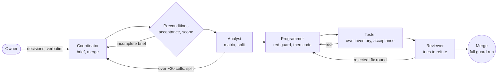

# codis-agents

**Agents are not what makes this work. What is written down around them is.**

A multi-agent delivery process for [Claude Code](https://claude.com/claude-code), packaged as a plugin: a coordinator
session, a chain of role agents that try to refute each other, and the written rules that keep them honest. It grew out
of a real product built with Claude Code on a single 16 GB laptop, several task chains a day, and every rule in it
exists because something broke without it.

## Start here - no plugin needed

Three habits carry most of the value, and they work for one person with one agent:

1. **A brief before work.** A file with the requester's words quoted verbatim and dated, and the acceptance written as a
   scenario in the real environment ("Add -> the item builds with no tab open"), not as a feature name.
2. **A red guard before code.** The agent first commits an executable check that fails on the current code, then the fix.
3. **Mutation after the commit.** Break the fix, see the guard go red, restore it, see it green. A check that does not
   turn red on a broken fix proves nothing.

Everything below is how those habits scale to a chain of roles and a dozen tasks a day.

## Terms

| term | meaning |
|---|---|
| guard | an executable check (`*-run.js`) judged by its exit code |
| brief | `BRIEF.md` of one task: the owner's words verbatim, scope, acceptance scenario |
| arc | a connected group of tasks over one surface, with one specification agreed up front |
| principles | the arc's numbered list of accepted decisions, each with its source and what it replaces |
| coordinator | the main session: writes briefs, starts chains, merges, decides what the principles answer, asks the owner the rest |

## The role chain



Each role runs as its own agent in its own git worktree. A second rejection for code stops the fix rounds: the next round
starts with the analyst. Work on access, keys or cookies gets a security reviewer as well. A role that hits an open
question writes it into its report for the coordinator and never answers it itself.

## Decisions live in three layers

| layer | what it holds | size on the project it came from |
|---|---|---|
| brief | one task: the owner's words, scope, acceptance scenario | one file per task |
| principles | numbered decisions, each with its source and a "Replaces:" line | 121 decisions |
| short model | one-sentence rules, each linked to the principle it comes from | 31 rules, two pages |

When a role asks a question, the coordinator:

1. answers it itself when an accepted principle answers it, and writes "decided by principle N" into the brief;
2. answers it itself when no principle does but the answer is reversible and local (one task; not a storage format, an
   address, sharing, data deletion or security), marked "coordinator's decision, not from the model - candidate" and
   listed in its report so the owner can overturn it;
3. sends everything else - everything the owner judges by looking at the screen (look, placement, UI wording),
   anything new or irreversible, two principles in conflict - to the owner as one list, each question with a
   recommendation.

A role never answers an owner question itself: it writes the question into its report for the coordinator.

## What counts as evidence

- **Guards**, red first, and **mutation-tested after the commit**.
- **Two browsers** for anything visual: WebKit drops things Chromium draws.
- **The real environment**: a change that touches two services is accepted in a two-service container stack driven
  through the real client, not in one process on the laptop, where guards stay green while the image fails.
- **A full guard run** after every merge: "N green - N new red - N known red"; only new red is a regression.

Its limit, honestly: no headless browser reproduced a blurry label in real Safari. A person looking at the screen found
it. Agents do not replace that.

## Rules that grew out of failures

| what happened | rule |
|---|---|
| a feature took three days with about ten owner questions per task; one decision flipped three times | a specification of the whole arc before its first task; one numbered `PRINCIPLES.md` with "Replaces:" lines |
| a decision the owner made never reached the list and was never started | a decision not in the principles is lost; the list is the only list |
| a layout arrived "locally" with a mockup, no decision behind it, and had to be redone | what the owner judges by the screen is never decided by an agent; a mockup of all states before code |
| a UX spec last touched at a redesign said nothing about the features built after it | living specs change in the same commit as the behaviour they describe |
| one task was re-scoped three times mid-flight and cost twice the median | split before the first programmer: over ~30 cells or more than two subsystems |
| the precondition check stopped tasks with an incomplete acceptance three times in one day | acceptance is a scenario in the real environment |
| agents were killed while their run waited for a heavy slot | reports are written as you go and end with "Next step"; a fresh agent continues |
| a role recorded "owner's answers" the owner never gave | only the coordinator writes decisions into a brief |
| idle waits over five minutes cost 21 % of all tokens | wait in slices of at most 270 s; the rule sits in every role prompt (21 % -> 7.4 %) |
| a resumed run of parallel tasks replayed one task's cached results into another, and both chains stopped | never `resumeFromRunId` for a multi-task run; relaunch each unfinished task alone with `start` |
| two parallel branches, each green alone, gave six red guards after the second merge | after merging the second of parallel branches over the same files: the guards of both tasks, then the full guard run |
| several container stacks at once pushed a 16 GB machine into swap | at most two chains with acceptance in Docker at once |
| a merged worktree removed after a clean `git status` held the only copy of a measurement corpus in ignored files; an old copy of the repository removed the same way broke 1809 symlinks elsewhere | before removing a worktree or a data directory, the owner says "yes" to the output of `scripts/wt-remove-check.js` (ignored data with sizes, the path in code, symbolic links that lead into it) |
| images of old test stacks (481 of them, ~130 GB) filled the disk and stopped the chains | a tester removes its own stack with `docker compose -p <stack> down -v --rmi all`; the owner's stack is never touched, other images and the build cache are not cleaned by roles |

## The bottleneck is the owner's attention

A day of fourteen tasks is about forty decisions a person has to make. Faster agents do not help until fewer questions
reach that person: rules that answer themselves, questions batched with a recommendation each, a mockup instead of a
description for anything visual, and a two-page model a human can hold in their head next to the long list the agents
read.

## What is inside

| path | what |
|---|---|
| `workflows/role-chain.js` | the chain: preconditions -> (analyst) -> programmer -> tester -> reviewer (+ security reviewer); fix rounds; an analyst after the second rejection |
| `agents/*.md` | role agents: `analyst`, `programmer`, `tester`, `reviewer`, `security-reviewer` (all may edit files - the tester its guards, the reviewers their reports; what they may change in the worktree is enforced by the git post-check, not by tool lists) |
| `skills/role-chain` | reads the project config and starts the workflow |
| `skills/brief` | how to write a task brief |
| `skills/coordinator` | the coordinator's loop |
| `rules/multi-agent.md` | the process rules; lines marked `<!-- role:<id> -->` go into every role prompt |
| `hooks/hooks.json` | PreToolUse on Bash: refuses `git add -A` / `git add .` and pushes to protected branches or of protected tags |
| `scripts/slots.zsh`, `heavy.sh`, `medium.sh` | memory slots for heavy and medium jobs, with a FIFO queue |
| `scripts/slot-journal.js` | summary of the slot journal: queue wait and hold per class and per worktree |
| `scripts/guards-all.sh` | a full guard run of one worktree in a heavy slot, with a shared worker budget |
| `scripts/wt-setup.sh` | creates a task worktree and clones (not symlinks) git-ignored data into it |
| `scripts/wt-remove-check.js` | before a worktree or data directory is removed: prints its ignored data with sizes, the path named in code and the symbolic links that lead into it; removes nothing |
| `scripts/role-diff-check.js` | git post-check of the tester and reviewers |
| `scripts/role-leftovers-check.js` | post-check after the tester and at the end of a task: Docker resources of the task's stack (by the compose project label), processes in its worktree, slots they hold; `--fix` removes only those, never the owner's stack |
| `scripts/chain-cost.js` | cost of chain runs per task from the agent transcripts, and per feature (parts summed by `feature`, across runs) |
| `scripts/env-check.js` | free disk and swap headroom for the preconditions, floors from `preconditions` in the config |
| `scripts/git-hooks/` | `pre-push` (protected branches and tags) and `pre-commit` (cloud conflict copies, extra checks) |
| `scripts/config.js` | finds, validates and resolves the project config |
| `examples/`, `schemas/` | an example project config and its JSON schema |

## Install

From a local clone:

```sh
claude plugin marketplace add /path/to/codis-agents
claude plugin install codis-agents@codis-agents
```

After editing a local clone, run `/reload-plugins` in a session. `claude plugin validate /path/to/codis-agents` checks
the manifests.

Things that bite on first use:

- A plugin installed in the middle of a session gives its skills, workflows and agents only after a session restart.
- `scripts/wt-setup.sh` is a zsh script: run it directly (its shebang is zsh) or with `zsh`, not with `bash`, which fails
  on its zsh syntax.
- A Workflow started by `scriptPath` (for example a modified copy of the role-chain workflow) takes the script only
  from the working directory or the session's scratchpad; anything else is refused. The plugin's own workflow is
  started by name.

Requirements: Node.js 18+ and git everywhere; zsh for the slot scripts and `scripts/wt-setup.sh`. The slot scripts also
use `/usr/bin/lockf`, `memory_pressure` and `vm_stat`, so they are **macOS-only**; the workflow, agents, hooks and
post-checks work anywhere. `wt-setup.sh` clones ignored data with an APFS clone (`cp -c`) and, where that is refused,
with `cp -r --reflink=auto` (GNU), then a plain copy. On a machine without zsh (Linux, CI) `npm test` stays green and
the zsh tests are skipped with "skipped: zsh not found" in their line and in the final tally.

## Configure a project

The plugin is opt-in per project: without `.claude/codis-agents.json` its hook does nothing. Copy
`examples/codis-agents.example.json` to `<project>/.claude/codis-agents.json` and edit it. The file is looked up in
this order: `$CODIS_AGENTS_CONFIG`; `$CLAUDE_PROJECT_DIR/.claude/`; the nearest `.claude/` above the working directory;
the main checkout of a linked worktree. Check it with:

```sh
node <plugin>/scripts/config.js check
```

| key | meaning |
|---|---|
| `repoDir` | main checkout; worktrees are created from it (`~` is expanded) |
| `worktreeRoot` | one worktree per task lives here |
| `sharedDir` | task folders `<sharedDir>/<task>/` (`BRIEF.md`, `analyst.md`, `prog.md`, `test.md`, `review.md`) and guard logs |
| `guardCommand` | the full guard run, executed with zsh in the worktree; placeholders `{wt}`, `{jobs}` and optionally `{limitFile}` (a file the runner re-reads for an adaptive worker limit) |
| `guardCommandLegacy`, `guardAdaptiveProbe` | for branches whose runner has no adaptive limit: if `<wt>/<probe.file>` lacks `<probe.contains>`, the legacy command runs with a fixed worker count |
| `worktreeSetup` | `scan` directories whose ignored data is copied into a new worktree; `skip` and `link` globs (everything else is an APFS clone) |
| `slots` | `medium`, `heavy`, `total`, `lockDir`, `legacyLock`, `jobsAlone`, `jobsShared` |
| `reportLanguage` | language of role reports (prompts stay in English) |
| `protectedBranches`, `protectedTagPattern` | refused by the hook and by `pre-push` without `ALLOW_PROTECTED_PUSH=1` |
| `ownerStackReadOnly` | the owner's Docker Compose project; roles only read from it |
| `medianTaskIE` | median cost of an accepted task; `chain-cost.js` flags tasks above twice this |
| `featureIELimit` | cost of a whole feature (its parts summed by the task field `feature`) above which `chain-cost.js` flags it; default 3 x `medianTaskIE` |
| `testerWritable` | regular expressions of paths the tester may change (default: `*-run.{js,mjs,cjs}` guards and `fixtures/`) |
| `roleNotes` | project-specific lines appended to one role's prompt (`analyst`, `programmer`, `tester`, `reviewer`, `security-reviewer`) |
| `threatModel` | path (in the worktree) of the threat model the security reviewer reads |
| `standingPush` | only for the repository of process rules: `branches` its HEAD may be pushed to without `ALLOW_PROTECTED_PUSH=1`, and a `check` that must pass first; the hooks honour only the committed `standingPush` of the repository that pushes, never forced, never tags |
| `gitHooks` | `blockICloudCopies` and `preCommit` (extra shell commands) for `scripts/git-hooks/pre-commit` |
| `preconditions` | `minFreeDiskGB` (default 10: an image build or a full guard run writes several GB) and `minSwapGB` (default 4: four slots of ~1 GB) - floors of free disk on the worktree and task folder volumes and of swap headroom, checked by `scripts/env-check.js` before a task starts |

Recommended in the project's `CLAUDE.md`, so the coordinator session follows the rules:

```markdown
@/path/to/codis-agents/rules/multi-agent.md
```

Git hooks for all worktrees of the project (optional; the Claude Code hook covers agents, these cover everyone):

```sh
git -C <repo> config core.hooksPath /path/to/codis-agents/scripts/git-hooks
```

`core.hooksPath` holds one directory, so the plugin's `pre-commit` runs the project's own checks for it: list them in
`gitHooks.preCommit`. Each entry is a shell command run in the repository root; a non-zero exit refuses the commit and
its output is shown. Keep project-specific checks (a bundle that must match its sources, a secrets scanner) in the
project, for example in its `.githooks/`, and call them from there:

```json
"gitHooks": {
  "blockICloudCopies": true,
  "preCommit": ["node .githooks/pre-commit.js"]
}
```

If the project keeps its own hooks directory as `core.hooksPath` instead, call the plugin from it:
`node /path/to/codis-agents/scripts/git-hooks/pre-commit.js` in its `pre-commit`, and pipe stdin to
`/path/to/codis-agents/scripts/git-hooks/pre-push "$@"` in its `pre-push`.

## Run a chain

1. Write a brief: `<sharedDir>/<task>/BRIEF.md` with the owner's words verbatim and dated, the scope, and the
   acceptance as a scenario in the real environment (skill `codis-agents:brief`).
2. Create the worktree: `<plugin>/scripts/wt-setup.sh <name> <branch> [base]`.
3. Ask Claude to run the role chain on the task (skill `codis-agents:role-chain`). The skill resolves the config and
   starts the workflow:

```js
Workflow({ name: "codis-agents:role-chain", args: {
  owner: "<the owner's request, verbatim>",
  config: /* output of: node <plugin>/scripts/config.js json */,
  tasks: [{ key: "q2", title: "Queue retries", wt: "q2", branch: "b-q2", analystFirst: true,
            accept: "Add -> the item builds with no tab open; log and screenshot attached" }]
} })
```

Every task carries exactly one of `analystFirst`, `analysis`, `noAnalysis`: `analystFirst: true` runs the analyst
first; `analysis: "<path>"` reuses an existing analyst or diagnosis report (checked by the preconditions, named in the
programmer prompt); `noAnalysis: "<reason>"` says why none is needed (for a defect, why the diagnosis is skipped). With
none or several the task stops before any agent. The result carries `analysis: {mode: run|reused|none, path?, reason?}`.
A feature gets its own analysis: `analysis` must lie in the task's folder or in the folder of its `feature`, and the arc
specification goes into `spec` (context for every role), never into `analysis`.
Optional task fields: `dir`, `gdir`, `start`, `feature` (the feature this task was split from), `spec` (the arc
specification), `stack` (the tester's own compose project), `security`.
Each task ends `done` or `stopped` with the reason, the open questions, a proposed split or the review findings.

## How the chain decides

- **Preconditions** first: a brief with an acceptance scenario, the worktree on its branch, no uncommitted changes, no
  unanswered question that acceptance depends on, free disk and swap headroom above the floors of `preconditions`
  (`scripts/env-check.js`). Otherwise it stops before any code.
- **Analyst** before the programmer when the task is marked `analystFirst`; a proposal to split stops the chain. With
  `analysis` the phase logs the reused report, with `noAnalysis` the reason.
- **Programmer** commits a red guard, then the code, then mutation-tests the guards after the commit and runs the full
  guard suite in a heavy slot.
- **Tester** builds its own inventory, adds and mutation-tests guards, runs the acceptance scenario for real. Red goes
  straight back to the programmer (up to three rounds), without a review. A red from the environment (a cut-off full
  run, no slot, disk or swap exhausted, Docker down) is the verdict `environment`: the task stops with its cause for the
  coordinator, not for a programmer.
- **Reviewer** reads only and tries to refute. With `security: true` a security reviewer follows; done needs both.
- **Rejection**: a fix round, then a second review. A rejection only for docs, guard wording or comments skips the
  tester: the second review reads the diff of the fix; when the fix touches files outside docs and guards, that review
  confirms it changes no behaviour (`fixBehaviourUnchanged`), and only an unconfirmed fix gets a tester round. A second rejection for code brings the analyst into the same run for one more round; after that the
  coordinator decides.
- **Post-checks**: after the tester and each reviewer, `role-diff-check.js` compares the worktree with the previous
  role's HEAD; any change a role may not make stops the chain. This, not a tool list, keeps product code out of their
  reach: a hook on Edit/Write would miss `sed -i`, `python -c`, a heredoc or a `git checkout`, while the post-check
  sees the result. The tester may change only paths matching `testerWritable` (guards and fixtures); the reviewers
  nothing in the worktree (their reports live in `sharedDir`).
- **Leftovers**: after the tester and at the end of the task, `role-leftovers-check.js --fix` removes what the task left
  running - containers, networks, volumes and images labelled with its compose project (`stack`), processes whose cwd
  or argv lies in its worktree, the memory slots they hold - and names them in the result and in `<task>/leftovers.md`.
  It never touches the owner's stack (`ownerStackReadOnly`) or another task; what it cannot remove stops the task.
- A failed post-check (ok=false or no result) is repeated once by the default model (label `...#retry`, logged) and the
  second answer decides: the cheap agent that runs it sometimes answers without running the script, and the scripts
  are deterministic, so a real violation or real leftovers still stop the task.
- Every role prompt carries the marked rules of `rules/multi-agent.md`: wait at most 270 s at a time, hand over past
  ~200k of context, open questions go to the coordinator, living specs change with the behaviour, stage by path,
  never push.

## Memory slots

Heavy work runs through `scripts/heavy.sh <cmd>` and `scripts/medium.sh <cmd>` (or `guards-all.sh <worktree>`):

- **medium** (tsc, one bundler build without a browser): `slots.medium` slots (2);
- **heavy** (browsers, full guard runs, image builds): `slots.heavy` slots (2), one more only while the minimum free
  memory over a 5-minute window stays at 50 % or more and swap does not grow;
- medium + heavy together at most `slots.total` (4); no slot at all while swap capacity is under 4 GB;
- waiters queue in arrival order; a full guard run first in the queue is never starved by single jobs;
- all full guard runs together use at most `slots.jobsAlone` workers (6), `slots.jobsShared` (3) next to another
  heavy job, re-evaluated during the run for runners that read `{limitFile}`.

The thresholds are measurements from a 16 GB machine; every one can be overridden from the environment (see the top of
`scripts/slots.zsh`).

Every slot hold appends one line to the slot journal, `<slots.lockDir>/journal.tsv` (`SLOT_JOURNAL` overrides it, empty
turns it off): request, acquire and release times, class, slot, kind, pid, exit code, worktree and a short command with
`name=value` words masked. A failed write is ignored and never stops a slot. `node scripts/slot-journal.js [--since 2d]
[--until <time>] [--json]` sums it up: queue wait (acquire - request) and hold (release - acquire), total and median,
per class and per worktree, and the share of the queue in the agents' waiting.

## Tests

```sh
npm test            # or: node tests/run.js [filter]
```

The suite checks the chain logic with fake agents (every routing case, the post-checks, the rule markers against
`RULE_LIST` and every role prompt), the post-check and cost scripts, the config, the hooks, the worktree setup, the
slots on a fake machine (classes, the extra slot, swap, queue order, worker budget, the slot journal and its summary), that the repository holds no
Cyrillic text, home paths or e-mail addresses, and that a run without zsh skips the zsh tests visibly instead of failing.

## License

MIT
